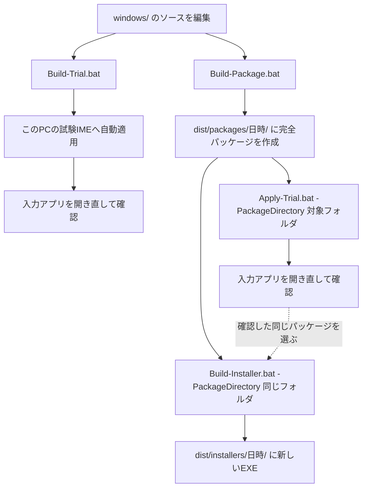

# 開発・このPCへの反映・インストーラー作成の手順

2026-10-23に現在のbat・PowerShell・Git状態を確認して作成。詳細なオプションや検証結果は [配布手順](local-installer.md)、今回の巻き戻りと復旧は [復旧記録](windows-source-recovery.md) を参照。

ビルド・試験IME・インストーラーの説明はWindows用。Androidの修正・テスト・端末更新・配布は [Android開発手順](android-development.md) を使う。後半のGit保全の考え方は両プラットフォームに適用する。

## 最初に区別する四つの状態

| 状態 | 意味 | 主な保存先 |
|---|---|---|
| ソース | 機能の設計図。ここを編集する | `windows/`、Androidなら `android/` |
| ビルド出力 | ソースをコンパイルしてできたDLL/EXE | `windows/target/`、Swiftの `.build/` |
| このPCの試験IME | Windowsに登録され、実際に使用するファイル | `ZeroConvertIME-windows/` |
| インストーラー | 別PCへの導入用に一式を梱包したEXE | `dist/installers/<日時>/` |

ソースを保存しただけでも、Gitにコミットしただけでも実IMEは変わらない。通常の `cargo build` や `npm run build` だけでも試験環境への適用は完了しない。インストーラー作成だけではこのPCの実IMEは変わらない。以前作ったインストーラーEXEが後から自動更新されることもない。

Gitのコミット・pushは、この図のどの適用操作の代わりにもならない。

## 機能を直す場所

以下はリポジトリルートからの相対パス。実行物や生成済みデータを直接修正せず、必要な層のソースを直す。

| 直したいもの | 最初に読むファイル |
|---|---|
| Windowsのかな漢字変換・辞書候補・文脈 | `windows/server-swift/Sources/azookey-server/azookey_server.swift` |
| Windowsのタイポ補正生成 | `windows/crates/server/src/ai_assist/corrector.rs`、`mod.rs`、`romaji_decoder.rs` |
| Windowsの先読み生成・出力検査 | `windows/crates/server/src/ai_assist/prediction.rs` |
| 入力・自動確定・候補選択 | `windows/crates/client/src/engine/composition.rs` |
| 補正採用・取消・非同期結果の照合 | `windows/crates/client/src/engine/composition/typo.rs` |
| サーバーとの受渡し | `windows/crates/server/src/main.rs`、`windows/crates/shared/service.proto`、clientの `ipc_service.rs` |
| 補正・候補・読みの見た目 | `windows/crates/ui/src/ruby.rs`、`candidate.rs`、`theme.rs` 等 |
| 設定画面 | `windows/frontend/src/`、`windows/frontend/src-tauri/src/` |
| 設定の定義・既定値 | `windows/crates/shared/src/lib.rs`、`windows/frontend/src/lib/config.ts`、`windows/deployment/settings.json` 等。画面・Swiftへの受渡しも確認する |
| モデルの起動・監視 | `windows/crates/launcher/src/main.rs`、`windows/crates/shared/src/runtime_assets.rs` |
| このPCへのビルド・適用 | ルートのbatと `windows/scripts/` |
| インストーラーの導入動作・梱包 | `windows/installer/Installer.iss`、`windows/scripts/build-local-installer.ps1` 等 |
| Androidの入力・補正・先読み | `android/app/src/main/java/com/zeroconvert/ime/`。Windowsの修正だけではAndroidに反映されない |

詳細は [ファイル探索ガイド](file-map.md)。モデルの重みは `artifacts/models/zerocon/` が正本でGit対象外。名前・用途・SHA-256は `windows/deployment/model-catalog.json` 等で管理し、重みそのものの変更はコード編集と区別する。

## 普段、このPCで機能を試す

1. 機能のソースを修正し、変更した層のテストを行う。
2. 入力途中の文字を確定し、設定画面の未保存の編集を保存する。
3. ルートの **`Build-Trial.bat` を実行する**。変更部分のビルドと試験IMEへの適用まで自動で行う。
4. 変更対象に応じて入力アプリを終了・起動し直す。特にTSF DLLを更新した場合、このCodexを含む既存アプリは旧DLLを保持し得る。
5. 打鍵→補正/先読み→追加入力→削除→カーソル移動→確定/取消を確認する。

**この手順の後にApply-Trial.batを実行する必要はない。** 引数なしのApply-Trialは完全配布パッケージを選ぶため、増分更新とは用途が違う。古い完全パッケージの暗黙適用は現在、停止するようにしている。

失敗やエラーがあれば反映完了とは扱わない。`Build-Trial.bat -WhatIf` は変更判定だけで、ビルドも適用も行わない。`Restart-IME.bat` は既存の実行物を再起動するだけで、新しいソースをビルド・適用しない。

## 動作確認した一式をインストーラーにする

普段の増分更新をそのまま「配布用の完全パッケージ」として扱わない。配布前には一式をそろえて確認する。

1. **`Build-Package.bat`** を実行する。全体をビルドし `dist/packages/<日時>/` に完全パッケージを作る。この時点では試験IMEを変更しない。
2. 出力された日時フォルダを記録する。
3. **`Apply-Trial.bat -PackageDirectory "<記録したフォルダ>"`** でその一式をこのPCへ適用する。
4. 入力アプリを開き直し、実IMEを確認する。
5. **`Build-Installer.bat -PackageDirectory "<同じフォルダ>"`** で、確認した同じ一式から新しいインストーラーを作る。
6. `dist/installers/<日時>/` のEXEとSHA-256、`package-source.json` を記録する。

`latest` は後の別ビルドで指す先が変わるため、確認済み一式を配布する作業では上記のようにフォルダを明示すると取り違えを減らせる。

`Build-Installer.bat` 単独もソースの全体ビルドとEXE作成を行うが、途中でこのPCの試験IMEに適用・実操作確認はしない。`-UseLatestPackage` は最新の完全パッケージの再利用であり、最新ソースの再ビルドではない。試験環境が増分更新中なら誤配布防止のため拒否する。

## 設定はコード・初期設定・個人設定で別

`windows/deployment/settings.json` は配布時の初期値。このPCで実際に使う設定は `%APPDATA%/Azookey/settings.json`。配布初期値を編集・再適用しても既存の個人設定は上書きしない。

機能をONにしたいだけなら、原則として設定画面で個人設定を変更する。既定動作を開発する場合は型定義・画面・受渡し・配布初期値をそろえて修正する。学習履歴と個人設定は配布物やGitへ入れない。

## Gitで何を管理するか

すでにルートのGitリポジトリとorigin `https://github.com/g0083/ZeroConvert-IME.git` がある。WindowsとAndroidの両方をこのGitで管理する。

| 用語 | 役割 |
|---|---|
| 作業ツリー | 編集中のファイル。未コミットの変更はここにある |
| コミット | 選択したソース変更を名前付きの履歴として保存する。新規ファイルは追加対象に含める必要がある |
| ブランチ | 履歴上の作業の分岐。同じフォルダに名前を増やすだけでは未コミット変更は隔離されない |
| push | コミットをGitHub等のリモートにも保存する。ローカルコミットだけではPC故障の備えにならない |
| worktree | 別の作業フォルダを持つ仕組み。独立した並行作業で未コミット変更の混在を避ける |

2026-10-23の復旧直後の確認では通常履歴は初期コミット `140bb74` の1件で、最新修正・新規ファイルは未コミットだった。その後のユーザーのコミット依頼に基づき、実IMEへ適用・検証したWindows復旧版、既存テーマ変更、ビルド・配布スクリプト、この手順を通常履歴の基準コミットとして保存する。Android・学習関連の別変更はその基準コミットへ含めず、pushも別操作とする。

保存時はWindowsエンジン、テーマ、Android等の差分を確認し、必要な新規ファイルも含めて意味のある単位でコミットする。既存変更が混在する現在のフォルダで無条件に全ファイルを一括追加しない。ユーザーの承認済み範囲に従って、ローカルコミットとpushを別々に行う。将来の依頼で「作業の区切りごとにローカルコミットまで行う」と明示すれば、その範囲を継続して扱える。

`.local/` の退避やエージェントのcheckpoint/stashは補助であり、通常のコミット・pushの代わりにしない。今回の退避コミットが見つかったことを、次回も必ず復旧できる保証とは扱わない。

Git対象はソース・テスト・スクリプト・文書・モデルカタログ。モデル重み、`ZeroConvertIME-windows/`、`dist/`、ビルド出力、個人設定・履歴は対象外。Git対象外のモデルや成果物は別の保管・バックアップも必要。

## エージェントの運用

`azookey-dev-flow` はWindows IMEの編集・回帰テスト・検証用として適切。ただしGitの履歴保存やこのPCの実IMEへの適用を自動的に保証する機構ではない。名前のazooKeyは開発基盤に由来し、このプロジェクトで使うこと自体が誤りではない。

役割を次のように分ける。

- `AGENTS.md`: 全作業に適用するソース保全・反映経路のルール。
- `azookey-dev-flow`: Windows機能の実装とテスト。ローカル手順はこの文書・配布手順を併用する。Windows用のVM環境を使えない場合は実施したローカル検証と未確認点を報告する。
- `azookey-pr`: 明示的に依頼されたPR作業。通常のローカル変更保存にPRは必須ではない。
- `azookey-release`: 正式公開用。ローカル試験やインストーラーEXEを作るだけの作業と区別する。

再発防止のルール:

1. 毎回、作業前後にブランチ・変更・新規ファイルを確認する。未コミットなら保存済みとは報告しない。
2. 作業フォルダをきれいにする目的でreset / restore / clean / stashを自動実行しない。復元作業は対象と保存先を明示し、内容確認後に行う。
3. 変更を抱えた共有フォルダで、別チャットのためにブランチを切り替えない。独立した並行作業は別worktreeを使うか順番に行う。
4. このPCの試験環境への適用は同時に複数チャットから行わず、反映担当を一つにする。別worktreeを作っただけではモデル・依存物・試験環境は引き継がれない。
5. 完了報告には「ソース編集」「テスト」「ビルド」「試験IMEへの適用」「入力アプリでの確認」「インストーラー」「Git保存」のどこまで済んだかを書く。未依頼の段階を実行する必要はないが、実行済みと混同しない。

OpenAIの説明でも、[skills](https://learn.chatgpt.com/docs/build-skills) はタスク用の再利用可能な指示で、[AGENTS.md](https://learn.chatgpt.com/docs/agent-configuration/agents-md) はプロジェクトの持続的な指示として位置づけられている。どちらもGitやバックアップそのものではない。
