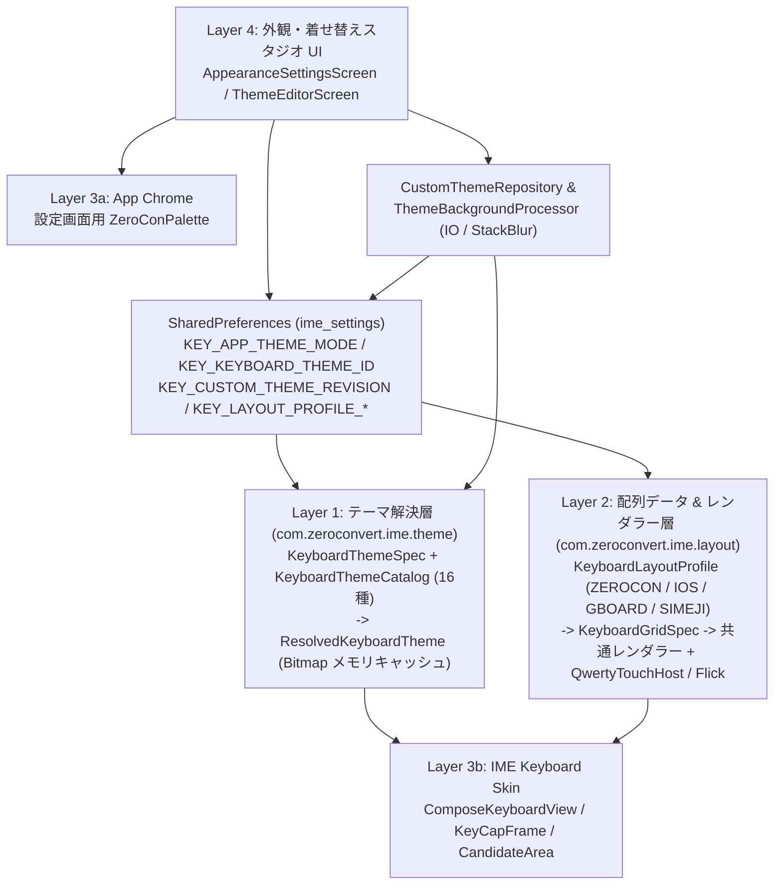

# Android版 テーマ・着せ替え・キーボード配列 再設計計画

> [!NOTE]
> **状態**: 段階実装中（Phase 1〜2 完了: 2026-11-27）
> **対象**: Android版（`:rebuilt` / `android/app/src/main/java/com/zeroconvert/ime/`）
> **現行関連ファイル**: [ZeroConTheme.kt](../../android/app/src/main/java/com/zeroconvert/ime/ZeroConTheme.kt) / [KeyboardKeyComponents.kt](../../android/app/src/main/java/com/zeroconvert/ime/KeyboardKeyComponents.kt) / [ComposeKeyboardView.kt](../../android/app/src/main/java/com/zeroconvert/ime/ComposeKeyboardView.kt) / [FlickKeyboardView.kt](../../android/app/src/main/java/com/zeroconvert/ime/FlickKeyboardView.kt) / [MainActivity.kt](../../android/app/src/main/java/com/zeroconvert/ime/MainActivity.kt) / [ZeroConvertInputMethodService.kt](../../android/app/src/main/java/com/zeroconvert/ime/ZeroConvertInputMethodService.kt)

---

## 1. 目的・スコープ・設計原則

### 1.1 目的

現在の Android 版 ZeroConvert IME は、Windows 版設定画面と揃えた 6 種類のカラーパレットと「12キー（フリック） / QWERTY（ローマ字）」の 2 配列に限定されており、キー造形（フラット・シャドウ・角丸・枠なし等）や背景写真・透過表現、他社IME（iOS標準・Gboard・Simeji）に慣れたユーザー向けのキー配置切替に対応できない構造になっている。

本計画では、デザイン・テーマ・配列を**4層のデータ駆動アーキテクチャ**へ再設計し、以下を実現する。

1. **プリセットテーマの大幅拡充**: OS風（iOS / Material）、ガラス・グラデーション、パステル・ネオンなど多様な見た目を即座に選択可能にする。
2. **Simeji水準の自由な着せ替え**: 写真背景（トリミング・ぼかし・暗幕/明るさ調整）、キー透過度、角丸・余白・影・枠線・立体ベベル、各要素の自由配色をライブプレビュー付きで作成・保存できる。
3. **有名配列プリセットの選択対応**: 12キー・QWERTYのそれぞれについて、ZeroCon標準・iOS標準風・Gboard風・Simeji風のキー配置やサイドキー/最下段構成を選べるようにする。

### 1.2 スコープ

- **今期スコープ（Phase 1〜3）**:
  - Android 版（[gradle.properties](../../android/gradle.properties): `minSdk = 26`, `compileSdk = 34`, `targetSdk = 34`）先行で構築する。
  - 背景画像・グラデーション・単色、キー透過・形状・質感、自由配色、カスタムテーマの保存・複製、有名配列プリセット（ZeroCon標準 / iOS標準風 / Gboard風 / Simeji風）を対象とする。
- **後続検討（Phase 4・スキーマ予約のみ）**:
  - フォント変更（同梱フォント / カスタム TTF）、押下エフェクト（波紋・光彩・パーティクル）・キータップ音、テーマパック（`.zctheme` ZIP）の共有インポート/エクスポート、Godan・50音配列・個別キー編集、Windows 版との拡張トークン連携。

### 1.3 技術制約・設計原則

1. **外部ライブラリ追加なし**: [rebuilt/build.gradle.kts](../../android/rebuilt/build.gradle.kts) に定義済みの Jetpack Compose BOM (`2024.02.02`)、Material 3、`activity-compose:1.8.2`（`ActivityResultContracts.PickVisualMedia` によりストレージ権限追加不要）、`org.json`（既存テスト依存・Android標準内蔵）、Android SDK 標準 API のみで完結させる。
2. **入力・推論経路の非阻害（60/120fps維持）**:
   - キー押下フレームでディスクI/O、Bitmapデコード、ぼかし計算を絶対に行わない。
   - テーマ変更時に誤って変換推論をキャンセルしない（後述の `loadAppearancePreferences()` 分離）。
3. **既存機能との完全互換**:
   - [KeyboardTouchLogic.kt](../../android/app/src/main/java/com/zeroconvert/ime/KeyboardTouchLogic.kt) の動的ヒット領域拡大（`NextKeyPredictor`）と空間タッチ座標タイポ補正（`TouchKeyBias` / `FlickTouchGeometry`）、[QwertySplitLayout.kt](../../android/app/src/main/java/com/zeroconvert/ime/QwertySplitLayout.kt)（分割）、`OneHandedLayout`（片手）、[FloatingKeyboardHost.kt](../../android/app/src/main/java/com/zeroconvert/ime/FloatingKeyboardHost.kt)（フローティング）、[EnterKeyAction.kt](../../android/app/src/main/java/com/zeroconvert/ime/EnterKeyAction.kt)、[InputTypeMode.kt](../../android/app/src/main/java/com/zeroconvert/ime/InputTypeMode.kt) を全配列・全テーマで維持する。
4. **後方互換移行**:
   - 既存の `KEY_THEME_MODE`（`"system"`, `"dark_blue"`, `"graphite"`, `"forest"`, `"plum"`, `"sakura"`, `"paper"`, 旧 `"dark"` / `"light"`）および `KEY_JAPANESE_LAYOUT`（`"FLICK_12KEY"`, `"QWERTY"`）の保存値を壊さず引き継ぐ。

---

## 2. 現行アーキテクチャの課題

ソース調査で確認された主な構造的ボトルネックは以下の通り。

| 領域 | 現状の実装と課題 |
| --- | --- |
| **テーマ表現力** | [ZeroConTheme.kt](../../android/app/src/main/java/com/zeroconvert/ime/ZeroConTheme.kt) が `ZeroConPalette`（16色の `Color` と `isDark`）のみを持ち、背景画像・グラデーション・キー透過・角丸・影・枠線太さ・ベベル強度・文字シャドウを表現できない。 |
| **キー造形ハードコード** | [KeyboardKeyComponents.kt](../../android/app/src/main/java/com/zeroconvert/ime/KeyboardKeyComponents.kt) の `KeyCapFrame` と `resolveKeyCapColors` に、`cornerRadius = 7.dp`（一部 `22.dp`）、上部ハイライト `1.65.dp`、下部リム `1.8.dp`、枠線 `0.8.dp`、押下時色補間ロジックが直接埋め込まれている。 |
| **設定画面とIMEの結合** | [MainActivity.kt](../../android/app/src/main/java/com/zeroconvert/ime/MainActivity.kt) が `rememberZeroConPalette(themeMode)` を Material 3 の `ColorScheme`（`toColorScheme()`）と IME キーボードの両方に共有しているため、IME を写真背景やネオン等の自由テーマにすると設定画面の視認性が崩れる。 |
| **配列とUIの密結合** | [ComposeKeyboardView.kt](../../android/app/src/main/java/com/zeroconvert/ime/ComposeKeyboardView.kt)（約3,870行）と [FlickKeyboardView.kt](../../android/app/src/main/java/com/zeroconvert/ime/FlickKeyboardView.kt)（約1,890行）の Composable 内に、行構成・文字・`weight`・サイドキー・最下段ボタンが直書きされている。`if` / `when` で配列分岐を増やすと片手・分割・フローティング・プレビューの保守が破綻する。 |
| **設定再読込の副作用** | [ZeroConvertInputMethodService.kt](../../android/app/src/main/java/com/zeroconvert/ime/ZeroConvertInputMethodService.kt) の `prefsListener` で、配置系以外のキー（`KEY_THEME_MODE` 等）が変更された際に `reloadPreferences()` が呼ばれ、`cancelPendingInference(edited = false)` まで実行されてしまう。 |

---

## 3. 全体アーキテクチャ（4層分離）

テーマ・配列・設定画面・IME本体を以下の4層に分離する。



- **Layer 1 (`com.zeroconvert.ime.theme`)**: テーマの全視覚パラメータを `KeyboardThemeSpec`（シリアライズ可能データモデル）で表現し、プリセットカタログ＋ユーザー保存テーマを解決する。
- **Layer 2 (`com.zeroconvert.ime.layout`)**: 12キー・QWERTYのキー配置を `KeyboardGridSpec` として宣言的データに分離し、配列プロファイル（ZeroCon / iOS / Gboard / Simeji）を切り替えても同じレンダラー・タッチエンジンで描画する。
- **Layer 3 (App Chrome vs Keyboard Skin 分離)**: 設定画面は常に読みやすい App Chrome パレット（`KEY_APP_THEME_MODE`）で描画し、IME キーボード本体は高自由度な `ResolvedKeyboardTheme`（`KEY_KEYBOARD_THEME_ID`）で描画する。
- **Layer 4 (`AppearanceSettingsScreen` / `ThemeEditorScreen`)**: `MainActivity.kt` から外観UI・ライブプレビュー・着せ替えエディタを分離し、肥大化を防ぐ。

---

## 4. データモデル詳細: テーマシステム (`com.zeroconvert.ime.theme`)

### 4.1 パッケージ構成

`android/app/src/main/java/com/zeroconvert/ime/theme/` に以下を配置する。既存 `ZeroConTheme.kt` は App Chrome 用の `ZeroConPalette` / `toColorScheme()` / `zeroConTypography()` / `ZeroConLogo` を維持する役割へ整理する。

| ファイル | 責務 |
| --- | --- |
| `KeyboardThemeSpec.kt` | テーマデータモデル（`KeyboardThemeSpec` 及び各 Style 定義）、デフォルト値、制約定数 |
| `KeyboardThemeCatalog.kt` | 同梱プリセット 16 種の定義（既存 6 種互換＋新規 10 種） |
| `KeyboardThemeJson.kt` | `org.json.JSONObject` による双方向シリアライズ／バリデーション（不明フィールド無視・範囲クランプ） |
| `CustomThemeRepository.kt` | `filesDir/themes/` 配下への保存・一覧読込・複製・削除・リビジョン管理 |
| `ThemeBackgroundProcessor.kt` | 画像縮小・EXIF回転補正・トリミング・純Kotlin StackBlur・`bg_rendered.webp` 生成とキャッシュ管理 |
| `KeyboardThemeResolver.kt` | `ZeroConPalette` との橋渡し、背景+キー透過時の視認性コントラスト補助、IME用 `ImageBitmap` メモリキャッシュ |

### 4.2 `KeyboardThemeSpec` 全フィールド定義

```kotlin
package com.zeroconvert.ime.theme

data class KeyboardThemeSpec(
    val schemaVersion: Int = CURRENT_SCHEMA_VERSION, // 1
    val id: String,
    val name: String,
    val category: ThemeCategory,
    val isBuiltIn: Boolean,
    val isDark: Boolean,
    val background: BackgroundStyle,
    val keySurface: KeySurfaceStyle,
    val typography: KeyTypographyStyle,
    val bars: BarStyle,
    val popup: PopupStyle,
    // Phase 4 拡張予約（Phase 1〜3 では null / 既定値で保持し、JSON 互換を維持）
    val fontFamilyId: String? = null,
    val tapEffectId: String? = null,
    val soundProfileId: String? = null
) {
    companion object {
        const val CURRENT_SCHEMA_VERSION = 1
    }
}

enum class ThemeCategory {
    STANDARD,
    OS_STYLE,
    GRADIENT_GLASS,
    POP_NEON,
    CUSTOM
}

enum class BackgroundKind {
    SOLID,
    LINEAR_GRADIENT,
    IMAGE
}

data class BackgroundStyle(
    val kind: BackgroundKind = BackgroundKind.SOLID,
    val solidColor: Long = 0xFF18191CL,
    val gradientStartColor: Long = 0xFF101722L,
    val gradientEndColor: Long = 0xFF24344BL,
    val gradientAngleDeg: Float = 135f,          // 0f..360f
    val imageFileName: String? = null,           // 例: "bg_rendered.webp"
    val cropCenterX: Float = 0.5f,               // 0f..1f
    val cropCenterY: Float = 0.5f,               // 0f..1f
    val cropScale: Float = 1.0f,                 // 1.0f..3.0f
    val blurRadiusDp: Float = 0f,                // 0f..24f
    val dimAlpha: Float = 0.25f,                 // 0f..0.85f（暗幕/明幕オーバーレイ）
    val dimColor: Long = 0xFF000000L,            // 黒オーバーレイ（明色テーマは白系も可）
    val applyToBars: Boolean = true              // true のとき候補バー/アシストバーにも背景を透過接続
)

enum class KeyStylePreset {
    BEVEL_3D,        // 現行 ZeroCon 互換（上部ハイライト＋下部リム＋細枠）
    IOS_SHADOW,      // iOS 風（フラット塗り＋下方向ドロップシャドウ＋微細境界）
    MATERIAL_FLAT,   // Gboard / Material You 風（シャドウ最小・フラット・ピル強調）
    OUTLINED_GLASS,  // すりガラス/写真向け（半透明塗り＋くっきり枠線）
    BORDERLESS       // 枠なし（写真背景を最大限見せる透過主体スタイル）
}

data class KeySurfaceStyle(
    val preset: KeyStylePreset = KeyStylePreset.BEVEL_3D,
    val cornerRadiusDp: Float = 7f,              // 0f..22f
    val enterCornerRadiusDp: Float = 22f,        // 0f..24f（Enter/アクションキー角丸）
    val horizontalGapDp: Float = 2.5f,           // 0f..6f
    val verticalGapDp: Float = 3.0f,             // 0f..6f
    val normalKeyFill: Long = 0xFF34373DL,
    val modifierKeyFill: Long = 0xFF292B30L,
    val accentKeyFill: Long = 0xFFC0C7D4L,
    val spaceKeyFill: Long = 0xFF34373DL,
    val pressedKeyFill: Long? = null,            // null の場合は accent 補間で自動算出
    val keyFillAlpha: Float = 1.0f,              // 0.0f..1.0f
    val modifierKeyAlpha: Float = 1.0f,          // 0.0f..1.0f
    val borderWidthDp: Float = 0.8f,             // 0f..2.5f
    val borderColor: Long = 0xFF454951L,
    val borderAlpha: Float = 0.7f,               // 0f..1.0f
    val shadowElevationDp: Float = 0f,           // 0f..6f（主に IOS_SHADOW 用）
    val shadowColor: Long = 0xFF000000L,
    val bevelIntensity: Float = 1.0f             // 0f..1.5f（BEVEL_3D のハイライト/リム強度）
)

data class KeyTypographyStyle(
    val primaryTextColor: Long = 0xFFF1F2F4L,
    val secondaryTextColor: Long = 0xFFB0B4BDL,  // 機能キーラベル・数字サブ表示
    val accentTextColor: Long = 0xFF22252BL,     // Enter 等のアクセントキー上の文字色
    val hintTextColor: Long = 0xFF9EA1AAL,       // 12キーの方向ヒント等
    val textShadowEnabled: Boolean = false,      // 写真背景＋高透過時の可読性確保
    val labelScale: Float = 1.0f,                // 0.85f..1.20f
    val showFlickDirectionHints: Boolean = true
)

data class BarStyle(
    val backgroundColor: Long = 0xFF232529L,
    val backgroundAlpha: Float = 1.0f,           // 0.0f..1.0f（写真背景時は 0.45f 等で透かす）
    val dividerColor: Long = 0xFF454951L,
    val candidateTextColor: Long = 0xFFF1F2F4L,
    val aiCandidateTextColor: Long = 0xFFD1D6DFL,
    val mutedTextColor: Long = 0xFF9EA1AAL,
    val chipBackgroundColor: Long = 0xFF34373DL
)

data class PopupStyle(
    val backgroundColor: Long = 0xFF34373DL,
    val accentColor: Long = 0xFFC0C7D4L,
    val textColor: Long = 0xFFF1F2F4L,
    val onAccentColor: Long = 0xFF22252BL,
    val borderColor: Long = 0xFF454951L,
    val cornerRadiusDp: Float = 10f
)
```

> [!NOTE]
> 色値は Compose `Color` をそのまま持たず `Long`（`0xAARRGGBB`）で保持する。これにより純粋な JVM ユニットテスト（Android UI ランタイムなし）でシリアライズ・バリデーション・解決ロジックを高速にテストできる。

### 4.3 プリセットカタログ（16種）

既存の 6 種は ID・色・造形（`BEVEL_3D`）を完全互換で残し、質感やスタイルの異なる 10 種を追加する。

| カテゴリ | ID | 表示名 | 特徴（キー造形・背景） |
| --- | --- | --- | --- |
| **Standard (既存互換 6種)** | `dark_blue`, `graphite`, `forest`, `plum`, `sakura`, `paper` | ダークブルー / グラファイト / フォレスト / プラム / サクラ / ペーパー | 現行パレットと完全一致、`BEVEL_3D`（角丸 `7dp`, Enter `22dp`） |
| **OS Style (4種)** | `ios_light` | iOS ライト風 | 明灰キャンバス (`#D1D5DB`)＋白キー (`#FFFFFF`)＋`IOS_SHADOW`（下影・角丸 `5dp`・枠なし）＋青アクセント Enter |
| | `ios_dark` | iOS ダーク風 | 濃灰キャンバス (`#1C1C1E`)＋キー (`#48484A` / `#2C2C2E`)＋`IOS_SHADOW` |
| | `material_light` | Material ライト風 | `MATERIAL_FLAT`、ペールブルー系、ピル型 Enter、影なし・余白広め |
| | `material_dark` | Material ダーク風 | `MATERIAL_FLAT`、ディープスレート＋ソフトブルーアクセント |
| **Gradient & Glass (3種)** | `aurora_glass` | オーロラグラス | 藍〜深緑グラデ背景＋`OUTLINED_GLASS`（半透明キー `alpha=0.28`＋白細枠） |
| | `sunset_glow` | サンセット | 茜〜琥珀グラデ背景＋暖色半透明キー＋暗幕入り透過バー |
| | `ocean_mist` | オーシャンミスト | 爽やかな青〜シアン明色グラデ＋白フロストキー |
| **Pop & Neon (3種)** | `pastel_mint` | パステルミント | ミント×クリーム明色、丸み強め（`cornerRadius = 11dp`）、`MATERIAL_FLAT` |
| | `cyber_neon` | サイバーネオン | 漆黒背景＋`OUTLINED_GLASS`（`alpha=0.18`＋シアン/マゼンタ発光枠線） |
| | `mono_minimal` | モノクロミニマル | 純黒×白枠線のみ（`BORDERLESS` / 低透過）、ミニマル志向 |

### 4.4 永続化・設定キー・後方互換

`SharedPreferences`（`PREFS_SETTINGS = "ime_settings"`）のキーを以下のように整理する。

| 設定キー | 型 | 既定値 / 移行ルール | 用途 |
| --- | --- | --- | --- |
| `KEY_APP_THEME_MODE` | `String` | 未設定時は既存 `KEY_THEME_MODE`（無ければ `"system"`）を引き継ぐ | 設定画面（App Chrome）の配色モード（`"system"` or 標準6種） |
| `KEY_KEYBOARD_THEME_ID` | `String` | 未設定時は既存 `KEY_THEME_MODE`（無ければ `"system"`）を引き継ぐ | IME キーボード本体のテーマID（`"system"`、プリセット16種、または `"custom_<uuid>"`） |
| `KEY_CUSTOM_THEME_REVISION` | `Long` | `0L`（カスタムテーマ編集・保存のたびにインクリメント） | IME サービスにカスタムテーマファイル再読込を通知するシグナル |
| `KEY_THEME_MODE` | `String` | 互換維持（読み取りフォールバック専用として残置） | 既存バージョンからの設定引き継ぎ |

**ファイル保存レイアウト（`context.filesDir/themes/`）**:

```text
files/themes/
  index.json                      # カスタムテーマ一覧メタデータ（id, name, updatedAt, thumbnailColor 等）
  custom_<id>/
    spec.json                     # KeyboardThemeSpec JSON
    bg_source.webp                # 選択時の元画像（最大辺 1440px にリサイズ保存・再トリミング用）
    bg_rendered.webp              # トリミング＋StackBlur 済みのベイク画像（IME 描画専用）
```

- JSON・画像ともに `*.tmp` へ書き出してから `File.renameTo()`（同ディレクトリ内アトミック置換）を行い、IME 側と設定アプリ側で書きかけファイルを読まない設計とする。
- [ZeroConvertInputMethodService.kt](../../android/app/src/main/java/com/zeroconvert/ime/ZeroConvertInputMethodService.kt) の `prefsListener` に `KEY_KEYBOARD_THEME_ID`, `KEY_CUSTOM_THEME_REVISION`, `KEY_LAYOUT_PROFILE_*` 用の軽量分岐 `loadAppearancePreferences(prefs)` を新設し、テーマや外観変更で `cancelPendingInference()` が発火しないようにする。

### 4.5 背景画像パイプライン（API 26+ 互換 & 高速描画）

Compose の `Modifier.blur()` は Android 12 (API 31) 以降でのみ動作し、さらに毎フレーム GPU パスを増やす。本アプリは `minSdk = 26` であるため、**事前ベイク方式**を採用する。

1. **画像選択**: `ActivityResultContracts.PickVisualMedia(PickVisualMedia.ImageOnly)` を使用（READ_MEDIA_IMAGES / READ_EXTERNAL_STORAGE 権限不要）。
2. **デコード & 正規化 (`Dispatchers.IO`)**:
   - `ContentResolver.openInputStream` から `inJustDecodeBounds` でサイズ確認し、`inSampleSize` で最大辺 1440px 以下へ縮小デコード。
   - EXIF `Orientation` を読み取って正立回転し、`bg_source.webp` として保存。
3. **ベイク生成 (`ThemeBackgroundProcessor`)**:
   - エディタで指定された `cropCenterX`, `cropCenterY`, `cropScale`（キーボードの想定アスペクト比基準、かつ IME 実描画時は `ContentScale.Crop` で微差吸収）で切り抜き、幅最大 `1080px` の Bitmap を生成。
   - `blurRadiusDp > 0f` の場合、縮小率（例: 1/2〜1/4 スケール）＋ **純 Kotlin StackBlur** を適用して数ミリ秒〜十数ミリ秒でぼかし画像を生成し、`bg_rendered.webp` へ保存。
4. **IME 側描画**:
   - `KeyboardThemeResolver` が `(themeId, revision)` をキーに `ImageBitmap` をメモリキャッシュ（非同期 IO ロード、UI スレッドでは既定色フォールバックから即時差し替え）。
   - IME 本体は「1枚の `Image`（`ContentScale.Crop`）＋ 1枚の `dimAlpha` オーバーレイ Box」を描くだけなので、キー打鍵中のパフォーマンス低下は発生しない。

### 4.6 `KeyCapFrame` のトークン駆動化

[KeyboardKeyComponents.kt](../../android/app/src/main/java/com/zeroconvert/ime/KeyboardKeyComponents.kt) の `KeyCapFrame`・`KeyboardActionKey`・`QwertyKeyPreviewBubble`、および [KeyboardCandidateArea.kt](../../android/app/src/main/java/com/zeroconvert/ime/KeyboardCandidateArea.kt)・[FlickKeyboardView.kt](../../android/app/src/main/java/com/zeroconvert/ime/FlickKeyboardView.kt) は `LocalZeroConPalette` に加えて `LocalKeyboardTheme`（`KeyboardThemeSpec`）を参照するよう拡張する。

- `KeyStylePreset.BEVEL_3D`: 現行の `topBevelPath` + `bottomBevelPath` + `border`（`bevelIntensity` で強度調整、`bordersEnabled` 設定で枠線/ベベルをオフ可能）。
- `KeyStylePreset.IOS_SHADOW`: 下方向 `1dp` オフセットシャドウ（`shadowElevationDp`）＋ フラット塗り ＋ 極薄枠線。
- `KeyStylePreset.MATERIAL_FLAT`: 影なしフラット塗り（`borderWidthDp = 0f`）。
- `KeyStylePreset.OUTLINED_GLASS`: 半透明塗り（`keyFillAlpha`）＋ くっきり枠線（`borderAlpha`）。
- `KeyStylePreset.BORDERLESS`: 塗り透過低め・枠線なし・影なし（写真背景向け）。文字には設定に応じて `Shadow(offset = Offset(0f, 1f), blurRadius = 3f)` を付与して可読性を担保する。

---

## 5. データモデル詳細: キーボード配列システム (`com.zeroconvert.ime.layout`)

### 5.1 方針: 「入力方式」と「配列プロファイル」の分離

既存の `JapaneseInputLayout`（`FLICK_12KEY`, `QWERTY`）はユーザーの根本的な入力方式としてそのまま残し、**配列プロファイル (`KeyboardLayoutProfile`)** を直交軸として導入する。

```kotlin
package com.zeroconvert.ime.layout

enum class KeyboardLayoutProfile(
    val id: String,
    val label: String,
    val summary: String
) {
    ZEROCON("zerocon", "ZeroCon標準", "Undo・矢印キーを備えた標準配列"),
    IOS("ios", "iOS標準風", "iOS日本語キーボード準拠の配置・最下段"),
    GBOARD("gboard", "Gboard風", "Googleキーボード準拠のサイドキー・記号配置"),
    SIMEJI("simeji", "Simeji風", "左定型/絵文字・右削除/確定の着せ替え定番配列");

    companion object {
        fun fromId(id: String?): KeyboardLayoutProfile =
            entries.firstOrNull { it.id == id } ?: ZEROCON
    }
}
```

設定キーは 12キーと QWERTY で好みが分かれる（例: 12キーは iOS 風だが QWERTY は Gboard 風にしたい）ため、**独立保存**を基本とし、UI からは一括適用と個別選択の両方を行えるようにする。

- `KEY_LAYOUT_PROFILE_FLICK`（既定 `"zerocon"`）
- `KEY_LAYOUT_PROFILE_QWERTY`（既定 `"zerocon"`）

### 5.2 宣言的レイアウトモデル (`KeyboardGridSpec`)

`android/app/src/main/java/com/zeroconvert/ime/layout/` に以下を配置する。

| ファイル | 責務 |
| --- | --- |
| `KeyboardLayoutProfile.kt` | プロファイル列挙体と設定解決 |
| `KeyboardGridSpec.kt` | `KeyAction`、`KeySlotSpec`、`KeyboardRowSpec`、`KeyboardGridSpec` の定義 |
| `FlickLayoutPresets.kt` | 4プロファイル × 3モード（日本語・英語・数字）の12キー配列定義 |
| `QwertyLayoutPresets.kt` | 4プロファイル × 2モード（日本語・英語）のQWERTY行・最下段・長押し記号定義 |
| `LayoutGridRenderer.kt` | `KeyboardGridSpec` を受け取り、`QwertyTouchHost` / `FlickKeyCell` / `KeyboardActionKey` へマッピングする共通レンダラー |

#### `KeyAction` と `KeySlotSpec` 構造

```kotlin
sealed interface KeyAction {
    data class CommitChar(
        val normal: Char,
        val shifted: Char = normal,
        val upFlick: Char? = null,
        val shiftedUpFlick: Char? = null,
        val longPressChars: List<Char> = emptyList()
    ) : KeyAction

    data class FlickKey(val def: FlickKeyDef, val isRow3FirstSpecial: Boolean = false) : KeyAction

    data object Backspace : KeyAction
    data object Space : KeyAction
    data object Enter : KeyAction
    data object Shift : KeyAction
    data object Undo : KeyAction
    data object CursorLeft : KeyAction
    data object CursorRight : KeyAction
    data object ModeCycleAa1 : KeyAction        // あa1（クリック/フリック切替）
    data object ToggleJpEn : KeyAction          // かな/英字切替
    data object SwitchToSymbols : KeyAction     // 記号パネル/記号モード
    data object SwitchToEmoji : KeyAction       // 絵文字パネル
    data object SwitchToClipboard : KeyAction   // クリップボードパネル
    data object GlobeOrImePicker : KeyAction    // 地球儀 / IME切替（長押し対応）
    data object PunctuationQuick : KeyAction    // 12キー/QWERTY 句読点・記号キー
}

enum class KeyVisualRole {
    CHARACTER,
    MODIFIER,
    ACCENT,
    SPACE
}

data class KeySlotSpec(
    val id: String,
    val action: KeyAction,
    val label: String,
    val subLabel: String? = null,
    val weight: Float = 1f,
    val role: KeyVisualRole = KeyVisualRole.CHARACTER,
    val supportsRepeat: Boolean = false,
    val startSpacerWeight: Float = 0f,
    val endSpacerWeight: Float = 0f
)
```

### 5.3 4プロファイルの具体的なキー配置仕様

#### A. 12キー配列（5列 × 4行 + サイドキー構成）

中央 3×4 の文字キー（あ〜わ・小゛゜・、。）は全プロファイルで標準50音順を維持し、**左右サイドキー（左列・右列）と最下段・記号切替**をプロファイルごとに再現する。

| 位置 | ZeroCon標準（現行） | iOS標準風 | Gboard風 | Simeji風 |
| --- | --- | --- | --- | --- |
| **左1行目** | Undo | `☆123`（数字・記号切替） | `←`（カーソル左） | `定型/クリップ` または `絵文字` |
| **左2行目** | `◀`（カーソル左） | `◀`（カーソル左） | `→`（カーソル右） | `←`（カーソル左） |
| **左3行目** | `かな/英`（モード切替） | `🌐`（地球儀/IME切替・長押しピッカー） | `あA1`（モード切替） | `→`（カーソル右） |
| **左4行目** | `あa1`（フリックモード切替） | `ABC / あいう`（かな/英/絵文字導線） | `🌐 / 絵文字` | `文字種`（あ/A/1切替） |
| **右1行目** | `⌫`（Backspace） | `⌫`（Backspace） | `⌫`（Backspace） | `⌫`（Backspace） |
| **右2行目** | `▶`（カーソル右） | `▶`（カーソル右） | `絵文字 / 記号` | `設定/Undo` |
| **右3行目** | `空白` | `空白` | `空白` | `空白` |
| **右4行目** | `確定 / Enter` | `確定 / 改行`（高さ強調） | `確定 / Enter` | `確定 / Enter` |

> [!TIP]
> iOS風では「左3行目＝🌐/あa切替」「左1行目＝☆123」が最大の識別ポイントであり、ZeroCon固有の便利機能（Undo・カーソル移動）を失わないよう上部ツールバー（クイックアクション）にも Undo / ◀ / ▶ を補完表示できる設計にする。

#### B. QWERTY配列（文字行＋最下段構成）

| 要素 | ZeroCon標準（現行） | iOS標準風 | Gboard風 | Simeji風 |
| --- | --- | --- | --- | --- |
| **Row 2 (ASDF行) 日本語** | `a..l` + `ー`（10キー均等） | `a..l`（9キー左右余白スタッガー）＋最上段/長押しに`ー` | `a..l`（9キースタッガー）＋記号/上フリックまたは数字行連動 | `a..l` + `ー`（10キー） |
| **Row 4 (最下段) 左** | `あa1` + `、` + `？` | `123` + `🌐` + `絵文字` | `?123` + `、` + `🌐` | `文字` + `絵文字` + `、` |
| **Row 4 (最下段) 中央** | `日本語` スペース | `空白`（広め） | `日本語 / English` スペース | `空白`（記号左右挟み） |
| **Row 4 (最下段) 右** | `。` + `◀` + `▶` + `Enter` | `。` + `ー` + `改行/確定` | `。` + `Enter`（ピル強調） | `。` + `◀` + `▶` + `Enter` |
| **キー長押しポップアップ** | 上フリック数字（数字行非表示時） | 上フリック数字 + 長押し記号候補選択（今後拡張） | 上段キー数字ヒント常時薄表示 + 上フリック | 長押し/フリック記号 |

### 5.4 既存機能との統合保証

1. **QWERTY タッチ補正 (`QwertyTouchHost` / `NextKeyPredictor`)**:
   - `LayoutGridRenderer` が `KeyAction.CommitChar` のスロットを描画する際に `host.registerSpec(id, spec)` と `onGloballyPositioned` で `KeyRect` を登録する。
   - したがって **どの配列プロファイルでも、iOS風の9キースタッガー配置でも、分割キーボードでも、`QwertyTouchHost` のスナップ・動的ヒット領域拡大・`TouchKeyBias` 記録がそのまま動作する**。
2. **分割・片手・フローティング**:
   - 分割キーボード（[QwertySplitLayout.kt](../../android/app/src/main/java/com/zeroconvert/ime/QwertySplitLayout.kt)）は `KeyboardGridSpec` の `splitCutAfter`（行ごとの分割位置）と重複キー規則に従って自動分割される。
   - 片手モード・フローティングモードは外枠コンテナ（`KeyboardRootView` / `FloatingKeyboardHost`）側で幅・高さが制約されるため、全プロファイルが自動的に追従する。

---

## 6. 画面構成・UX設計

### 6.1 ファイル分割方針

[MainActivity.kt](../../android/app/src/main/java/com/zeroconvert/ime/MainActivity.kt) は現在 3,351 行に達しているため、新しい外観画面と着せ替えエディタは別ファイルへ分離する。

- `AppearanceSettingsScreen.kt`: 外観タブ全体（ライブプレビュー、テーマギャラリー、配列プロファイル選択、サイズ・操作設定、設定アプリ配色）
- `ThemeEditorScreen.kt`: 着せ替えスタジオ（フル機能カスタマイズ画面、別Route/Modalシートとして遷移）
- `ThemeColorPicker.kt`: HSV カラーホイール/スライダー＋Hex入力＋おすすめプリセットスウォッチ（外部ライブラリなしの Compose `Canvas` 実装）

### 6.2 外観タブ (`AppearanceSettingsScreen`) の構成

1. **リアルタイムキーボードプレビュー（上部固定/折りたたみ可能）**
   - 右上に「12キー / QWERTY」切替トグル、および「実際に試す」簡易テスト入力欄を配置し、IME を開かずにテーマと配列の組み合わせを即確認できる。
2. **テーマギャラリー**
   - 「マイテーマ（新規作成 ＋）」横スクロール行（作成したカスタムテーマのサムネイル一覧、タップで適用、長押し/アイコンで編集・複製・削除）
   - カテゴリ別プリセットグリッド（Standard / OS風 / グラデ＆ガラス / ポップ＆ネオン）＋「システム連動（端末のダークモードに追従）」
3. **キーボード配列**
   - 入力方式（12キー / QWERTY）の切替
   - 配列プロファイルカード選択（ZeroCon標準 / iOS標準風 / Gboard風 / Simeji風）— 12キー用・QWERTY用をタブまたは個別セレクタで変更可能
4. **サイズ・操作性（既存設定を維持）**
   - キー高さ、下余白、数字行、片手/分割、フリックのみ、キープレビュー、フリック感度、動的タッチアシスト
5. **設定画面の配色（App Chrome）**
   - 「キーボードと分離して見やすい標準テーマを保つ」ための設定画面専用テーマ選択（システム / 標準6種）

### 6.3 着せ替えスタジオ (`ThemeEditorScreen`) の構成

既存プリセットを「複製してカスタマイズ」または「新規作成」で開く。

- **上部**: ライブプレビュー（現在の背景・ぼかし・キー透過・配列をリアルタイム反映）＋ **視認性警告チップ**（文字色と背景合成色のコントラスト比が低い場合、「文字シャドウON」や「暗幕を強める」ワンタップ補正ボタンを提示）。
- **下部 4 タブ**:
  1. **背景**: 単色 / グラデーション（2色＋角度）/ 画像（写真を選ぶ・拡大率＆上下左右パンでトリミング・ぼかしスライダー `0..24dp`・暗幕スライダー `0..85%`・候補バーにも背景を伸ばすスイッチ）
  2. **キー造形**: スタイルプリセット（立体ベベル / iOSシャドウ / Materialフラット / ガラス枠 / 枠なし）、角丸スライダー、キー間隔（余白）スライダー、通常キー透明度・機能キー透明度、枠線の太さ・透明度、影の強さ
  3. **カラー**: 通常キー色 / 修飾キー色 / Enter(アクセント)色 / 文字色 / サブ文字色 / 枠線色 / 候補バー色（`ThemeColorPicker` で調整、背景画像から代表色を自動抽出する「画像から配色を提案」機能も Android `Palette` 相当の簡易量子化で提供可能）
  4. **文字・保存**: 文字サイズ倍率、`文字に影をつける（写真背景推奨）`、フリック方向ヒント表示ON/OFF、テーマ名入力、保存 / 名前を付けて複製 / リセット

---

## 7. 段階的実装ロードマップと検証計画

### Phase 1: テーマ基盤刷新・App/IME分離・プリセット16種

- **実装内容**:
  - `theme/` パッケージ新設（`KeyboardThemeSpec`, `KeyboardThemeCatalog`, `KeyboardThemeJson`, `KeyboardThemeResolver`）。
  - `KeyCapFrame`, `KeyboardActionKey`, `QwertyKeyPreviewBubble`, `KeyboardCandidateArea`, `FlickKeyCell` 等を `KeyboardThemeSpec` トークン駆動へ移行。
  - `KEY_APP_THEME_MODE` と `KEY_KEYBOARD_THEME_ID` を分離し、`ZeroConvertInputMethodService` に `loadAppearancePreferences()` を追加。
  - `AppearanceSettingsScreen.kt` へ外観タブを分離し、16種のプリセットギャラリーを実装。
- **完了条件・検証**:
  - 既存の全6テーマの見た目・色値が壊れていないこと。
  - 設定画面をダーク/ライトに保ったまま、IME だけを iOS風・ガラス風・ネオン等へ切り替えられること。
  - コマンド: `./gradlew.bat :rebuilt:testDebugUnitTest :rebuilt:lintDebug :rebuilt:assembleDebug`
  - 新規 JVM テスト: `KeyboardThemeCatalogTest`（全16種のID一意性・値域）、`KeyboardThemeJsonTest`（往復シリアライズ・不正値クランプ）、`ThemePreferenceMigrationTest`（旧 `KEY_THEME_MODE` からの移行）。

### Phase 2: 自由カスタマイズ・写真背景・着せ替えエディタ

- **実装内容**:
  - `CustomThemeRepository.kt` と `ThemeBackgroundProcessor.kt`（リサイズ・EXIF回転・トリミング・純Kotlin StackBlur・アトミック保存・メモリキャッシュ）を実装。
  - `ThemeEditorScreen.kt` と `ThemeColorPicker.kt` を実装。
  - `KeyboardRootView` に背景レイヤー（単色 / グラデ / `ImageBitmap` + 暗幕）を統合し、候補バー・アシストバーの透過接続（`applyToBars`）に対応。
- **完了条件・検証**:
  - 写真を選んでトリミング・ぼかし・キー透過を設定し、別アプリ上の実際の IME ウィンドウに即時反映され、再起動後も維持されること。
  - 高解像度画像（4000×3000px 等）を選択しても OOM にならず、キータッチ時のフレーム落ちがないこと。
  - コマンド: `./gradlew.bat :rebuilt:testDebugUnitTest :rebuilt:lintDebug :rebuilt:assembleDebug`
  - 新規 JVM テスト: `CustomThemeRepositoryTest`（作成・一覧・複製・削除・不正JSON耐性）、`ThemeBackgroundProcessorTest`（トリミング矩形・StackBlur境界値）。

### Phase 3: 配列エンジンのデータ駆動化 & 有名配列プリセット

- **実装内容**:
  - `layout/` パッケージ新設（`KeyboardLayoutProfile`, `KeyboardGridSpec`, `FlickLayoutPresets`, `QwertyLayoutPresets`, `LayoutGridRenderer`）。
  - `ComposeKeyboardView.kt` / `FlickKeyboardView.kt` のキー配置直書き部分を `LayoutGridRenderer` へ移行し、ZeroCon標準 / iOS標準風 / Gboard風 / Simeji風 を 12キー・QWERTY それぞれで選択可能にする。
  - `KEY_LAYOUT_PROFILE_FLICK` / `KEY_LAYOUT_PROFILE_QWERTY` をサービス・設定画面・プレビューへ接続。
- **完了条件・検証**:
  - 全4プロファイル × 12キー/QWERTY × 標準/片手/分割/フローティング でキー欠落・重なり・タッチ座標ずれがないこと。
  - [KeyboardTouchLogic.kt](../../android/app/src/main/java/com/zeroconvert/ime/KeyboardTouchLogic.kt) のタイポ補正・上フリック数字・Enterラベル動的切替が全プロファイルで正常動作すること。
  - コマンド: `./gradlew.bat :rebuilt:testDebugUnitTest :rebuilt:lintDebug :rebuilt:assembleDebug`（＋対象端末での `assembleDebugAndroidTest` / 実機IME確認）。
  - 新規 JVM テスト: `LayoutPresetIntegrityTest`（全プロファイルで必須アクション `Backspace`/`Space`/`Enter`/文字キー が網羅され ID 重複がないことを検証）、`SplitLayoutPresetTest`（分割時の重み合計・左右バランス検証）。

### Phase 4: 後続拡張（任意・別計画として切り出し）

- カスタムフォント選択（同梱フォント + TTF 読み込み）
- 押下エフェクト（波紋・光彩・パーティクル）とキータップ音
- テーマパック（`.zctheme` ZIP）のインポート / エクスポート
- Godan 配列・50音配列・ユーザーによるサイドキー/最下段個別カスタマイズ
- Windows 版との拡張テーマ定義共有検討

---

## 8. 影響ファイル一覧（予定）

### 新規作成予定（`android/app/src/main/java/com/zeroconvert/ime/` 配下）

- `theme/KeyboardThemeSpec.kt`, `KeyboardThemeCatalog.kt`, `KeyboardThemeJson.kt`, `CustomThemeRepository.kt`, `ThemeBackgroundProcessor.kt`, `KeyboardThemeResolver.kt`
- `layout/KeyboardLayoutProfile.kt`, `KeyboardGridSpec.kt`, `FlickLayoutPresets.kt`, `QwertyLayoutPresets.kt`, `LayoutGridRenderer.kt`
- `AppearanceSettingsScreen.kt`, `ThemeEditorScreen.kt`, `ThemeColorPicker.kt`

### 主な変更予定

- [ZeroConTheme.kt](../../android/app/src/main/java/com/zeroconvert/ime/ZeroConTheme.kt)（App Chrome と Keyboard Skin の橋渡し整理）
- [KeyboardKeyComponents.kt](../../android/app/src/main/java/com/zeroconvert/ime/KeyboardKeyComponents.kt)（`LocalKeyboardTheme`・`KeyStylePreset` 別描画・文字シャドウ）
- [KeyboardCandidateArea.kt](../../android/app/src/main/java/com/zeroconvert/ime/KeyboardCandidateArea.kt)（`BarStyle` によるバー透過・色トークン適用）
- [ComposeKeyboardView.kt](../../android/app/src/main/java/com/zeroconvert/ime/ComposeKeyboardView.kt) / [FlickKeyboardView.kt](../../android/app/src/main/java/com/zeroconvert/ime/FlickKeyboardView.kt)（背景レイヤー統合・`LayoutGridRenderer` 移行）
- [ZeroConvertInputMethodService.kt](../../android/app/src/main/java/com/zeroconvert/ime/ZeroConvertInputMethodService.kt)（新設定キーと `loadAppearancePreferences()` 分離）
- [MainActivity.kt](../../android/app/src/main/java/com/zeroconvert/ime/MainActivity.kt)（`AppearanceTabContent` を `AppearanceSettingsScreen` へ委譲し画面遷移を追加）
