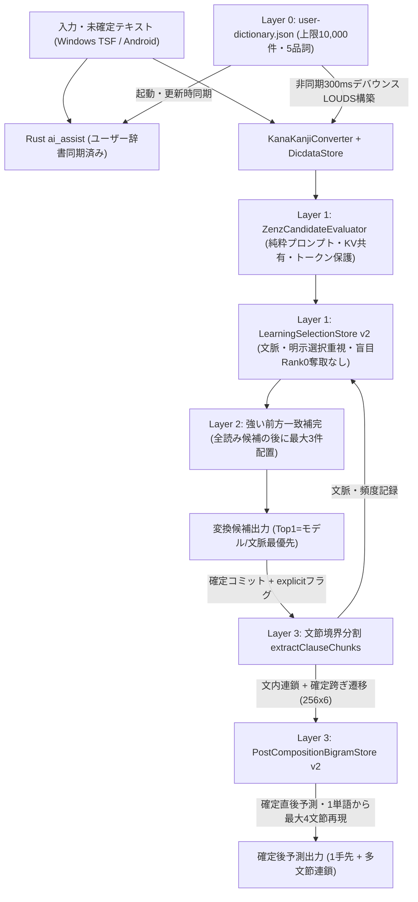

# 辞書機能・学習機能統合・モデル重視刷新計画

> [!NOTE]
> - **状態**: 実装済み（2026-11-20）
> - **現行仕様**: [アーキテクチャ](../architecture.md)
> - **目的**: Windows 版を優先対象としつつ共有エンジン（Swift / Rust / `converter_patch.py`）で「メイン変換モデルの文脈判断」「多文節の連鎖記憶による文再現」「ユーザー辞書 10,000 件・品詞プリセット統合」を衝突なく実現する。
> - **方針決定**: 辞書制御タグ（`\u{EE03}` / `\u{EE06}` 等）のプロンプト注入および追加学習は採用せず、**純粋プロンプト + 評価時ユーザー辞書トークン保護** で運用する。
> - **実装担当向け**: 本書 1 本で最後まで（Step 2〜Step 5 の最終全検証まで）止まらず一気通貫で実装する。細部の実装差や軽微な未定義点は、計画書の目的と §0.3 不変条件・既存テストを壊さない最も自然な形で自律判断して進めてよい。

---

## 0. 実装エージェント向けルール・不変条件

実装作業時は、以下のルールを遵守すること。

### 0.1 作業方針と停止・自律判断の基準

1. **一気通貫完走（途中停止しない）**: 既に完了している Step 1 の成果物を壊さず維持したまま、**Step 2 → Step 3 → Step 4 → Step 5（最終全検証）までを 1 本で最後まで実装・検証し切る**（実装順の目安として §3 の Step 2〜5 に沿って積み上げると依存衝突が起きない）。途中のステップ完了ごとに立ち止まらない。
2. **細部の自律判断（不必要な停止の禁止）**: 計画書の目的と §0.3 不変条件・現行の安全契約（既存テストや後方互換性）を壊さない範囲であれば、細部の差異（既存テスト名・関数名の揺れ、DTO フィールドの有無、補助フィールド・タイブレーク細部、目的達成に直結する軽微な周辺ファイル調整など）で **停止して確認を求めず、最も自然で後方互換・安全な形で自律判断して実装を完了する**。自律調整した点があれば最終報告に簡潔に記載する。
   - **停止して相談すべき例外**: ① 設計方針やユーザー体験が大きく変わる二択、② 既存ユーザーデータや保存形式を破壊しかねない判断、③ テスト・ビルド環境自体の障害で検証不能な場合のみ。
3. **無関係な大規模整理の禁止**: 本計画と無関係な箇所への整形・大規模リファクタリングは行わない。一方で、計画全体の目的を達成し綺麗に動作させるための軽微な周辺調整は許可する。

### 0.2 編集禁止ファイル・操作禁止コマンド

| 対象 | 理由 | 正しい手順 |
| --- | --- | --- |
| `artifacts/dependencies/...` 配下すべて | [prepare-modern-llama.py](../../windows/scripts/prepare-modern-llama.py) が上書き生成する依存キャッシュ | [converter_patch.py](../../windows/scripts/converter_patch.py) を編集し、`prepare-modern-llama.py --check-converter` / `--converter-only` で反映・検証する |
| [KeyboardTypoDictionary.swift](../../windows/server-swift/Sources/azookey-server/KeyboardTypoDictionary.swift) 直接編集 | 生成物ファイル（上書き対象） | [generate-keyboard-typo-dictionary-swift.mjs](../../windows/scripts/generate-keyboard-typo-dictionary-swift.mjs) を編集・実行し、`--check` で同期検証する |
| ルート `Build-Trial.bat`, `Apply-Trial.bat`, `Build-Package.bat`, `Build-Installer.bat` | PC 実環境 IME への適用は単一担当・明示指示時のみ実施 | §3 記載のユニットテスト・ビルド確認コマンドのみ実行する |
| `git commit`, `git push`, `git reset`, `git checkout --` | Git 保存・履歴操作はユーザー承認後 | 差分は未コミットのまま残し、変更ファイルとテスト結果を報告する |

### 0.3 絶対不変条件チェックリスト（全体共通）

- **不変条件 1（プライベート入力保護）**: `privateInputActive == true`（`azookey_server.swift`、`SetPrivateInput` 経由）の間は、いかなる学習ストアの読み取り・書き出し・キャッシュ記録・連鎖予測記録も行わない。
- **不変条件 2（学習モード尊重）**: [learning_policy.rs](../../windows/crates/shared/src/learning_policy.rs) の 4 フラグ契約（`record` / `read` / `forget` / `clear`）に厳密に従う：
  - `enabled`（`enabled`）: `record: true, read: true, forget: true, clear: true`
  - `read_only`（`read_only` / `LearningMode::ReadOnly`）: `record: false, read: true, forget: true, clear: true`（新規学習の記録・自動更新は禁止しつつ、既存学習の読み取りと、ユーザー操作による明示的な単語削除 `forget`・全消去 `clear` およびその削除結果のディスク反映は現行契約・既存テスト通り許可する）
  - `disabled`（`disabled` / `LearningMode::Disabled`）: `record: false, read: false, forget: false, clear: true`（学習の記録・読み取り・個別削除を全面停止し、全消去 `clear` のみ許可する。ユーザー辞書登録語は学習履歴ではないため常に有効とする）
- **不変条件 3（候補削除の前段検証契約）**: [learning-deletion-plan.md](learning-deletion-plan.md) の契約通り、`ValidateLearningCandidateDeletion` による対象確認が成功した場合にのみ `LearningCandidateCache` を消費し、対象が見つからない・学習無効時の削除拒否でキャッシュやストアを破壊しない。
- **不変条件 4（キーボードタイポ補正非学習・非汚染）**: `.isKeyboardTypoCorrection` を持つ候補は `candidate.isLearningTarget = false` を維持し、通常学習およびユーザー辞書トークン保護・ユーザー辞書件数カウントのいずれにも含めない。
- **不変条件 5（`ZenzDigitMasking` 保全）**: `converter_patch.py` 内の数字マスキング・復元の挙動と既存テストを破壊しない。
- **不変条件 6（Proto / 設定・学習データの後方互換性）**: [service.proto](../../windows/crates/shared/service.proto) の既存タグ（`LearningCommitKind` の `0..=3`、`CommitLearningCandidateRequest` の `1..=5`、`LearningCandidateCommit` の `1..=3`、`LearningStatsResponse` の `1..=7`）は番号・型を変更・再利用しない。新規追加は各メッセージの末尾新タグ（`CommitLearningCandidateRequest` は `6`、`LearningCandidateCommit` は `4`、`LearningStatsResponse` は `8` 以降）のみとし、旧版 `settings.json` / `selection-overrides.json` (v1) / `post-composition-bigrams.json` (v1) を無破壊で読み込む。
- **不変条件 7（TSF / IME 経路の非同期性）**: 文字入力・変換候補取得の同期 RPC 経路で LOUDS 再構築や大容量ファイル同期書き出しを行わない。
- **不変条件 8（読み・表記の正規化統一）**: 全角カタカナ／ひらがな変換と UTF-8 境界チェックを統一し、空文字や制御文字だけのキーを学習ストアに格納しない。

---

## 1. 現状課題と実測ベンチマークに基づく設計判断

### 1.1 現行システム間の主な衝突（棚卸しサマリー）

| 領域 | 現状の実装箇所 | 発生している問題 |
| --- | --- | --- |
| 選択学習の上書き | [azookey_server.swift](../../windows/server-swift/Sources/azookey-server/azookey_server.swift)（`LearningSelectionStore`, `prioritizeLearningSelectionOverrides`） | 文脈有無・明示選択／暗黙確定（そのまま Enter）を区別せず最新選択を無条件 Rank 0 へ昇格。さらに部分一致する先頭節だけを強制置換して非文（フランケン文）を生成。LRU も `keys.first` で不定順追い出し |
| ユーザー辞書プロンプト | `converter_patch.py` / `ZenzCandidateEvaluator`（`userDictionaryPrompt`） | 辞書有効時に生文字列 `"辞書:..."` をプロンプト注入し、`.v3` / `Nano v4.1` の出力を破壊。また `\u{EE03}`/`\u{EE06}` の導入は KV prefix cache を壊す上に英語・記号・顔文字・造語に弱い |
| ユーザー辞書＋タイポ辞書混在 | [KeyboardTypoDictionary.swift](../../windows/server-swift/Sources/azookey-server/KeyboardTypoDictionary.swift)（`makeConversionDictionaryEntries`） | ユーザー辞書と静的タイポ辞書 104 件を合算して `importDynamicUserDictionary` へ渡しているため境界が曖昧 |
| ユーザー辞書上限・品詞・保存 | `azookey_server.swift`, [lib.rs](../../windows/crates/shared/src/lib.rs), [dictionary-entries.js](../../windows/frontend/src/lib/dictionary-entries.js), [bridge.rs](../../engine/rust/src/bridge.rs) | 上限 50 件でハードコード。一律 `CIDData.固有名詞` (1288) 固定、`score = -5 - rank*0.01` のため大規模辞書で `-17` 閾値以下に沈む。`settings.json` 肥大化。Windows 側 `ai_assist` にユーザー辞書が未同期 |
| 文予測・連鎖記憶 | [PostCompositionPrediction.swift](../../windows/server-swift/Sources/azookey-server/PostCompositionPrediction.swift) | 確定操作を跨ぐ遷移（1確定→次確定）しか記録せず、1文をまとめて確定した文内の文節連鎖（例: `今日は→天気が→いい`）が一切残らない。予測も 1 単語止まり・上限 `128 × 4` |
| 永続化・Android 二重記録 | [main.rs](../../windows/crates/server/src/main.rs), [WindowsEngine.kt](../../android/app/src/main/java/com/zeroconvert/ime/engine/WindowsEngine.kt), [TypoLearning.kt](../../android/app/src/main/java/com/zeroconvert/ime/assist/TypoLearning.kt) | サーバー終了時の即時フラッシュと連鎖統計の可視化が不足。Android 側はタイポ学習二重保存の余地 |

### 1.2 辞書プロンプトタグ比較ベンチマーク実測結果（2026-11-20）

`llama-server` CPU 推論（`temperature = 0`, `n_predict = 48`）にて、15 件の未知固有名詞・英語・定型文・顔文字・文脈同音異義語でプロンプト注入方式を比較した実測値は以下の通り。

| 方式 | `zenz-v3.2-xsmall-f16` (25M) | `zenz-v3.2-small-q4km` (90M) | `zerocon-nano-v4.1-q8` (25M) | `zerocon-nano-v4.1-iq4` (25M) |
| --- | --- | --- | --- | --- |
| タグなし（比較基準） | `0 / 15` | `0 / 15` | `0 / 15` | `0 / 15` |
| 生文字列 `辞書:{word}({hira})`（旧実装相当） | `0 / 15` | `1 / 15` | `0 / 15` | `0 / 15` |
| `\u{EE03}辞書:{word}({hira})`（v3 特殊トークン） | `4 / 15` | `7 / 15` | `4 / 15` | `4 / 15` |
| `\u{EE06}辞書:{word}({hira})`（代替特殊トークン） | `4 / 15` | `6 / 15` | `4 / 15` | `4 / 15` |

- 25M 級（`zenz-v3.2-xsmall` および `zerocon-nano-v4.1`）では、`\u{EE03}` / `\u{EE06}` を入れても **英語（`ZeroConvert`）・定型文（`test@example.com`）・顔文字（`(^o^)`）・造語（`碧海乃`）は全滅** し、一部既知漢字（`麗和商事`・`隼企画` 等）でも後続ひらがなの文字化けが発生した。生文字列 `辞書:...` では `000000...` 等の崩壊が多発する。

### 1.3 純粋プロンプト + 評価時ユーザー辞書トークン保護の実測結果（2026-11-20）

対照的に、プロンプトには `辞書:` を一切入れず（KV cache 完全共有）、`ZenzCandidateEvaluator` 側で **ユーザー辞書要素トークンの制約棄却（`.wholeResult(...)` / `.fixRequired(...)`）を保護する方式** を `zerocon-nano-v4.1-q8` / `iq4` の 19 ケースで検証した結果：

| 指標 / カテゴリ | 実測結果（`v4.1-q8` / `v4.1-iq4`） | 設計への落とし込み |
| --- | --- | --- |
| ユーザー語以後の後続トークン一致率 | **16 / 19 ケースで 0 不一致（EOS / 助詞完全一致）** | ユーザー語トークンと直後の例外助詞だけを保護すれば文脈評価の恩恵はそのまま残る |
| 不一致となった残り 3 ケースの内訳 | 全 3 件とも **ASCII 末尾の登録語＋直後助詞 `を`**（`ZeroConvertを使う` 系）。モデル第1予測が `'e'` になり、`を` との logit gap は `1.8〜3.6` (Q8) / `1.5〜2.9` (IQ4) | 「直前要素が印刷可能 ASCII 文字（`0x21..=0x7E`）で終わる保護対象ユーザー辞書語である場合の**直後1トークン**に限り、トークン先頭スカラーがひらがなかつ `maxRawLogit - tokenRawLogit <= 4.5` なら `.wholeResult(...)` / `.fixRequired(...)` を返さず通過させる」 |
| カテゴリ別のユーザー語トークン `maxLogit - tokenLogit` | 記号/定型文 (`(^o^)`, `test@example.com`): `7.6〜>14.3`、造語 (`麗和商事`, `隼企画`, `Rust`): `3.2〜7.8`、中立人名 (`貴志`, `蒼井`, `嘉藤`): `2.4〜5.0`、強逆文脈同音語 (`ご飯を食べるのに+橋`, `美術館で+海外`): `5.1〜8.5` | ユーザー辞書登録語トークン自体は logit gap 上限による足切りを行わず確実に評価を通過させ、最終順位で同音競合・文脈と折り合いをつける |

**結論**: 辞書制御タグの注入も、制御タグ前提のモデル追加学習も **不要であり採用しない**。純粋プロンプト + ユーザー辞書トークン保護によって KV キャッシュ破壊ゼロ・造語/英語/記号/定型文すべてに対応可能な高精度と高速レスポンスを両立する。

---

## 2. 刷新アーキテクチャ仕様

### 2.1 全体データフロー



---

### 2.2 Layer 0: ユーザー辞書刷新（10,000 件・5 品詞・設定分離・同期）

#### 2.2.1 5 品詞プリセット定数表

全プラットフォーム・層で以下の固定 enum 値・CID・スコア規則を使用する。`serde(default)` 時の既定値は `proper_noun`。

| `pos` 識別子 (JSON) | UI 表示名 | `lcid` / `rcid` / `mid` | `DicdataElement.value` 計算式（登録順 `rank >= 0`） | 登録方式 / 特記事項 |
| --- | --- | --- | --- | --- |
| `"proper_noun"` | 固有名詞 | `1288` / `1288` / `1288` | `-5.0 - min(Float(rank) * 0.0001, 1.5)` | `importDynamicUserDictionary`（`.isFromUserDictionary`） |
| `"common_noun"` | 一般名詞 | `1285` / `1285` / `1285` | `-5.0 - min(Float(rank) * 0.0001, 1.5)` | `importDynamicUserDictionary`（`.isFromUserDictionary`） |
| `"sahen_noun"` | サ変名詞 | `1283` / `1283` / `1283` | `-5.0 - min(Float(rank) * 0.0001, 1.5)` | `importDynamicUserDictionary`（`.isFromUserDictionary`、既存辞書 `Dictionary/p/*.csv` のサ変名詞 CID `1283` に準拠） |
| `"shortcut"` | 定型文・ショートカット | `1288` / `1288` / `1288` | `-1.0 - min(Float(rank) * 0.00001, 0.2)` | `KanaKanjiConverter.importDynamicUserDictionary(_:shortcuts:)` の `shortcuts:` 引数へ渡す（`KanaKanjiConverter` 側の `userShortcutsCandidates` で完全一致優先かつ `isLearningTarget = false` が適用され、`LearningMemory` を汚染しない） |
| `"symbol"` | 記号・顔文字 | `5` / `5` / `5` | `-5.0 - min(Float(rank) * 0.0001, 1.5)` | `importDynamicUserDictionary`（`.isFromUserDictionary`） |

> **スコア幅の必須修正理由**: 従来の `-5 - Float(rank) * 0.01` では 1,200 件以上で `DicdataStore.threshold = -17.0` を下回り辞書語が棄却される。上記 `-5.0 - min(Float(rank) * 0.0001, 1.5)` により 10,000 件登録しても常に `[-6.5, -5.0]` に収まる。

#### 2.2.2 保存先分離と自動マイグレーション仕様

- **新ファイル**: Windows は `%APPDATA%\Azookey\user-dictionary.json`（`AppConfig::settings_path()` と同ディレクトリ）。定数 `USER_DICTIONARY_FILENAME = "user-dictionary.json"`、`MAX_USER_DICTIONARY_ENTRIES = 10_000`。
- **JSON スキーマ (`version: 1`)**:
  ```json
  {
    "version": 1,
    "entries": [
      {
        "reading": "ぜろこん",
        "word": "ZeroConvert",
        "pos": "proper_noun"
      }
    ]
  }
  ```
- **読込・移行・書込プロトコル（Windows `shared::AppConfig` / Tauri / `azookey_server.swift`）**:
  1. **読込時**: `user-dictionary.json` が存在すればそれを正本として読み込む（`settings.json` の `user_dictionary.entries` が空でなくても上書きしない）。`user-dictionary.json` が存在せず `settings.json` に `user_dictionary.entries` が 1 件以上ある場合のみ、旧エントリ（`pos` 欠落時は `"proper_noun"`）を `user-dictionary.json` にアトミック書き出しで自動移行し、次回の `settings.json` 保存時に旧 `entries` を `[]` に整理する（`UserDictionaryConfig` / `UserDictionarySettings` に新たな有効・無効フラグは追加せず、登録数 0 件で実質無効を表す）。
  2. **書込時**: アトミック一時ファイル書き出し＋リネーム＋書き込みロックで `user-dictionary.json` のみを更新し、`settings.json` に 10,000 件を二重書きしない。
  3. **Swift 側 `LoadConfig`**: `settings.json` と同じディレクトリの `user-dictionary.json` を優先読込し、未生成時のみ `config.userDictionary.entries` へフォールバックする。
  4. **デバウンス非同期 LOUDS 構築**: `LoadConfig` 連続呼び出しは **300ms デバウンス** で集約し、バックグラウンドキュー上で LOUDS を再構築後、アクティブな `DicdataStore` 状態をスワップする（TSF / IME 変換 RPC をブロックしない）。
  5. **Rust `ai_assist` 同期**: Windows サーバー起動時および設定再読込時に、解決済みエントリ一覧（0 件時は空リスト）を `ai_assist::set_user_dictionary_vocabulary` へ反映する。`reading_check.rs` の `is_known_clean_reading`, `reading_for_surface`, `min_reading_distance` は `STANDARD_VOCAB` や `ReverseDictionary` より先にユーザー辞書登録語を参照し、登録語の読みを誤字訂正対象として破壊しない。

---

### 2.3 Layer 1: モデル重視変換と文脈・明示選択分離

#### 2.3.1 `ZenzCandidateEvaluator`（`converter_patch.py` 内での確定仕様）

1. **プロンプト構築（新規アンカー `ZENZ_EVALUATOR_USER_DICT_PROMPT_ANCHOR`）**:
   - `ZenzCandidateEvaluator.swift` L33–36 の `var userDictionaryPrompt = ""` + `for item in candidate.data where item.metadata.contains(.isFromUserDictionary) { ... }` を置換し、**常に `let userDictionaryPrompt = ""`** に固定する（`patch_zenz_evaluator(text)` 内で既存 Setup/Loop パッチ前に適用）。`"辞書:..."` および `\u{EE03}`/`\u{EE06}` の注入を完全廃止する。
2. **純粋判定ヘルパー `public enum ZenzUserDictionaryProtection`（`converter_patch.py` で注入）**:
   - `ZenzDigitMasking` と同様に `public enum ZenzUserDictionaryProtection` を公開シンボルとして配置し、`azookey_serverTests` から単体テスト可能にする：
     - `public static func isProtectedUserDictionaryElement(_ element: DicdataElement) -> Bool`: `element.metadata.contains(.isFromUserDictionary) && !element.metadata.contains(.isKeyboardTypoCorrection)`
     - `public static func endsWithPrintableAscii(_ word: String) -> Bool`: `word.unicodeScalars.last.map { $0.value >= 0x21 && $0.value <= 0x7E } ?? false`
     - `public static func isHiraganaLeadingBytes(_ bytes: [UInt8]) -> Bool`: `String(decoding: bytes, as: UTF8.self).unicodeScalars.first.map { $0.value >= 0x3041 && $0.value <= 0x3096 } ?? false`
     - `public static let asciiTrailingParticleMaxLogitGap: Float = 4.5`
     - `public static func shouldAllowMismatch(isUserDict: Bool, precedingUserDictEndedAscii: Bool, rawLogitGap: Float, tokenBytes: [UInt8]) -> Bool`:
       - `isUserDict` が `true` なら無条件で `true`。
       - `precedingUserDictEndedAscii` が `true` の場合は `rawLogitGap <= Self.asciiTrailingParticleMaxLogitGap && Self.isHiraganaLeadingBytes(tokenBytes)` を返す。
       - いずれでもなければ `false`。
3. **要素・トークンマッピング（`ZENZ_EVALUATOR_SETUP_REPLACEMENT`）**:
   - 既存の `isLearnedToken` 構築ループと並列に `tokenProtection: [(isUserDict: Bool, precedingUserDictEndedAscii: Bool)]`（要素数＝`promptTokens.count`＋各要素トークン数）を構築する（`ZenzDigitMasking` 適用後・要素単位で ASCII 末尾フラグを追跡し、ASCII 末尾の保護要素の**直後最初の非 EOS トークン 1 個のみ** `precedingUserDictEndedAscii = true`、それ以外は `false`）。
   - **重要（Step 1 実装方針・タイポ辞書保持）**: `DicdataStoreState.swift` L94–95（`[.isFromUserDictionary, .isKeyboardTypoCorrection]`）および [KeyboardTypoDictionary.swift](../../windows/server-swift/Sources/azookey-server/KeyboardTypoDictionary.swift) / [generate-keyboard-typo-dictionary-swift.mjs](../../windows/scripts/generate-keyboard-typo-dictionary-swift.mjs) は変更しない（`zenzai.swift` の `ignoreMemoryAndUserDictionary` フォールバックが `.isFromUserDictionary` を参照するため、除外判定は Step 1 で実装済みの `ZenzUserDictionaryProtection.isProtectedUserDictionaryElement` 側で完結させる）。
4. **評価ループ規則（`ZENZ_EVALUATOR_LOOP_REPLACEMENT` の `personalizationMode != nil` と `nil` 両分岐）**:
   - `maxItem.token != tokenID`（`personalizationMode != nil`）および `maxToken != tokenID`（`nil`）の両方で、**`if maxItem.token == context.eosToken { return .wholeResult(...) }` / `return .fixRequired(...)` より手前**で `shouldAllowMismatch` を判定する：
     - `rawLogitGap = maxRawLogit - logits[startIndex + Int(tokenID)]`（`personalizationMode != nil` 側でも `maxItem.logprob - actualLogp` と一致または `rawLogitGap` を算出し、`tokenBytes = context.tokenToPiece(token: tokenID).map(UInt8.init)` を渡す）。
     - `shouldAllowMismatch(...) == true` の場合は `.wholeResult(...)` も `.fixRequired(...)` も返さずそのまま通過させ、既存の `score += ...` 行へ合流する（`test_converter_patch.py` L389 の `rindex('return .fixRequired') < rindex('let logsumexp = stabilizedLogSumExp')` 順序制約を壊さないこと）。
   - それ以外のトークンは既存の Zenzai 厳密評価を維持する。

#### 2.3.2 明示選択 vs 暗黙確定の分離 (`explicitSelection`) と非破壊 FFI 境界

- **Client → Server 伝播**:
  - `ClientAction::CommitEnglishLearning`（[client_action.rs](../../windows/crates/client/src/engine/client_action.rs) L38–42）は既に `explicit_selection: bool` を持つが、`ClientAction::CommitLearning`（同 L33–37）には未搭載であるため、`explicit_selection: bool` フィールドを追加する。
  - [composition.rs](../../windows/crates/client/src/engine/composition.rs) は候補一覧からユーザーが明示選択（矢印選択・数字選択・クリック・Space 送り後の確定・再変換選択）した場合に `explicit_selection = true` を設定し、未展開での Enter / 自動確定で Rank 0 をそのまま確定した場合は `explicit_selection = false` とする（[ipc_service.rs](../../windows/crates/client/src/engine/ipc_service.rs) 経由で `CommitLearningCandidateRequest` タグ `6`・`LearningCandidateCommit` タグ `4` に設定。同時に [tests.rs](../../windows/crates/client/src/engine/composition/tests.rs) および [key_recovery.rs](../../windows/crates/client/src/engine/composition/tests/key_recovery.rs) の `ClientAction::CommitLearning` パターンマッチも更新する）。
- **後方互換 C FFI 境界**:
  - 既存の `@_silgen_name("CommitLearningCandidate")` (`(UInt64, Int32) -> Bool`) および `@_silgen_name("CommitLearningCandidates")` (`(UnsafePointer<UInt64>?, UnsafePointer<Int32>?, Int32) -> Int32`) のシグネチャは変更しない（[ffi.h](../../windows/server-swift/Sources/ffi/include/ffi.h)・既存 Swift テスト・[PredictiveConnectionTests.swift](../../windows/server-swift/Tests/azookey-serverTests/PredictiveConnectionTests.swift) を無破壊で維持し、共通実装へ `explicitSelection = false` で転送する）。
  - 新規に `@_silgen_name("CommitLearningCandidateWithExplicit")` (`(UInt64, Int32, Bool) -> Bool`) および `@_silgen_name("CommitLearningCandidatesWithExplicit")` (`(UnsafePointer<UInt64>?, UnsafePointer<Int32>?, UnsafePointer<Bool>?, Int32) -> Int32`) を [azookey_server.swift](../../windows/server-swift/Sources/azookey-server/azookey_server.swift) へ公開し、[main.rs](../../windows/crates/server/src/main.rs) の `extern "C"` ブロックから呼び出す（`ffi.h` は変更不要）。
  - [AndroidBridge.swift](../../engine/swift/AndroidBridge.swift)（`op == "commit"`）は任意キー `(request["explicitSelection"] as? Bool) ?? false` を読み取り `commit_learning_candidate_with_explicit(...)` を呼ぶ。
- **`LearningCandidateCache` 元順位判定**:
  - `LearningCandidateCache.Batch` に `originalRanks: [Int]?`（既定 `Array(0..<candidates.count)`）を保持し、既存の `consume(_ candidateId: UInt64) -> Candidate?` を維持したまま `consumeWithOriginalRank(_ candidateId: UInt64) -> (candidate: Candidate, originalRank: Int)?` を追加する。
  - 最終判定式は `explicitSelection = clientExplicitSelection || (originalRank > 0)` とする（旧クライアントや Android が `explicitSelection` 未送信＝`false` でも、Rank 1 以降の選択は自動的・確実に明示選択扱いとなる）。

#### 2.3.3 `LearningSelectionStore` v2（`selection-overrides.json`）スキーマと優先規則

- **定数**: `maxLearningSelectionOverrideCount = 4_096`, `maxOutputsPerRuby = 6`, `maxContextsPerRecord = 4`（ファイル名定数 `learningSelectionOverridesFilename = "selection-overrides.json"` を継続使用）。
- **スキーマ (`version: 2`、読みキーは `normalizedLearningRuby` による全角カタカナ統一)**:
  ```json
  {
    "version": 2,
    "entriesByRuby": {
      "ハシ": [
        {
          "output": "橋",
          "explicitCount": 2,
          "implicitCount": 0,
          "lastUsedEpochMs": 1795140000000,
          "contextCounts": {
            "川に架かる": 2
          },
          "recentContexts": ["川に架かる"]
        }
      ]
    }
  }
  ```
- **既存テスト・旧 JSON との互換 API 維持**:
  - `ExpressibleByDictionaryLiteral`, `subscript(ruby: String) -> String?`, `count`, `keys`, `isEmpty`, `outputs(for:)`, `remove(output:for:)`, `removeValue(forKey:)`, `removeAll(keepingCapacity:)` を維持する。
  - `mutating func record(output: String, for ruby: String, leftContext: String = "", explicit: Bool = true, nowEpochMs: Int64 = Int64(Date().timeIntervalSince1970 * 1000))` として `explicit` 既定値を `true` に保ち、既存辞書リテラル・既存単体テストの `record(output:for:)` 呼び出しが期待通り動作するようにする。
  - `init(from:)` は v2（`version: 2`, `entriesByRuby`）、v1（`[String: [String]]`）、および旧 v0（`[String: String]`）の **全 3 形式** をデコード可能にする（v1/v0 は `explicitCount = 1, implicitCount = 0, lastUsedEpochMs = nowMs - index * 1000, contextCounts = [:], recentContexts = []` として昇格し、次回保存時に v2 形式で書き出す）。v2 デコード時、`recentContexts` が存在する場合は `contextCounts` に含まれるキーのみ順序保持で抽出し（未記載キーがあれば辞書順で末尾補完し先頭 `4` 件に丸める）、欠落時のみ `contextCounts.keys.sorted()` の先頭 `4` 件で初期化する。
- **決定論的 LRU 追い出し**: 従来の `keys.first` を廃止し、各 `ruby` の最大 `lastUsedEpochMs` が最も古いキー（同率時は辞書順最小）を追い出す。
- **左文脈キーと最新 4 文脈の順序保持**:
  - 記録時は `!leftContext.isEmpty` のときに `key = String(leftContext.suffix(12))` を作成し、`contextCounts[key] = min((contextCounts[key] ?? 0) + 1, 1000)` を加算するとともに、`recentContexts`（先頭が最新）の重複 `key` を除去して先頭へ挿入する。
  - `recentContexts.count > maxContextsPerRecord` (`4`) の間、`oldest = recentContexts.removeLast()` を末尾から取り除き、`contextCounts.removeValue(forKey: oldest)` で対応回数を削除する（JSON 保存後も `A→B→C→D` 再読込後の `E` 追加では `A`、`B→A→C→D` 再読込後の `E` 追加では `B` が決定論的に落ちる）。
  - 照合時は `!leftContext.isEmpty && record.contextCounts.keys.contains(where: { !$0.isEmpty && leftContext.hasSuffix($0) })` が `true` のときに文脈一致とみなす（一致スコア計算に使う `matchedContextCount` は最長一致キー／一致中最大 `contextCounts[key]` を使用）。
- **候補並び替えルール（`prioritizeLearningSelectionOverrides`）**:
  `leftContext: String = ""` 引数（既定 `""`、`GetComposedText` および `GetComposedTextForCursorPrefix` から `contextString` を渡す）を追加する。現在の変換入力全文読み（全角カタカナ正規化済み）を `fullRuby`、Zenzai/通常変換の先頭候補を `modelTop`、かつ `modelTopIsUserDict = elements.first.map { candidate($0).data.contains(where: { $0.metadata.contains(.isFromUserDictionary) && !$0.metadata.contains(.isKeyboardTypoCorrection) }) } ?? false` とするとき、以下を上から順に適用する：
  1. **部分読み先頭強制スワップの全面廃止**: `azookey_server.swift` L1530–1552 にある `elemRuby != normalizedRuby` 時の `results.swapAt(firstIdx, targetIdx)` 処理（`fullRuby` の真接頭辞に対する過去学習だけで他候補と先頭を入れ替える挙動）は **全面削除** する。
  2. **暗黙確定のみ (`explicitCount == 0`) の保護**: `explicitCount == 0` のレコードはいかなる条件でも `modelTop` の上位（Rank 0）へ昇格させず、未出現候補の新規合成（`synthesizeLearnedCandidate`）も行わない（変換結果一覧に既存出現する候補同士の Rank 1 以降のタイブレークおよび Layer 2 補完材料のみに使用）。
  3. **文脈一致昇格**: `explicitCount >= 1` かつ上記の左文脈キー照合が一致（`!leftContext.isEmpty` かつ `hasSuffix` 一致）するレコード群（並順: `(matchedContextCount DESC, lastUsedEpochMs DESC, output ASC)`）を最優先で **Rank 0** へ配置する（ユーザーが同一文脈で明示選択した別候補を優先するため、`modelTopIsUserDict` より上）。
  4. **無文脈入力時の明示選択昇格**: `leftContext.isEmpty` かつ `( (nowMs - lastUsedEpochMs <= 24時間 && explicitCount >= 1) || (nowMs - lastUsedEpochMs <= 14日 && explicitCount >= 2) )` を満たすレコード群（並順: `(lastUsedEpochMs DESC, explicitCount DESC, output ASC)`）は、`modelTopIsUserDict == true`（別表記）でなければ **Rank 0**、`modelTopIsUserDict == true` の場合は `modelTop` を Rank 0 に残した **Rank 1** に配置する。
  5. **文脈不一致時のモデル優先**: `!leftContext.isEmpty` かつ文脈一致なしの場合、過去 30 分以内の連続明示上書き（`explicitCount >= 3 && nowMs - lastUsedEpochMs <= 30分`）に限り Rank 0（`modelTopIsUserDict == true` の場合は Rank 1）とし、それ以外の `explicitCount >= 1` レコード（並順: `(lastUsedEpochMs DESC, explicitCount DESC, output ASC)`）は **`modelTop` を Rank 0 に維持したまま Rank 1 以降に挿入** する。

#### 2.3.4 予約済み学習強度設定 (`learning.strength`)

- **本計画の変更対象は Rust（[lib.rs](../../windows/crates/shared/src/lib.rs) `LearningConfig`）および Swift（[azookey_server.swift](../../windows/server-swift/Sources/azookey-server/azookey_server.swift) `LearningSettings`）のみ** とし、いずれも `strength` フィールド（既定値 `"model_first"`、将来拡張予約値 `"balanced"` / `"strong"`）を追加する。
- **TypeScript（`windows/frontend`）の `learning.strength` 型・強度切替 UI は本計画の変更対象外**（将来の UI 拡張時に追加。現行 [general.tsx](../../windows/frontend/src/pages/general.tsx) L301–303 は既存 `config.learning` オブジェクトを保持したまま `mode` のみを上書き保存するため、保存された `strength` は欠落せず保持される）。

---

### 2.4 Layer 2 / Layer 3: 強い前方一致補完と多文節連鎖予測（Gboard 型文再現）

#### 2.4.1 決定論的文節チャンク分割 `extractClauseChunks(from candidate: Candidate)`

1 回の長い確定（例: `"きょうはてんきがいい"` → `"今日は天気がいい"`）から文内連鎖を抽出するため、[PostCompositionPrediction.swift](../../windows/server-swift/Sources/azookey-server/PostCompositionPrediction.swift) に純 Swift の決定論的分割器 `extractClauseChunks(from candidate: Candidate) -> [(surface: String, ruby: String, rcid: Int, mid: Int)]` を追加する（空白入力・単一要素でも破綻しないこと）。

1. `candidate.data` の各要素を走査し、`ruby` は既存の `normalizedLearningRuby`（全角カタカナ）、`rcid` / `mid` は各チャンク末尾要素のもの（欠損時フォールバック `CIDData.一般名詞.cid` / `MIDData.一般.mid`）を保持する。
2. 現在の蓄積チャンク `current`（`surface`, `ruby`, `rcid`, `mid`）に対し、次要素 `elem` が以下の **すべて** を満たす場合に `current` へ連結する（`rcid`, `mid` は `elem` で上書き更新）：
   - `!current.surface.isEmpty`
   - `elem.word` が長さ `1..=3` の純粋ひらがなまたは句読点・記号（`"、。！？,.!?"`）である
   - 連結前の `current.surface` がまだ「終止助詞・句読点」（末尾文字が `["は", "が", "を", "に", "へ", "と", "で", "の", "も", "ね", "よ", "か", "、", "。", "！", "？"]`）で終わっていない、**または** `elem.word` 自体が句読点（`"、。！？"`）である
3. 上記を満たさない場合、`current` を確定チャンクとして配列に追加し、`elem` から新しい `current` を開始する。
4. `recordPostCompositionLearningCommit` 内の遷移記録規則：
   - **前提ガード**: `currentLearningType == .inputAndOutput && !privateInputActive && candidate.isLearningTarget`。
   - **確定跨ぎ遷移**: `previous = lastCommittedPostCompositionCandidate` が存在し、`previous.isLearningTarget` かつ `!contextBeforeCommit.isEmpty && contextBeforeCommit.hasSuffix(previous.text)` かつ双方とも `!isPostCompositionStopForBigram(...)` を満たす場合、`previousChunk -> chunks[0]` を記録する（従来ガードを維持）。
   - **文内連鎖遷移（複数文節コミット）**: `contextBeforeCommit` が空（欄内最初の入力）であっても、`chunks.count >= 2` ならすべての `0 <= j < chunks.count - 1`（各チャンクが `!isPostCompositionStopForBigram(...)`）について `chunks[j] -> chunks[j + 1]` を記録し、変更があれば 1 回まとめて `savePostCompositionBigrams()` を呼ぶ。
   - 終了時、`lastCommittedPostCompositionCandidate = candidate` を更新する。

#### 2.4.2 `PostCompositionBigramStore` v2（`post-composition-bigrams.json`）と連鎖予測生成

- **容量**: `maxPostCompositionBigramPreviousCount = 256`（従来 128）、`maxPostCompositionBigramNextCount = 6`（従来 4）。
- **エントリ拡張と v1 後方互換**:
  - 既存の `PostCompositionBigramEntry`（`surface: String`, `ruby: String`, `rcid: Int`, `mid: Int`）に **`count: UInt32 = 1`, `lastUsedEpochMs: Int64 = 0`** を追記する（デフォルト引数付きメンバーワイズ互換、かつ `init(from:)` にて `decodeIfPresent` で v1 `post-composition-bigrams.json` をそのまま読み込み可能にする）。
  - 同一 `(prev, nextSurface)` の再学習時は `count = min(count + 1, 1000)` とし `lastUsedEpochMs = nowMs` を更新。
  - LRU 追い出しの決定論的タイブレーク: `prev` 内が `6` 件を超えた場合は最小 `lastUsedEpochMs`（同率時は最小 `count`、さらに同率時は `surface` 辞書順最小）を削除し、`entriesByPrevious.count` が `256` を超えた場合は各 `prev` の最大 `lastUsedEpochMs` が最も古いキー（同率時は `prev` 辞書順最小）を削除する。
- **予測候補生成 (`generatePostCompositionPredictions`) と重み式**:
  - `ageDays = entry.lastUsedEpochMs == 0 ? 7.0 : max(0.0, Double(nowEpochMs - entry.lastUsedEpochMs) / 86_400_000.0)`
  - `recencyWeight = 1.0 / (1.0 + ageDays / 14.0)`
  - 辺スコア = `Double(entry.count) * recencyWeight`（同点時は新しい `lastUsedEpochMs`、次いで `surface` 辞書順を優先）。
  - 入力 `prevSurface` に対し、以下を重複排除（テキスト完全一致）して返す：
    1. **1 ステップ次文節候補**: 直接遷移先を辺スコア降順で上位最大 4 件（Android / Windows の単語単位次候補と後方互換）。
    2. **多文節連鎖（文再現）候補**: 最もスコアの高い上位 2 本の開始エッジから貪欲追跡し、**最大ホップ数 `4`・累計文字数 `<= 40`・訪問済み `surface` 集合による循環防止** の条件で連結した文字列を **最大 2 件** 生成して結果に含める（ホップ数 1 で終わった場合は 1 ステップ候補と重複するため除外）。連鎖候補はホップ列から `DicdataElement` 配列を構築し、`PostCompositionPredictionCandidate(text: chainedSurface, value: -0.6, type: .additional(data: hopElements))` → `enginePred.join(to: leftSideCandidate)` を経て `PublishedPostCompositionPrediction(..., isTerminal: isPostCompositionTerminal(chainedSurface), isEmoji: false, shouldLearn: true)` として `publishedPostCompositionPredictions` へ登録する。
- **Layer 2: 変換中前方一致補完（入力読み長 >= 2 ひらがな文字）**:
  - `azookey_server.swift` に `nonisolated(unsafe) var currentUserDictionaryEntries: [DicdataElement] = []` を設け、`LoadConfig` 内の `reconversionDictionary.replaceUserEntries(dynamicUserDictionary)` と同期保持する（**学習モード `enabled` / `read_only` / `disabled` にかかわらず読込済みユーザー辞書を常に保持**し、未ロード時および `user_dictionary.entries` が 0 件のときのみ空配列とする。`UserDictionarySettings` へ有効・無効フラグは追加しない）。
  - `insertLearnedPrefixPredictions` における `LearningSelectionStore` 由来の接頭辞候補上限は **既存互換のため `maxCount: 2`**（`PredictiveConnectionTests.swift` L223 `learningSelectionOverridesPrioritizeRecentAndPromoteAboveSubClauses` の配列長・順位期待値を維持）とし、さらにすべての読みを `normalizedLearningRuby`（全角カタカナ、`ruby != normalizedRuby`）で比較して、まず `PostCompositionBigramStore`（`effectivePostCompositionContextClause(committedText: leftContext, context: leftContext)` 次いで異なる場合の `leftContext` キーの遷移先のうち `nextRuby.hasPrefix(normalizedRuby)` を辺スコア降順で探索）、次に `currentUserDictionaryEntries`（登録順）から未重複の接頭辞候補を **最大 1 件（合計追加最大 3 件まで）** 抽出し、**必ず完全一致の通常変換候補群の後ろ** に追加する（先頭候補の差し替え禁止）。なお `privateInputActive || currentLearningType == .nothing` 時も `prioritizeLearningSelectionOverrides` 冒頭ガードにより学習系補完は抑制される。

#### 2.4.3 忘却・範囲リセットとの一貫性

- `forgetPostCompositionLearning` は 1 ワード指定時に `prev == target` だけでなく `nextSurface == target` 側の遷移エッジも削除する。
- `ResetLearningMemory()`（ゼロ引数の既存 C ABI `() -> Bool` を維持）は Rust [main.rs](../../windows/crates/server/src/main.rs) から `"conversion"` スコープまたは全リセット時に呼び出され、`LearningMemory` + `LearningSelectionStore` + `PostCompositionBigramStore` の 3 者を同時にクリアし永続化する（なお `LearningMode::ReadOnly` / `Disabled` 時の削除・全消去可否は §0.3 不変条件 2 に従う）。

---

## 3. 一気通貫実装ステップ（Step 1 完了済み → Step 2〜5 を連続実施）

> 全体の依存順に従い **Step 2 → Step 3 → Step 4 → Step 5** を連続で最後まで実装・検証すること。Step 1 は作業ツリー上に実装・検証済みのため、既存の差分とテストをそのまま維持する。

### Step 1（実装・検証済み・そのまま維持）: 純粋プロンプト + 評価時ユーザー辞書保護 + タイポ辞書メタデータ除外

- **状態**: **完了済み（維持対象）**
- **目的**: 辞書プロンプト汚染の根絶、Nano/Zenzai でのユーザー辞書語・ASCII 末尾助詞の評価通過保証、タイポ辞書の保護対象からの切り離し。
- **変更済みファイル**:
  - [converter_patch.py](../../windows/scripts/converter_patch.py)
  - [test_converter_patch.py](../../windows/scripts/test_converter_patch.py)
  - [azookey_serverTests.swift](../../windows/server-swift/Tests/azookey-serverTests/azookey_serverTests.swift)
  - ※ [generate-keyboard-typo-dictionary-swift.mjs](../../windows/scripts/generate-keyboard-typo-dictionary-swift.mjs) / [KeyboardTypoDictionary.swift](../../windows/server-swift/Sources/azookey-server/KeyboardTypoDictionary.swift) / [azookey_server.swift](../../windows/server-swift/Sources/azookey-server/azookey_server.swift) は本ステップでは変更しない（§2.3.1 の通り `.isKeyboardTypoCorrection` 除外を `ZenzUserDictionaryProtection` 側で完結させ、`DicdataStoreState.swift` のタイポ辞書動作も維持する）。
- **詳細仕様**:
  1. `converter_patch.py` に `ZENZ_EVALUATOR_USER_DICT_PROMPT_ANCHOR` を追加し、`userDictionaryPrompt` を常に `""` に固定する（`patch_zenz_evaluator` で適用）。また `test_converter_patch.py` の `ZenzEvaluatorTests._evaluator_fixture()` にこのアンカーを含めて既存アサーションが引き続き通るようにする。
  2. `ZenzCandidateEvaluator.swift` へ §2.3.1 の `public enum ZenzUserDictionaryProtection` と `tokenProtection` を導入し、`personalizationMode != nil` と `nil` の双方で `.wholeResult(...)` / `.fixRequired(...)` 判定前に保護評価を行う。`ZenzDigitMasking` および `rindex('return .fixRequired') < rindex('let logsumexp = stabilizedLogSumExp')` の構造を壊さないこと。
  3. [generate-keyboard-typo-dictionary-swift.mjs](../../windows/scripts/generate-keyboard-typo-dictionary-swift.mjs) `--check` が無変更でパスする状態を維持する。
- **更新/維持すべき既存テスト**:
  - `test_converter_patch.py`: `ZenzEvaluatorTests.test_uses_single_pass_argmax_masks_digits_and_delays_logsumexp`（fixture 更新対応）、`ZenzEvaluatorTests.test_rejects_broken_anchor_or_double_patching`、および `ZenzPromptBuilderTests` がパスすること。
  - `azookey_serverTests.swift`（すべて既存名のまま無改変で維持しパス確認）:
    - `keyboardTypoCorrectionDictionaryIsOnlyMergedWhenEnabled`
    - `keyboardTypoCorrectionDictionaryCandidatesAreNotLearnedWhileEnabled`
    - `zenzDigitMaskingMasksAndRestoresWithoutCorruptingEnglishAndPartialBytes`
    - `zenzDigitMaskingConvertsNumericInputsAndContextWithRealNanoV41`
- **新規追加必須テスト**:
  - `test_converter_patch.py`: `userDictionaryPrompt` が `let userDictionaryPrompt = ""` に置換されること、`ZenzUserDictionaryProtection` 公開ヘルパー・`tokenProtection`・`asciiTrailingParticleMaxLogitGap: Float = 4.5`・`!.isKeyboardTypoCorrection` が注入されること、変更/二重パッチ時に `ValueError` を送出することの検査。
  - `azookey_serverTests.swift`:
    - `keyboardTypoCorrectionEntriesDoNotTriggerUserDictionaryProtection`（モデルファイル不要の純粋ユニットテスト：`ZenzUserDictionaryProtection.isProtectedUserDictionaryElement` / `shouldAllowMismatch` が `[.isFromUserDictionary, .isKeyboardTypoCorrection]` を保護除外し、通常ユーザー辞書語・ASCII 末尾＋助詞ひらがな開始 `rawLogitGap <= 4.5` を許容し、`> 4.5` または非ひらがな開始を拒否することを検証）
    - `userDictionaryEvaluatorProtectsCoinedAndAsciiWordsWithoutPromptInjection`（`zenzDigitMaskingConvertsNumericInputsAndContextWithRealNanoV41` と同様に `zerocon-nano-v4.1-iq4nl-emb8.gguf` を使用し、`importDynamicUserDictionary` 経由で造語 `碧海乃`、英語＋助詞 `ZeroConvertを使う`、顔文字 `(^o^)`、定型文 `test@example.com` が候補に含まれることを検証）
- **完了検証コマンド**:
  ```powershell
  python -m unittest windows/scripts/test_converter_patch.py
  python windows/scripts/prepare-modern-llama.py --check-converter
  node windows/scripts/generate-keyboard-typo-dictionary-swift.mjs --check
  . .\windows\scripts\modern-llama.ps1
  Initialize-ModernLlama | Out-Null
  swift test --package-path windows/server-swift --filter azookey_serverTests
  ```

---

### Step 2: モデル重視ランキング + 文脈付き選択学習 + 多文節連鎖予測（共有 Swift / Rust）

- **目的**: 暗黙確定や部分一致スワップによる Top 1 乗っ取りを廃止し、モデル主導 + 明示選択文脈昇格（Layer 1）+ 強い前方一致（Layer 2）+ 1 文確定からの Gboard 型連鎖予測（Layer 3）を実装する。
- **変更対象ファイル**:
  - [service.proto](../../windows/crates/shared/service.proto)（`CommitLearningCandidateRequest` へ `bool explicit_selection = 6;`、`LearningCandidateCommit` へ `bool explicit_selection = 4;` を追記。既存タグ `0..=3`, `1..=5`, `1..=3`, `1..=7` 不変）
  - [lib.rs](../../windows/crates/shared/src/lib.rs)（`LearningStrength` enum 定義・`LearningConfig.strength` 既定 `"model_first"`）
  - [client_action.rs](../../windows/crates/client/src/engine/client_action.rs), [composition.rs](../../windows/crates/client/src/engine/composition.rs), [ipc_service.rs](../../windows/crates/client/src/engine/ipc_service.rs)（`ClientAction::CommitLearning` への `explicit_selection` 追加と gRPC 伝播）
  - [tests.rs](../../windows/crates/client/src/engine/composition/tests.rs), [key_recovery.rs](../../windows/crates/client/src/engine/composition/tests/key_recovery.rs)（`ClientAction::CommitLearning` のパターンマッチ更新・明示/暗黙フラグテスト追加）
  - [main.rs](../../windows/crates/server/src/main.rs)（`CommitLearningCandidateWithExplicit` / `CommitLearningCandidatesWithExplicit` 経由の `explicit_selection` 受け渡し）
  - [azookey_server.swift](../../windows/server-swift/Sources/azookey-server/azookey_server.swift)（`LearningSettings.strength`、`LearningSelectionStore` v2、決定論的 LRU、`prioritizeLearningSelectionOverrides` 刷新、`LearningCandidateCache.consumeWithOriginalRank`、WithExplicit FFI、`currentUserDictionaryEntries` 同期＋Layer 2 前方一致拡張。[ffi.h](../../windows/server-swift/Sources/ffi/include/ffi.h) は既存関数シグネチャ維持のため変更不要）
  - [PostCompositionPrediction.swift](../../windows/server-swift/Sources/azookey-server/PostCompositionPrediction.swift)（`extractClauseChunks`, `256 × 6` v2 ストア、文内連鎖記録、最大 4 ホップ文再現生成）
  - [AndroidBridge.swift](../../engine/swift/AndroidBridge.swift)（`op=commit` で `explicitSelection` 読み取り、`op=postComposition` の連鎖予測返却）
  - [azookey_serverTests.swift](../../windows/server-swift/Tests/azookey-serverTests/azookey_serverTests.swift)
- **詳細仕様**:
  1. §2.3.2〜§2.3.4 の明示判定・非破壊 FFI 境界・`LearningSelectionStore` v2 スキーマ・v1/v0（`selection-overrides.json`）互換移行・決定論的 LRU・Rank 0 昇格/Rank 1 配置ルール・部分強制スワップ廃止をそのまま実装する。
  2. §2.4.1〜§2.4.3 の `extractClauseChunks`、v2 `256 × 6` ストア、1 ステップ + 多文節連鎖（最大 4 ホップ / 40 文字 / 循環防止）を実装する。
  3. §0.3 不変条件 1〜3（`privateInputActive`, `LearningMode::ReadOnly`/`Disabled`, `ValidateLearningCandidateDeletion`）を厳守する。
- **明示的に更新する既存テスト / 無改変維持テスト**:
  - 更新対象（モデル重視＆部分先頭スワップ廃止に合わせて更新）: [azookey_serverTests.swift](../../windows/server-swift/Tests/azookey-serverTests/azookey_serverTests.swift) L884〜L1290 内の `latestLearningSelectionPrioritizesWholeAndPartialMatchingReadings`, `prioritizeLearningSelectionOverridesSynthesizesMissingLearnedCandidate`, `prioritizeLearningSelectionOverridesPreservesMultipleLRUOrder`, `prioritizeLearningSelectionOverridesPrefixSuggestsRecentCompletions`, `latestSelectionReplacesPreviouslyLearnedFirstCandidate`, `learningCandidateBatchCommitsAllSelectionsAndPersistsOverridesOnce`, `deletionRemovesTheTaughtWordAndPersistsTheStore`。
  - 無改変で維持すべき削除検証契約テスト（[azookey_serverTests.swift](../../windows/server-swift/Tests/azookey-serverTests/azookey_serverTests.swift) L398〜L504）: `learningCandidateCanOnlyBeConsumedOnce`, `refusedDeletionLeavesTheCandidateUsable`, `refusedDeletionWhileLearningIsDisabledKeepsTheCandidate`, `deletionValidationConsumesWithoutWritingStores`。
  - 無改変で維持すべき連鎖予測・接頭辞互換テスト（[PredictiveConnectionTests.swift](../../windows/server-swift/Tests/azookey-serverTests/PredictiveConnectionTests.swift)）: `learningSelectionOverridesPrioritizeRecentAndPromoteAboveSubClauses` (L223), `postCompositionPredictsNextWordsChainsMultiHopAndConnectsContinuation` (L507), `postCompositionBigramLearningPrioritizesCommittedPairsReloadsAndResets` (L631)。
- **新規追加必須テスト**:
  - Swift (`azookey_serverTests.swift`):
    - `implicitCommitDoesNotHijackModelTopInOppositeContext`
    - `explicitSelectionWithMatchingLeftContextPromotesToTop`
    - `partialReadingDoesNotSpliceClauseHeadIntoModelTop`
    - `multiClauseSingleCommitRecordsChainBigramsAndReproducesSentence`
    - `postCompositionChainAvoidsCyclesAndStopsAtMaxDepth`
    - `learningSelectionStoreMigratesV1JsonToV2Safely`
    - `learningModeReadOnlyAndDisabledRespectPersistenceAndReadContracts`（ReadOnly での新規自動記録拒否＋既存読み取り・明示削除・全消去許可、Disabled での読み書き・個別削除停止を確認）
  - Rust (`shared` / `server`): `learning_config_strength_defaults_to_model_first_for_legacy_json`
- **完了検証コマンド**:
  ```powershell
  cargo test --manifest-path windows/Cargo.toml -p shared -p server -p client
  . .\windows\scripts\modern-llama.ps1
  Initialize-ModernLlama | Out-Null
  swift test --package-path windows/server-swift
  ```

---

### Step 3: ユーザー辞書刷新（10,000 件・5 品詞・`user-dictionary.json` 分離・デバウンス LOUDS・Rust 同期）

- **目的**: 50 件上限と `settings.json` 肥大化を解消し、5 品詞プリセット・非同期 LOUDS・Rust `ai_assist` 誤補正防止・設定 UI を統合する。
- **変更対象ファイル**:
  - [lib.rs (shared)](../../windows/crates/shared/src/lib.rs)（`UserDictionaryPos` 5 種、`MAX_USER_DICTIONARY_ENTRIES = 10_000`、`user-dictionary.json` 読み書き・自動移行）
  - [lib.rs (src-tauri)](../../windows/frontend/src-tauri/src/lib.rs)（`user-dictionary.json` 経由の保存・`settings.json` 非肥大化・サーバー再読込通知）
  - [azookey_server.swift](../../windows/server-swift/Sources/azookey-server/azookey_server.swift)（`maxUserDictionaryEntryCount = 10_000`、5 品詞 CID/score 計算式、shortcut 分離、`user-dictionary.json` 読込、300ms デバウンス非同期 LOUDS 更新）
  - [main.rs](../../windows/crates/server/src/main.rs), [reading_check.rs](../../windows/crates/server/src/ai_assist/reading_check.rs), [mod.rs](../../windows/crates/server/src/ai_assist/mod.rs)（`ai_assist::set_user_dictionary_vocabulary` 同期と優先判定）
  - [dictionary-entries.js](../../windows/frontend/src/lib/dictionary-entries.js), [dictionary.tsx](../../windows/frontend/src/pages/dictionary.tsx), [dictionary-entries.test.mjs](../../windows/frontend/tests/dictionary-entries.test.mjs)（`pos` 型・表示および `MAX_ENTRIES = 10_000` 更新、必要なら [config.ts](../../windows/frontend/src/lib/config.ts) 連携）
  - [bridge.rs](../../engine/rust/src/bridge.rs), [AndroidBridge.swift](../../engine/swift/AndroidBridge.swift)（上限 `50 -> 10_000` および 5 品詞マッピング整合）
- **詳細仕様**:
  1. §2.2.1 の 5 品詞・CID・スコア計算式（`-5.0 - min(Float(rank) * 0.0001, 1.5)`、shortcut `-1.0 - min(Float(rank) * 0.00001, 0.2)`）を実装する。
  2. §2.2.2 の `user-dictionary.json` 自動移行（初回読込時、旧エントリを移して次回保存で `settings.json` `entries` を空化）・300ms デバウンス非同期 LOUDS 再構築を実装する。
  3. `dictionary.tsx` では 5 品詞ドロップダウン、検索フィルタ、`100` 件単位のページ/スライス表示（10,000 件時の WebView フリーズ防止）、登録数 `N / 10,000` 表示を追加する（未指示の外部ファイル取り込みウィザード等は増やさない）。
- **更新する既存テスト / 新規追加必須テスト**:
  - Frontend (`dictionary-entries.test.mjs`): 既存テスト `"50 entries and an empty dictionary are valid; the first excess row has an inline error"`（L35–40、`/50/` 正規表現含む）を `10,000` 件上限（`MAX_ENTRIES === 10_000`）検証へ更新し、`pos` 既定値 (`"proper_noun"`)・5 品詞バリデーションテストを追加する。
  - Rust (`shared`, `server`, `zerocon-engine`):
    - `user_dictionary_migrates_from_settings_json_to_user_dictionary_json`
    - `user_dictionary_pos_defaults_to_proper_noun_for_legacy_json`
    - `user_dictionary_accepts_up_to_10000_entries_and_clamps_beyond`
    - `ai_assist_respects_synced_user_dictionary_readings_without_typo_false_positive`
    - `engine/rust` `setVocabulary` の 10,000 件受理・10,001 件目拒否テスト
  - Swift (`azookey_serverTests.swift`):
    - `userDictionaryPosPresetsMapToExpectedCidsAndStableScoresAt10000Entries`
    - `userDictionary10000EntryLoadCompletesWithinBudget`
    - `userDictionaryDebouncedReloadCoalescesRapidConfigUpdates`
- **完了検証コマンド**:
  ```powershell
  cargo test --manifest-path windows/Cargo.toml --workspace
  cargo test --manifest-path engine/rust/Cargo.toml
  . .\windows\scripts\modern-llama.ps1
  Initialize-ModernLlama | Out-Null
  swift test --package-path windows/server-swift
  npm --prefix windows/frontend test
  npm --prefix windows/frontend run typecheck
  npm --prefix windows/frontend run build
  ```

---

### Step 4: 学習永続化フラッシュ・統計可視化・Android タイポ二重保存解消

- **目的**: 異常/通常終了前の学習ロス防止、連鎖/文脈学習件数の可視化・スコープ削除完全一致、Android 側のタイポ二重保存解消。
- **変更対象ファイル**:
  - [azookey_server.swift](../../windows/server-swift/Sources/azookey-server/azookey_server.swift)（`@_silgen_name("FlushLearningMemory")`, dirty flag 管理、`GetLearningStats` JSON 拡張、`ResetLearningMemory` 3 ストア一括削除確認）
  - [main.rs](../../windows/crates/server/src/main.rs)（`extern "C"` へ `FlushLearningMemory` 追加、`MainFfiShutdownGuard::Drop` で `FfiMessage::Shutdown` 前にフラッシュ実行、定期フラッシュ）
  - [service.proto](../../windows/crates/shared/service.proto)（`LearningStatsResponse` に `uint32 post_composition_bigram_count = 8;`、`uint32 selection_override_count = 9;` を追記、既存 `1..=7` 不変）
  - [lib.rs (src-tauri)](../../windows/frontend/src-tauri/src/lib.rs), [general.tsx](../../windows/frontend/src/pages/general.tsx)（統計ビュー拡張・学習統計カード表示）
  - [AndroidBridge.swift](../../engine/swift/AndroidBridge.swift), [WindowsEngine.kt](../../android/app/src/main/java/com/zeroconvert/ime/engine/WindowsEngine.kt), [TypoLearning.kt](../../android/app/src/main/java/com/zeroconvert/ime/assist/TypoLearning.kt), [ConversionCommitLearning.kt](../../android/app/src/main/java/com/zeroconvert/ime/ConversionCommitLearning.kt), [ConversionCommitLearningTest.kt](../../android/app/src/test/java/com/zeroconvert/ime/ConversionCommitLearningTest.kt)
- **詳細仕様**:
  1. `FlushLearningMemory` は dirty なストアのみ保存し、`MainFfiShutdownGuard::Drop` で確実に完了してから `shutdown_main_ffi()` を呼ぶ。
  2. `ResetLearningMemory` の `"conversion"` スコープは `LearningMemory`, `LearningSelectionStore`, `PostCompositionBigramStore` のすべてを同時に消去・保存する。
  3. Android の確定・タイポ学習経路（`WindowsEngine.kt` と `TypoLearning.kt`）を 1 確定 1 記録に統一し、プライベート入力・読み取り専用/無効設定を厳密に同期する。
- **新規追加必須テスト**:
  - Swift: `flushLearningMemoryPersistsDirtyStoresOnly`, `resetConversionScopeClearsLearningMemorySelectionsAndBigrams`
  - Rust: `learning_stats_response_preserves_legacy_tags_and_maps_new_fields`
  - Android Unit Test（`ConversionCommitLearningTest.kt` 等）: 同一タイポ確定で記録回数が 1 回のみであること・プライベート入力時に増加しないことを検証
- **完了検証コマンド**:
  ```powershell
  cargo test --manifest-path windows/Cargo.toml --workspace
  . .\windows\scripts\modern-llama.ps1
  Initialize-ModernLlama | Out-Null
  swift test --package-path windows/server-swift
  npm --prefix windows/frontend test
  npm --prefix windows/frontend run build
  Push-Location android; .\gradlew.bat testDebugUnitTest; Pop-Location
  ```

---

### Step 5（最終回帰・全検証）: クロスプラットフォーム回帰・モデル評価・整合性最終確認

- **目的**: 全テスト・ビルド・ヘッドレス実モデル変換評価を通し、リグレッションゼロを確認する（本ステップまで合格すれば本計画の実装完了。Windows 実 IME 反映・インストーラー作成はユーザー承認後に [docs/development-workflow.md](../development-workflow.md) に従う）。
- **検証シナリオ（必ず実行して数値を報告）**:
  1. ユーザー辞書回帰: 造語（`碧海乃`）、ASCII＋助詞（`ZeroConvertを使う`, `Rustで書く`）、定型文（`test@example.com`）、顔文字（`(^o^)`）の変換と KV キャッシュ共有。
  2. 文脈優先（Model-First）: 文脈 `ご飯を食べるのに+はし` vs 単体選択 `橋`、および `explicit = false` による無関係誤昇格が起きないこと。
  3. 1 文確定文節連鎖再現: `"今日は天気がいいから散歩に行こう"` を 1 度確定した後、`"今日は"` 確定直後の予測に `"天気が"` および連鎖文 `"天気がいいから散歩に行こう"` 系候補が現れること。
  4. 10,000 件ロード: Windows ユーザー辞書 10,000 件読込・品詞混在・タイポ辞書非干渉。
  5. ドキュメントリンク・リポジトリ整合性検証: `python scripts/check_repository.py`。
- **完了検証コマンド**:
  ```powershell
  python -m unittest windows/scripts/test_converter_patch.py
  python windows/scripts/prepare-modern-llama.py --check-converter
  node windows/scripts/generate-keyboard-typo-dictionary-swift.mjs --check
  cargo test --manifest-path windows/Cargo.toml --workspace
  cargo test --manifest-path engine/rust/Cargo.toml
  . .\windows\scripts\modern-llama.ps1
  Initialize-ModernLlama | Out-Null
  swift test --package-path windows/server-swift
  npm --prefix windows/frontend test
  npm --prefix windows/frontend run build
  Push-Location android; .\gradlew.bat testDebugUnitTest; Pop-Location
  python scripts/check_repository.py
  ```

---

## 4. `gpt-6.2-sol (high)` へ渡す一気通貫指示テンプレート

以下のプロンプト 1 本を `gpt-6.2-sol (high)` へ渡してください（途中停止せず Step 2〜5 を最後まで完走させる指示になっています）。

```text
docs/investigations/dictionary-learning-architecture-plan.md を設計仕様書として読み込み、
実装済みの Step 1 を壊さず維持したまま、Step 2 〜 Step 5（最終全検証）までを止めずに一気通貫で実装・完了してください。

禁止事項（§0.2）:
- artifacts/dependencies 配下や KeyboardTypoDictionary.swift の直接編集禁止
- Build-Trial.bat / Apply-Trial.bat / Build-Package.bat / Build-Installer.bat の実行禁止
- git commit / push / reset / checkout -- の実行禁止

実装・判断方針（§0.1 / §0.3）:
- 計画書の目的（モデル重視変換・多文節連鎖による文再現・10,000件ユーザー辞書刷新・学習永続化）と §0.3 不変条件・現行安全契約（既存テスト、後方互換性）を壊さない範囲の細部差（命名差・補助フィールド・タイブレーク・軽微な周辺調整）は確認のために停止せず安全側で自律判断して最後まで進め、調整内容だけを最終報告に簡潔に記載してください。
- Step 2 の指定テスト更新（latestLearningSelectionPrioritizesWholeAndPartialMatchingReadings 等）・Step 3 の dictionary-entries.test.mjs 上限テスト更新・§3 各 Step の新規必須テスト追加を行い、PredictiveConnectionTests.swift 等維持対象の既存テストが引き続きすべて合格することを保証してください。
- 最後に Step 5 の完了検証コマンド（Python/Rust/Swift/Frontend/Android/check_repository.py および実変換回帰シナリオ）を実行し、変更ファイル一覧・自律調整点・テスト結果数値をまとめて報告してください。
```
