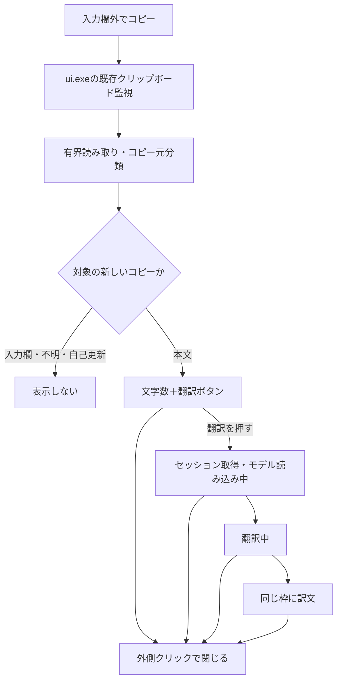

# 入力欄外のコピーから文字数・翻訳フローティングを表示する計画

作成日: 2026-11-06

状態: **実装前の計画書**。この文書の作成では、ソース変更・ビルド・試験IMEへの適用を行わない。

## 1. 目的と合意した操作

Webページ本文など、IMEの入力欄ではない場所でコピーしたテキストに対し、既存の選択翻訳と同じ系統のフローティングを表示する。

1. 利用者が入力欄外の文章を選択し、コピーする。
2. コピー時のマウス位置付近に「文字数」と「翻訳」ボタンを表示する。
3. 「翻訳」を押したときだけ推論を開始し、同じフローティング内に訳文を表示する。
4. **フローティング以外をクリックすると、文字数表示・読み込み表示・結果表示のいずれも閉じる。** そのクリックは元のアプリへ通常どおり届く。
5. 次の対象テキストがコピーされたら、以前の内容・結果を破棄して新しい文字数表示に更新する。

表示によって元のアプリからフォーカスを奪わない。本文を自動で書き換えない。翻訳結果の「コピー」を押したときだけクリップボードを書き換える。

## 2. 対象と初期実装の範囲

| 項目 | 方針 |
|---|---|
| 初期の必須確認先 | Chrome / Edge / Vivaldiの通常のHTML本文 |
| コピー操作 | Ctrl+Cと右クリックメニューのコピーを確認する |
| PDF | テキストとしてコピーできるPDFを追加確認対象とする。画像PDFのOCRは対象外 |
| 入力欄 | 編集可能な入力欄・contenteditable内は新経路から除外し、既存の選択表示を使う |
| 判定できないアプリ | 初期版では自動表示しない。対応済みとは扱わない |
| 動作する入力モード | ui.exe稼働中の通常デスクトップで、かな／英数モードに依存させない |
| 自動翻訳 | 行わない。コピー時は文字数とボタンの表示まで |
| 翻訳サーバー | 既存のモデル・読み込み表示・常時起動設定を利用する |
| ショートカット | 入力欄内のCtrl+Tは維持する。ブラウザ全体のCtrl+Tを横取りしない |
| 既存のクリップボード履歴 | 項目・ピン留め・保持期間・表示ショートカットを維持する |

ページ内の独自コピーボタン、他のPDFビューア、リモートデスクトップ経由の更新は、コピー元を確認できるかPoCで調べる。通常のクリップボード更新だけで全アプリを対応済みとはしない。

## 3. 現在の実装と利用できる部品

パスはリポジトリルートからの相対パス。

| ファイル | 現状と利用方針 |
|---|---|
| `windows/crates/ui/src/clipboard.rs` | `AddClipboardFormatListener` / `WM_CLIPBOARDUPDATE`で監視し、起動時にも現在の内容を履歴へ取り込む。新しいコピーイベントの入口として利用する |
| `windows/crates/ui/src/main.rs` | `ClipboardUpdated`は履歴画面の更新に使う。これをそのまま新フローティングの表示トリガーにはしない |
| `windows/crates/client/src/tsf/selection_count.rs` | 入力欄内の選択通知・文字数・表示要求を扱う。入力欄の既存経路として維持する |
| `windows/crates/client/src/tsf/selection_popup.rs` | テーマ対応の文字数・翻訳結果カードを専用UIスレッドで表示する。表示・翻訳ライフサイクルを共通部品にする候補 |
| `windows/crates/shared/src/translation_http.rs` | 準備状態と、上限付きのローカルHTTP通信を再利用する |
| `windows/crates/shared/src/translation_session.rs` | 翻訳を要求するときのセッション所有に利用する |
| `windows/crates/launcher/src/main.rs` | `translation_keep_alive`による常時起動／セッション連動を維持する |

既存の履歴処理は同じテキストの再コピーをまとめる。一方、新フローティングでは、**一度閉じた後に同じ文章をもう一度コピーしたら再表示する**。履歴の項目IDや内容一致だけで表示判定しない。

## 4. コピー元の判定が実装上の重点

### 4.1 クリップボード更新と利用者のコピーを区別する

クリップボードの変更通知には、起動直後の内容取得、IME自身の貼り付け準備・結果コピー、履歴ツールの書き戻しなども混ざる。新機能用に次の情報をまとめた一時スナップショットを作る。

- クリップボードのシーケンス番号、受信時刻、通知の起点。
- 通知時点の前景ウィンドウ・プロセス、クリップボード所有ウィンドウ、マウスの画面座標。
- 上限内で取得したUnicodeテキスト、文字数、読み取りが打ち切られたか。
- コピー元の分類、表示世代、IME自身の書き込みかどうか。

`GetClipboardSequenceNumber`は内容変更の識別に使い、利用者のコピー操作そのものの証明にはしない。起動時点の番号を基準にし、起動時の履歴取り込みではフローティングを出さない。遅延レンダリングで番号が変わる場合もあるため、読み取り前後の番号を比較する。[Microsoft: GetClipboardSequenceNumber](https://learn.microsoft.com/en-us/windows/win32/api/winuser/nf-winuser-getclipboardsequencenumber)

`GetClipboardOwner`は補助情報に使う。返るのはクリップボード所有ウィンドウであり、選択元の入力コントロールを確定する情報とは扱わない。[Microsoft: GetClipboardOwner](https://learn.microsoft.com/en-us/windows/win32/api/winuser/nf-winuser-getclipboardowner)

### 4.2 三つの分類を用意する

| 分類 | 新しいフローティング |
|---|---|
| `Editable` | 表示しない。既存の入力欄側に任せる |
| `ReadOnlyDocument` | ほかの条件も満たせば表示する |
| `Unknown` | 初期版では表示しない |

専用ワーカーでコピー前後のフォーカス情報、UI Automationの編集可能性・コントロール情報・必要に応じた選択範囲を照合する。読み取り専用の入力コントロールなど、本文との区別が曖昧なものはPoCで分類を決める。

**TextPatternがあることや、ValuePatternがないことだけで、入力欄外だと判断しない。** TextPatternはTextBox等にも用いられる。[Microsoft: UI Automation TextPattern](https://learn.microsoft.com/en-us/dotnet/framework/ui-automation/ui-automation-textpattern-overview)

右クリックメニュー表示中は、フォーカスが本文からメニューへ移る。直前の元ウィンドウ・対象要素を短時間だけ保持し、同じ前景アプリ・新しいコピーとの対応を確認する。対応が曖昧な場合は表示しない。UIAがなくても判定できる標準コントロールの扱いは、PoCの結果で追加する。

UIA照会は入力スレッドやクリップボード通知コールバック内で実行しない。論理的な照会期限は暫定300msとし、期限超過後の結果は無視する。照会は最大1件とし、呼び出し自体が固まったときに代替スレッドを無制限に作らない。復帰しない実例があれば、判定部分のヘルパープロセス分離を実装判断の条件にする。

## 5. 推奨構成

### 5.1 表示を共通部品へ切り出す

`selection_popup.rs`を別プロセスから直接呼び出す構成にはしない。既存のネイティブ表示・翻訳ライフサイクルを小さなRustライブラリへ切り出し、clientとuiの両方から使用する案を推奨する。仮の配置先は `windows/crates/selection-ui/`。

共通部品は原文スナップショット、表示世代、アンカー、表示起点（入力欄／コピー）、閉じ方を受け取る。TSF固有の型・入力アプリの状態を持たせない。入力欄の既存表示ルールは維持し、外側クリックによる新しい終了ポリシーはまずコピー起点に適用する。

`ui.exe`にコピー起点の表示コントローラーを置く。既存の履歴更新イベントとは別に、コピー元等を持つイベントを渡す。クリップボード監視をもう一つ増やさない。

### 5.2 最小限の状態

`Hidden → Toolbar → Loading → Translating → Result` と、失敗時の `Error` を用意する。各非表示状態への遷移で世代を進める。

| 現在の状態 | イベント | 動作 |
|---|---|---|
| Hidden | 対象テキストの新しいコピー | スナップショットを固定しToolbarを表示 |
| Toolbar | 翻訳クリック | 同じ原文のままセッションを取得しLoadingへ |
| Loading | モデル準備完了 | Translatingへ |
| Translating | 同じ世代の結果 | Resultへ |
| 表示中の任意状態 | 次の対象コピー | 古い結果を無効化し、新しいToolbarへ |
| 表示中の任意状態 | 外側クリック／Esc／コピー元終了／アプリ切替 | Hiddenへ。未完了の結果は再表示しない |
| 表示中の任意状態 | 翻訳機能OFF | Hiddenへ。新しいコピーの表示も停止 |
| Result | 結果コピー | 訳文をコピーして閉じる。自己更新として再表示を抑制 |
| 任意 | 別のコピーで内容が変わったが表示対象外 | 古い表示を閉じる |

推論開始済みのHTTP要求が即時停止するとは限らない。終了・更新後に古い結果を表示しないことを保証し、不要な待機・要求を積み上げない。

## 6. 表示と終了の仕様

- 既存IMEテーマ・フォント・角丸・DPIスケールを使う。
- コピー通知時点のマウス座標をアンカーにし、ウィンドウ表示後のマウス移動には追従しない。
- 画面端ではモニターの作業領域内に収める。負座標や異なるDPIのモニターも扱う。
- `WS_EX_NOACTIVATE`等の既存方針を維持し、原文の選択や元アプリのフォーカスを維持する。
- ツールバー・結果本文・コピー・閉じるボタンを、すべて「フローティング内」と判定する。
- フローティング外での左・右・中・追加ボタンの押下で閉じる。クリックを消費せず、対象アプリの通常操作を妨げない。
- ポップアップがフォーカスを取らないため、フォーカス喪失イベントだけで外側クリックを検知する実装にはしない。
- 表示中だけ低レベルマウスフック等で押下を検知する案をPoCで確認する。コールバックは座標・公開済み矩形と世代の照合、有界キューへの通知だけを行い、速やかにフックチェーンへ渡す。COM、HTTP、ファイル読み取り、翻訳、同期待ちは置かない。[Microsoft: LowLevelMouseProc](https://learn.microsoft.com/en-us/windows/win32/winmsg/lowlevelmouseproc)
- Escも表示中に限って非奪取で検知する案とする。グローバルなCtrl+T登録は追加しない。
- 閉じる際は表示世代を進め、フック・一時スナップショット・この表示が所有するセッションを解放する。他の翻訳表示や常時起動設定を巻き込まない。
- 入力欄側とコピー側の二重表示は、コピー元の分類で抑制する。判定遅延中に先に新表示を出さない。

## 7. テキスト・自己更新・上限

### 7.1 文字数と翻訳の上限

- 対象はUnicodeテキスト。画像だけ・ファイル一覧だけ・空文字・空白だけは表示しない。OCRやファイル内容の読み取りはしない。
- CRLFを一つの改行として数えるなど、入力欄内の文字数表示と規則を揃える。必要ならカウントの純粋関数を共通化する。
- クリップボードからの読み取りは、初期案として最大65,536 UTF-16単位とする。サロゲートの途中で切らない。
- 上限を超えた場合は読み取れた範囲の文字数に「以上」を付け、翻訳は無効にする。全文の正確な文字数と偽らない。
- 初期の翻訳上限は現行と同じ512文字。超える場合も文字数は表示し、翻訳ボタンを無効化して「翻訳は512文字まで」と示す。先頭だけを黙って翻訳しない。
- 表示・翻訳に用いる原文は、コピー時に固定する。ボタンを押した時点の別のクリップボード内容を読み直さない。

### 7.2 自分の書き込みと履歴の扱い

- IMEの結果コピー・履歴からの貼り付け準備などを、新しい外部コピーとして表示しない。
- 共通の自己書き込み識別子とシーケンス番号を使う案を確認する。別プロセスのclientからの結果コピーも区別する。
- コピー元がIMEのプロセスだからという理由だけで、外部更新すべてを除外する判定にはしない。
- 既存の `ExcludeClipboardContentFromMonitorProcessing` / `Clipboard Viewer Ignore` の除外を新経路にも適用する。
- クリップボードが開けない場合の再試行はワーカーで上限付きとする。読み取り中に番号が変わったら古いスナップショットを破棄する。常時ポーリング・無限リトライは追加しない。
- 既存履歴の保存方針は変えない。新機能の原文・訳文・UIA情報をログや追加の永続ファイルへ保存しない。

## 8. 設定とモデルの起動

既存の `general.experimental_translation` を新機能の有効条件にも使う。初期実装では新しい設定項目を必須にしない。

文字数ツールバーを出しただけでは、翻訳モデルのセッションを取得しない。「翻訳」を押した時点で取得する。常時起動OFFでは終了に合わせて解放し、ONでは既存ランチャーの仕様で保持する。

表示状態は「モデルを読み込み中」→「翻訳中」→結果とする。現行の準備待ち30秒・翻訳10秒を基準に、失敗時は同じ枠内で説明する。変更が必要なら、入力欄内の翻訳との整合も検証する。

## 9. 実装手順と判定条件

| 段階 | 作業 | 次へ進む条件 |
|---|---|---|
| 0. 判定PoC | Chrome / Edge / Vivaldiの本文・入力欄・右クリックコピーで通知、所有者、フォーカス、UIAを確認 | 本文と編集可能入力欄を区別できること。判定不能と対応範囲を記録する |
| 1. 純粋な状態処理 | コピー世代、起動時除外、自己更新除外、カウント、判定結果と閉じるイベントを実装 | 同じ文の再コピー、更新と取消の順序をユニットテストで確認 |
| 2. 表示部品の共通化 | 既存ネイティブポップアップを切り出し、入力欄側の回帰確認 | 既存の選択翻訳・入力速度・フォーカスが退行しない |
| 3. コピー経路の接続 | ui.exeの既存監視から分類ワーカー・コピー用コントローラーへ接続 | コピーでツールバーだけが表示され、外クリックで閉じる |
| 4. 翻訳接続 | スナップショット、準備表示、結果、コピーと取消を接続 | 旧結果が新しいコピーや非表示状態へ混ざらない |
| 5. 実IMEへ適用 | 関連チェック後 `Build-Trial.bat -NoPause`。入力アプリを開き直す | 下記の必須操作を実画面で確認する |
| 6. 記録 | 現行ガイドを更新し、検証記録を `reports/typo-assist/` へ保存 | ソース・テスト・適用・実操作・Git保存の状態を区別して報告する |

段階0で主要ブラウザの本文判定が成立しない場合、「全コピーで表示する」仕様へ無断で緩めない。失敗理由と代替案を整理してから扱いを決める。

## 10. 想定変更箇所

| 箇所 | 変更内容 |
|---|---|
| `windows/crates/ui/src/clipboard.rs` | 履歴とコピー通知を区別し、シーケンス・自己更新・コピー元情報を引き渡す |
| `windows/crates/ui/src/main.rs` | コピー起点のコントローラーと、設定変更・アプリ切替・終了の処理 |
| `windows/crates/ui/src/copy_translation.rs`（新規案） | 分類要求、世代管理、表示条件、翻訳開始・取消 |
| `windows/crates/ui/src/copy_source.rs`（新規案） | UIA等のコピー元判定を専用ワーカーで実行 |
| `windows/crates/selection-ui/`（新規案） | 文字数・翻訳結果表示の共通ライブラリ、閉じ方、外側クリック監視 |
| `windows/crates/client/src/tsf/selection_count.rs` | 入力欄の既存入口を維持し、共通ライブラリへ接続 |
| `windows/crates/client/src/tsf/selection_popup.rs` | 共通部品への移動元。二つの表示実装を別々に育てない |
| `windows/Cargo.toml`、各crateのCargo.toml、Cargo.lock | 共通crateと必要なWindows API featureを追加 |
| 共通のカウント・自己書き込みヘルパー（配置は実装時決定） | clientとuiでの規則・識別を統一 |
| `docs/investigations/windows-translation-input.md` | 対応範囲・操作・制限を更新 |

新規crateへの切り出しが過大になる場合は、PoC後に再利用単位を見直す。ただし、TSF DLLをui.exeからロードして表示を呼ぶ方法は採らない。

## 11. 検証と完了条件

### 自動チェック

- コピー状態の単体テスト: 起動時は非表示、同内容の新しいコピーは再表示、入力欄・不明・自己更新は非表示。
- 順序のテスト: Aコピー→A翻訳→Bコピー→A完了、翻訳中→外クリック→結果到着、外クリック→別コピー。いずれも旧表示を復活させない。
- カウントと上限: CRLF、絵文字、サロゲート、空白、512文字境界、読み取り上限。
- ヒット判定: ボタン・本文・枠内は維持、外側の各マウスボタンは閉じる、負座標・DPI変更。
- フック・ワーカー・セッションの生成と終了、表示を繰り返したときのリソース残留。
- 変更crateの `cargo test` / `cargo check`、必要なフロントエンド変更があればtypecheck・テスト。
- `cargo fmt --all --check`、`git diff --ignore-submodules --check`、`node windows/scripts/sync-version.mjs --check-release`。既存エラーと新規エラーを分けて記録する。

### Windows上で必須の操作

| 操作 | 期待結果 |
|---|---|
| 各対象ブラウザで本文選択→Ctrl+C | 一つだけ文字数＋翻訳ボタンが出る |
| 本文選択→右クリック→コピー | メニューをコピー元と誤認せず、同じ表示が出る |
| input / textarea / contenteditable内でコピー | コピー用表示は出ず、既存の入力欄側と重複しない |
| 翻訳前・モデル準備中・翻訳中・結果表示中に外側をクリック | 即座に閉じ、クリック先の通常操作も実行される |
| 枠内の翻訳・結果本文・コピー・閉じるをクリック | 外側と誤判定しない。結果コピーで再表示ループにならない |
| Aを翻訳中にBをコピー | Bの文字数へ更新し、Aの遅延結果は出ない |
| 閉じた後に同じ文章を再コピー | 新しい操作として表示される |
| コピー直後に別アプリへ切り替える | 遅延した判定・表示が別アプリ上に出ない |
| 画面端・別モニター・異なるDPIでコピー | 表示が作業領域内に収まり、クリック判定がずれない |
| 翻訳機能OFF／常時起動ON・OFF | 既存設定どおり表示とサーバーの寿命が切り替わる |
| クリップボード履歴表示・ピン留め・履歴から貼り付け | 既存機能が維持され、新表示の自己更新ループを起こさない |
| モデル未配置・サーバー停止・UIAタイムアウト | 元アプリの入力・コピー・クリックを止めない |

初期対象ブラウザで上記の必須操作を確認し、対応アプリと未対応条件を明記できた状態を完了とする。機能実装・通常Git保存・配布インストーラー作成はそれぞれ別の作業として扱う。

## 12. 関連資料

- [現行のWindows翻訳入力](windows-translation-input.md)
- [Windows側の開発・反映手順](../development-workflow.md)
- [選択翻訳・表示修正の検証記録](../../reports/typo-assist/windows-selection-translation-fix-20261105.md)
- [翻訳サーバー常時起動の検証記録](../../reports/typo-assist/windows-translation-keepalive-20261105.md)

Windows APIの参照先は2026-11-06に確認した。APIで保証される情報と、この計画で追加するコピー元推定・UI仕様を区別して実装する。
