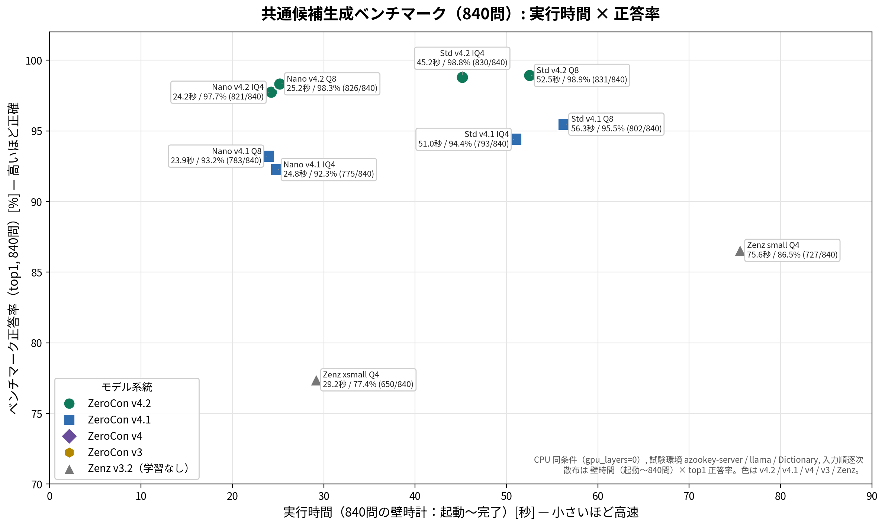

# 共通候補生成ベンチマーク（840問）10モデル比較 — 実行時間 × 正答率

2026-11-23、共通候補生成で840問ベンチマークを10種で実行した。横軸は840問の壁時計（起動〜完了）、縦軸はtop1正答率。その散布図がこれ。



## 設定

共通候補生成は、Zenzaiの直接生成に標準辞書のN-best候補を足して順位付けするまでを測る方式。設定画面の「共通候補生成」と同じプロトコルで `azookey-server.exe --conversion-benchmark` を1モデルにつき1プロセス起動し、問題を入力順で逐次送った。

CPU同条件にした。 `gpu_layers=0`、サーバ・ランタイム・辞書は `ZeroConvertIME-windows/` の試験環境（`azookey-server.exe` 2026-11-23 04:34 ビルド、`llama/`、`Dictionary/`）。設問は `benchmarks/common/conversion.jsonl` の840問（basic 230 / hard 250 / realistic 160 / colloquial 100 / additional_dict 100）。採点はRust `score_conversion` と同一規則をPythonに移植したもので、変換8件のparityケースで一致した。top1だけを採点し、forbidden含有・空白除去・ひらがな一致まで含む。

依頼の「iq4em8」は現存ファミリ名に存在しないため、既存の IQ4_NL / emb8 として扱った。「q8」は `q8_0`、「q4k」は `q4km`。内訳は ZeroCon v4.2 / v4.1 の Standard・Nano × IQ4_NL emb8 / Q8_0 の8種と、Zenz v3.2 の small・xsmall × Q4_K_M の2種。実行した金属のファイルは `summary.json` の `model_path` と `model_sha256` に残してある。

起動はSwift側で「とうきょう」のウォームアップを1回済ませてから第1問に入る。辞書は遅延読み込み（`preloadDictionary=false`）なので、第1問に辞書ロードが含まれる点は設定画面実行と揃えた。N-best部分（辞書側の追加検索）の平均は全モデルで4.7ms前後とほぼ同じで、壁時間の差はおもにモデルの生成時間に由来する。

## 結果

| モデル | 正解 / 840 | 正答率 | 壁時間（秒） | 平均（ms） | p95（ms） | サイズ |
| --- | --- | --- | --- | --- | --- | --- |
| ZeroCon Standard v4.2 Q8_0 | 831 | 98.9% | 52.5 | 56.6 | 92.5 | 99.1 MiB |
| ZeroCon Standard v4.2 IQ4_NL emb8 | 830 | 98.8% | 45.2 | 47.5 | 81.5 | 58.6 MiB |
| ZeroCon Nano v4.2 Q8_0 | 826 | 98.3% | 25.2 | 27.3 | 47.8 | 27.7 MiB |
| ZeroCon Nano v4.2 IQ4_NL emb8 | 821 | 97.7% | 24.2 | 26.2 | 48.6 | 18.7 MiB |
| ZeroCon Standard v4.1 Q8_0 | 802 | 95.5% | 56.3 | 61.2 | 102.6 | 99.1 MiB |
| ZeroCon Standard v4.1 IQ4_NL emb8 | 793 | 94.4% | 51.0 | 54.9 | 109.1 | 58.6 MiB |
| ZeroCon Nano v4.1 Q8_0 | 783 | 93.2% | 23.9 | 25.7 | 44.8 | 27.7 MiB |
| ZeroCon Nano v4.1 IQ4_NL emb8 | 775 | 92.3% | 24.8 | 26.9 | 51.0 | 18.7 MiB |
| Zenz v3.2 small Q4_K_M | 727 | 86.5% | 75.6 | 83.6 | 149.8 | 61.3 MiB |
| Zenz v3.2 xsmall Q4_K_M | 650 | 77.4% | 29.2 | 31.7 | 62.7 | 17.6 MiB |

図でも右上のNano v4.2 IQ4（24.2秒・97.7%）が目に入るはずで、Standard v4.2は約2倍の45〜52秒かけて98.8〜98.9%まで押し上げる並びだ。同サイズの比較では、Q8はIQ4より速さでは負けるが正解は数問だけ多い。Standard v4.2ではQ8とIQ4の差は1問（831対830）だったし、Nano v4.2でも差は5問（826対821）で、速度の差（IQ4の方が1〜7秒速い）と比べると小さい。単純に「Q8が正しい」と言えるほど開いているわけではない。

Zenz v3.2の2種は、ZeroCon全種に支配されている。smallは最慢（75.6秒）かつ精度も下位で、xsmallはNano並みの速さ（29.2秒）だが77.4%まで落ちる。共通候補生成のN-bestで順位付けしても、Zenz側の候補品質が全体を引っ張っている形だ。

## v4.1とv4.2の差は additional_dict が作っている

v4.2からv4.1への低下は、全体では3〜4ポイントだが、内訳を見ると additional_dict（741〜840の100問）にほぼ全部集まっている。

| モデル | basic (230) | hard (250) | realistic (160) | colloquial (100) | additional_dict (100) |
| --- | --- | --- | --- | --- | --- |
| Standard v4.2 IQ4 | 97.8% | 99.2% | 98.8% | 100.0% | 99.0% |
| Standard v4.1 IQ4 | 97.8% | 98.4% | 97.5% | 98.0% | 68.0% |
| Nano v4.2 IQ4 | 97.4% | 98.8% | 96.3% | 99.0% | 97.0% |
| Nano v4.1 IQ4 | 96.5% | 98.4% | 95.6% | 97.0% | 57.0% |
| Zenz small | 87.8% | 83.2% | 92.5% | 93.0% | 76.0% |
| Zenz xsmall | 83.9% | 68.0% | 87.5% | 89.0% | 58.0% |

v4.1は additional_dict で57〜73%まで落ちているのに対し、v4.2は97〜99%を保っている。他の4 subsetsではv4.1でも95%前後が出ている。普通の変換能力の差というより、v4.2がこの部分集合を拾うようになった差が支配的だ。追加辞書100問は1割しかないのに、v4.1との隔たりのほとんどが生まれる。v4.1の誤りは `mismatch` と `forbidden` が混ざったもので、辞書候補が揃わないというより選び順が外れている例が多かった。

## 拾い上げられなかったもの（注意）

これはモデル単体の1回測りであって、実IMEでの快適さを保証するものではないし、予測・タイポ補正・学習辞書を含まない。実行時間もCPU同条件1回分で、Vulkan・温度・負荷で動く。測定中は稼働中の試験IMEサーバが並走していたため、絶対秒数はその影響を受ける。モデル順はv4.2 StandardからZenzへ固定したため、時間とともに負荷が変われば順番バイアスが混ざる。そのつもりで「24秒対45秒」のような順序の大小として読むのが安全だ。壁時間には起動（0.3秒前後）が含まれるが、全体に占める割合は小さい。

zstdのような再実行はこのコマンドでできる。設定画面の再実行でなく、ドライバ直結の再実行だ。

```sh
python scripts/run.py benchmarks/common/run_common_candidates.py --outdir artifacts/results/common-candidates-840-10models-20261123
python scripts/run.py benchmarks/common/run_common_candidates_plot.py --outdir artifacts/results/common-candidates-840-10models-20261123
```

データは `artifacts/results/common-candidates-840-10models-20261123/` にある。`summary.json` が集計、`comparison.csv` が表、`*.jsonl` が問題ごとの候補とtop1・正誤・レイテンシ、`scatter.html` が図と表をまとめたブラウザ版だ。サーバ・モデルのハッシュは `summary.json` の `condition` と各モデルの `model_sha256` を見直すこと。ベンチマーク正本は `benchmarks/common/` のままで、手編集した問題は使っていない。
