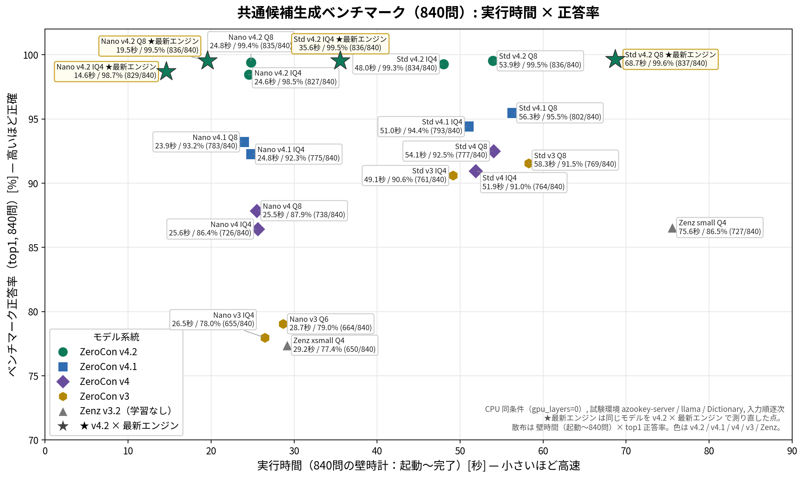

# 共通候補生成ベンチマーク（840問）18モデル比較 — 実行時間 × 正答率

2026-11-23、共通候補生成で840問ベンチマークを18種で実行した。横軸は840問の壁時計（起動〜完了）、縦軸はtop1正答率。その散布図がこれ。



図の★は、同じモデル（v4.2）を最新エンジン（18:14 / 18:15ビルド）で測り直した点だ。表と本文の数値は特に断りがない限り旧エンジン（04:34ビルド）のもの。

## 設定

共通候補生成は、Zenzaiの直接生成に標準辞書のN-best候補を足して順位付けするまでを測る方式。設定画面の「共通候補生成」と同じプロトコルで `azookey-server.exe --conversion-benchmark` を1モデルにつき1プロセス起動し、問題を入力順で逐次送った。

CPU同条件にした。 `gpu_layers=0`、サーバ・ランタイム・辞書は `ZeroConvertIME-windows/` の試験環境（`azookey-server.exe` 2026-11-23 04:34 ビルド、`llama/`、`Dictionary/`）。設問は `benchmarks/common/conversion.jsonl` の840問（basic 230 / hard 250 / realistic 160 / colloquial 100 / additional_dict 100）。採点はRust `score_conversion` と同一規則をPythonに移植したもので、変換8件のparityケースで一致した。top1だけを採点し、forbidden含有・空白除去・ひらがな一致まで含む。

依頼の「iq4em8」は現存ファミリ名に存在しないため、既存の IQ4_NL / emb8 として扱った。「q8」は `q8_0`、「q4k」は `q4km`。今回の18種は ZeroCon v4.2 / v4.1 / v4 / v3 の Standard・Nano × IQ4_NL emb8 / 高精度版の16種と、Zenz v3.2 の small・xsmall × Q4_K_M の2種。v3 Nano には Q8_0 リリースが無いため、高精度側は Q6_K を用いた。Standard v4 は `standard-v4-nano-transfer` の同量子化で、Nano v4 は `zerocon-nano-v4` の同量子化だ。実行した金属のファイルは `summary.json` の `model_path` と `model_sha256` に残してある。

v4.2 の4種は 2026-11-23 05:45〜05:48 に新しいGGUFへ差し替えられたため、06:05〜06:10 に4種だけ測り直した。新しいハッシュは `windows/crates/shared/src/runtime_assets.rs` の配布カタログと一致している（Nano IQ4 `5367df4e…`、Nano Q8 `7a613da5…`、Standard IQ4 `bf73bf47…`、Standard Q8 `43fcbfae…`）。差し替え前の値は `summary.pre-v42-update.json` に残した。v4.2以外の14種は同日 04:47〜05:06 の結果をそのまま使う。

起動はSwift側で「とうきょう」のウォームアップを1回済ませてから第1問に入る。辞書は遅延読み込み（`preloadDictionary=false`）なので、第1問に辞書ロードが含まれる点は設定画面実行と揃えた。N-best部分（辞書側の追加検索）の平均は全モデルで4.7〜5.1msとほぼ同じで、壁時間の差はおもにモデルの生成時間に由来する。

## 結果（18種・正答率降順）

| モデル | 正解 / 840 | 正答率 | 壁時間（秒） | 平均（ms） | p95（ms） | サイズ |
| --- | --- | --- | --- | --- | --- | --- |
| ZeroCon Standard v4.2 Q8_0 | 836 | 99.5% | 53.9 | 58.6 | 96.8 | 99.1 MiB |
| ZeroCon Nano v4.2 Q8_0 | 835 | 99.4% | 24.8 | 27.0 | 49.1 | 27.7 MiB |
| ZeroCon Standard v4.2 IQ4_NL emb8 | 834 | 99.3% | 48.0 | 51.6 | 88.2 | 58.6 MiB |
| ZeroCon Nano v4.2 IQ4_NL emb8 | 827 | 98.5% | 24.6 | 26.6 | 50.3 | 18.7 MiB |
| ZeroCon Standard v4.1 Q8_0 | 802 | 95.5% | 56.3 | 61.2 | 102.6 | 99.1 MiB |
| ZeroCon Standard v4.1 IQ4_NL emb8 | 793 | 94.4% | 51.0 | 54.9 | 109.1 | 58.6 MiB |
| ZeroCon Nano v4.1 Q8_0 | 783 | 93.2% | 23.9 | 25.7 | 44.8 | 27.7 MiB |
| ZeroCon Standard v4 Q8_0 | 777 | 92.5% | 54.1 | 58.0 | 98.1 | 99.1 MiB |
| ZeroCon Nano v4.1 IQ4_NL emb8 | 775 | 92.3% | 24.8 | 26.9 | 51.0 | 18.7 MiB |
| ZeroCon Standard v3 Q8_0 | 769 | 91.5% | 58.3 | 63.2 | 105.9 | 99.1 MiB |
| ZeroCon Standard v4 IQ4_NL emb8 | 764 | 91.0% | 51.9 | 55.0 | 89.8 | 58.6 MiB |
| ZeroCon Standard v3 IQ4_NL emb8 | 761 | 90.6% | 49.1 | 52.2 | 88.5 | 58.6 MiB |
| ZeroCon Nano v4 Q8_0 | 738 | 87.9% | 25.5 | 27.2 | 49.5 | 27.7 MiB |
| Zenz v3.2 small Q4_K_M | 727 | 86.5% | 75.6 | 83.6 | 149.8 | 61.3 MiB |
| ZeroCon Nano v4 IQ4_NL emb8 | 726 | 86.4% | 25.6 | 27.5 | 53.9 | 18.7 MiB |
| ZeroCon Nano v3 Q6_K | 664 | 79.0% | 28.7 | 31.0 | 59.9 | 21.9 MiB |
| ZeroCon Nano v3 IQ4_NL emb8 | 655 | 78.0% | 26.5 | 28.6 | 57.5 | 18.7 MiB |
| Zenz v3.2 xsmall Q4_K_M | 650 | 77.4% | 29.2 | 31.7 | 62.7 | 17.6 MiB |

### 更新後のv4.2はどこまで動いたか

| モデル | 更新前 | 更新後 | 差 | 更新前の壁時間 | 更新後の壁時間 |
| --- | --- | --- | --- | --- | --- |
| Standard v4.2 Q8 | 831（98.9%） | 836（99.5%） | +5問 | 52.5秒 | 53.9秒 |
| Standard v4.2 IQ4 | 830（98.8%） | 834（99.3%） | +4問 | 45.2秒 | 48.0秒 |
| Nano v4.2 Q8 | 826（98.3%） | 835（99.4%） | +9問 | 25.2秒 | 24.8秒 |
| Nano v4.2 IQ4 | 821（97.7%） | 827（98.5%） | +6問 | 24.2秒 | 24.6秒 |

伸びたのは主に additional_dict だ。更新前の v4.2 は98〜99%だったが、更新後は Standard の2種が100%、Nano の2種が99%になった。basic も97.0〜98.3%から98.3〜99.6%へ上がっている。壁時間はほぼ変わらず、Standard IQ4 が2.8秒遅くなった程度だ。

更新で順位が1つ入れ替わった。Nano v4.2 Q8（835問）が Standard v4.2 IQ4（834問）を1問だけ上回り、18種中2位に付けた。サイズは27.7 MiB対58.6 MiB、壁時間は24.8秒対48.0秒なので、同点ならNanoを選ぶ理由が強い。Standard v4.2 Q8 は836問で首位を維持したが、Nano v4.2 Q8 との差は1問まで詰まった。

世代の階段は Standard で v4.2（99.5%）＞ v4.1（95.5%）＞ v4（92.5%）＞ v3（91.5%）、Nano で v4.2（99.4%）＞ v4.1（93.2%）＞ v4（87.9%）＞ v3（79.0%）と単調のまま、v4.2 の位置だけが切り上がった。v4.1 との差は Standard で4.0ポイント、Nano で6.2ポイントに広がった。

Zenz v3.2 の2種は ZeroCon 全種の下位に残った。small は75.6秒で86.5%、xsmall は29.2秒で77.4%だ。Nano v4.2 IQ4（24.6秒・98.5%）と比べると、速さで負け、正答率で12〜21ポイント負ける。

## 世代差の内訳

| モデル | basic (230) | hard (250) | realistic (160) | colloquial (100) | additional_dict (100) |
| --- | --- | --- | --- | --- | --- |
| Standard v4.2 Q8 | 99.6% | 99.6% | 98.8% | 100.0% | 100.0% |
| Standard v4.2 IQ4 | 99.6% | 98.8% | 98.8% | 100.0% | 100.0% |
| Nano v4.2 Q8 | 99.6% | 99.2% | 99.4% | 100.0% | 99.0% |
| Nano v4.2 IQ4 | 98.3% | 98.4% | 98.1% | 99.0% | 99.0% |
| Standard v4.1 Q8 | 97.8% | 99.6% | 97.5% | 99.0% | 73.0% |
| Standard v4 Q8 | 92.2% | 98.8% | 93.8% | 93.0% | 75.0% |
| Standard v3 Q8 | 90.4% | 98.0% | 92.5% | 93.0% | 75.0% |
| Nano v4 Q8 | 90.9% | 96.4% | 87.5% | 88.0% | 60.0% |
| Zenz small | 87.8% | 83.2% | 92.5% | 93.0% | 76.0% |
| Nano v3 Q6 | 88.3% | 68.8% | 88.1% | 90.0% | 58.0% |
| Zenz xsmall | 83.9% | 68.0% | 87.5% | 89.0% | 58.0% |

追加辞書100問の段差は更新後も残る。v4.2 が99〜100%に届いた一方、v4.1 は68〜73%、v3/v4 は58〜76%だ。v4.1 が v4 から得た3ポイントは basic と colloquial の伸びで、追加辞書ではなかった。v4.2 が v4.1 から得た伸びは、更新前から追加辞書が支配的で、更新後はそこが満点まで埋まった形になる。

Nano v3 の弱さも変わらず hard の68.8%に集中する。同じ68%帯に Zenz xsmall がいるが、それ以外の全モデルは hard で83%を超える。

## v4.2 × 最新エンジンの組み合わせ

その後、試験環境の `azookey-server.exe` / `azookey-server.dll` が 18:14 / 18:15 にさらに更新された（build `0.8.1-dev.1795180917.ga7edf7ea`）。このため、面の図の★は 07:16 / 07:25 ビルドの値から、最新エンジンで測り直した v4.2 の4種へ差し替えた。モデルGGUFは更新後のまま（`bf73bf47…`（Standard IQ4）、`43fcbfae…`（Standard Q8）、`5367df4e…`（Nano IQ4）、`7a613da5…`（Nano Q8））で、他14種は旧エンジンの点をそのまま残してある。

この4点は面の図に「★最新エンジン」で重ねてある。表だけが見たい場合は下のとおり。

| モデル | 旧エンジン 正解 | 最新エンジン 正解 | 差 | 旧 壁時間 | 最新 壁時間 | 変化 | 前回新エンジン 壁時間 | 最新の変化 |
| --- | --- | --- | --- | --- | --- | --- | --- | --- |
| ZeroCon Standard v4.2 Q8_0 | 836（99.5%） | 837（99.6%） | +1 | 53.9秒 | 68.7秒 | +27% | 34.0秒 | +102% |
| ZeroCon Standard v4.2 IQ4_NL emb8 | 834（99.3%） | 836（99.5%） | +2 | 48.0秒 | 35.6秒 | −26% | 28.6秒 | +25% |
| ZeroCon Nano v4.2 Q8_0 | 835（99.4%） | 836（99.5%） | +1 | 24.8秒 | 19.5秒 | −21% | 11.9秒 | +64% |
| ZeroCon Nano v4.2 IQ4_NL emb8 | 827（98.5%） | 829（98.7%） | +2 | 24.6秒 | 14.6秒 | −41% | 8.4秒 | +74% |

正答率は前回新エンジンと同数（837・836・836・829問）で、更新による精度の変化はなかった。速度は旧エンジン比では2種が短くなったが、前回新エンジン（07:16 / 07:25 ビルド）比では4種とも遅くなり、Standard Q8 は2倍強になった。今回の単発測定だけでは、この低下がエンジン由来か、同時刻の負荷・温度由来かを切り分けていない。

再現に使った最新エンジンは `azookey-server.exe` 11e53804…（5,319,168バイト）、`llama/llama.dll` 5ab313c6… で、値は `common-candidates-v42-latestengine-20261123/summary.json` の `condition.server_sha256` / `condition.llama_dll_sha256` に残した。07:16 / 07:25 ビルドの18種測定は `common-candidates-840-18models-newengine-20261123/` に残してある。

```sh
python scripts/run.py benchmarks/common/run_common_candidates.py \
  --models v4.2 --overwrite \
  --outdir artifacts/results/common-candidates-v42-latestengine-20261123
python scripts/run.py benchmarks/common/run_common_candidates_plot.py \
  --outdir artifacts/results/common-candidates-840-18models-20261123 \
  --overlay artifacts/results/common-candidates-v42-latestengine-20261123/summary.json \
  --overlay-label "v4.2 × 最新エンジン" --overlay-tag "★最新エンジン"
```

データは旧エンジンの `artifacts/results/common-candidates-840-18models-20261123/`、前回新エンジンの `artifacts/results/common-candidates-840-18models-newengine-20261123/`、最新エンジンの `artifacts/results/common-candidates-v42-latestengine-20261123/` にある。`summary.json` が集計、`comparison.csv` が表、`*.jsonl` が問題ごとの候補とtop1・正誤・レイテンシ、`scatter.html` が図と表をまとめたブラウザ版だ。更新前のv4.2値は `summary.pre-v42-update.json`、10種だけの先行スナップショットは `common-candidates-840-10models-20261123.md` に残してある。モデル直結の比較は `common-model-scope-840-18models-20261123.md` を見てほしい。

## 拾い上げられなかったもの（注意）

これはモデル単体の1回測りであって、実IMEでの快適さを保証するものではないし、予測・タイポ補正・学習辞書を含まない。実行時間もCPU同条件1回分で、Vulkan・温度・負荷で動く。測定中は稼働中の試験IMEサーバが並走していたため、絶対秒数はその影響を受ける。v4.2の4種だけ別時刻に測っているので、他の14種との秒数の比較は、同日・同条件とはいえ時刻差を含む。順序の大小として読むのが安全だ。

再実行はこのコマンドでできる。設定画面の再実行でなく、ドライバ直結の再実行だ。

```sh
python scripts/run.py benchmarks/common/run_common_candidates.py --outdir artifacts/results/common-candidates-840-18models-20261123
python scripts/run.py benchmarks/common/run_common_candidates_plot.py --outdir artifacts/results/common-candidates-840-18models-20261123
```

v4.2だけ測り直す場合は `--models v4.2 --overwrite` を付ける。今回その部分実行で未測定モデルが summary から落ちる不具合が出たため、`write_summary` に前回集計の引き継ぎを足した。
