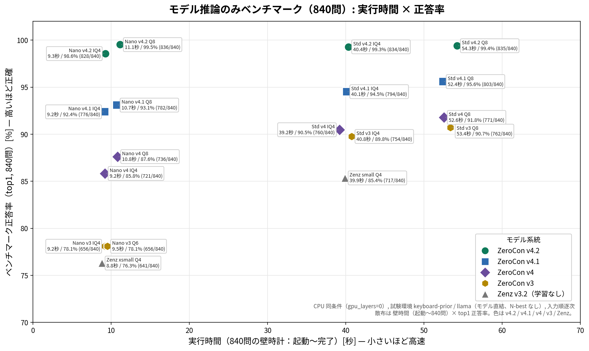

# モデル推論のみベンチマーク（840問）18モデル比較 — 実行時間 × 正答率

2026-11-23、共通候補生成と同じ840問・同じ18モデルを「モデル推論のみ」で測った。横軸は840問の壁時計（起動〜完了）、縦軸はtop1正答率。その散布図がこれ。



## 設定

設定画面の「モデル推論」スコープと同じく、読みからモデルが直接生成した表記をtop1として採点する。辞書のN-best追加も順位付けも入らない。実行は `keyboard-prior.exe --benchmark` を1モデルにつき1プロセス起動し、問題を入力順で逐次送った。

プロンプトは `crates/server/src/ai_assist/benchmark.rs` の `Inference::convert` をPythonへ移植した。`\uEE02`＋左文脈＋`\uEE00`＋カタカナ読み＋`\uEE01` の形で、数字列は `nam` にマスクして生成後に復元する。`n_predict=80`、timeout 2000ms、CPU（`gpu_layers=0`）は設定画面と同一。worker は `AZOOKEY_LLAMA_BACKEND_DIR` と `AZOOKEY_KEYBOARD_PRIOR_GPU_LAYERS` を設定画面と同じく渡し、`llama/` のランタイムを使う。

設問は `benchmarks/common/conversion.jsonl` の840問（basic 230 / hard 250 / realistic 160 / colloquial 100 / additional_dict 100）。採点は共通候補生成の回と同じ `score_conversion`（変換8件のparityで一致済み）。レイテンシは worker が返す推論時間 `elapsed_ns` だけで、プロセス間転送は含まない。壁時間は起動（モデルロード）から840問完了までだ。

モデルは18種で、共通候補生成の回と同一ファイル。v4.2 の4種は 2026-11-23 05:45〜05:48 の新しいGGUF（配布カタログのSHAと一致）を使った。Nano v3 は Q8_0 リリースが無いため高精度側に Q6_K を使った。

前回の測定（05:12〜05:29）は別タスクが同時に走っていたため、同じ18種を06:12〜06:22に測り直した。前回値は `summary.pre-rerun.json` に残してある。

## 結果（18種・正答率降順）

| モデル | 正解 / 840 | 正答率 | 壁時間（秒） | 平均（ms） | p95（ms） |
| --- | --- | --- | --- | --- | --- |
| ZeroCon Nano v4.2 Q8_0 | 836 | 99.5% | 11.1 | 12.8 | 26.1 |
| ZeroCon Standard v4.2 Q8_0 | 835 | 99.4% | 54.3 | 64.1 | 111.3 |
| ZeroCon Standard v4.2 IQ4_NL emb8 | 834 | 99.3% | 40.4 | 47.5 | 73.9 |
| ZeroCon Nano v4.2 IQ4_NL emb8 | 828 | 98.6% | 9.3 | 10.6 | 20.0 |
| ZeroCon Standard v4.1 Q8_0 | 803 | 95.6% | 52.4 | 61.9 | 102.2 |
| ZeroCon Standard v4.1 IQ4_NL emb8 | 794 | 94.5% | 40.1 | 47.2 | 78.8 |
| ZeroCon Nano v4.1 Q8_0 | 782 | 93.1% | 10.7 | 12.3 | 24.7 |
| ZeroCon Nano v4.1 IQ4_NL emb8 | 776 | 92.4% | 9.2 | 10.5 | 19.6 |
| ZeroCon Standard v4 Q8_0 | 771 | 91.8% | 52.6 | 62.1 | 100.8 |
| ZeroCon Standard v3 Q8_0 | 762 | 90.7% | 53.4 | 63.1 | 103.5 |
| ZeroCon Standard v4 IQ4_NL emb8 | 760 | 90.5% | 39.2 | 46.2 | 78.0 |
| ZeroCon Standard v3 IQ4_NL emb8 | 754 | 89.8% | 40.8 | 47.9 | 77.8 |
| ZeroCon Nano v4 Q8_0 | 736 | 87.6% | 10.8 | 12.4 | 24.2 |
| ZeroCon Nano v4 IQ4_NL emb8 | 721 | 85.8% | 9.2 | 10.5 | 18.6 |
| Zenz v3.2 small Q4_K_M | 717 | 85.4% | 39.9 | 47.0 | 81.3 |
| ZeroCon Nano v3 IQ4_NL emb8 | 656 | 78.1% | 9.2 | 10.5 | 20.9 |
| ZeroCon Nano v3 Q6_K | 656 | 78.1% | 9.5 | 10.9 | 20.2 |
| Zenz v3.2 xsmall Q4_K_M | 641 | 76.3% | 8.8 | 10.0 | 18.2 |

今回は18種すべて推論失敗ゼロで完走した。前回は Zenz の2種で1問ずつ timeout していたが、それが消えた。合計壁時間は500.8秒で、前回の646.6秒から146秒縮んだ。並行タスクが消えた分だ。個別には Standard v4.1 Q8 が98.9秒から52.4秒へ、Nano v4.2 Q8 が19.6秒から11.1秒へ短くなった。前回の秒数は他プロセスの影響を含んでいたので、速度の比較には今回値を使う。

Nano v4.2 Q8（836問・11.1秒）が首位で、Standard v4.2 Q8（835問・54.3秒）を1問差で上回る。さらに Standard v4.2 IQ4（834問・40.4秒）も1問差で続く。3種が1問ずつ違いで並び、サイズは27.7 MiB・99.1 MiB・58.6 MiB、時間は11秒・54秒・40秒と開く。同じ正答率ならNano Q8を選ぶ理由が圧倒的に強い。Nano v4.2 IQ4（828問・9.3秒）は18.7 MiBで98.6%に届き、Standard v4.1 IQ4（794問・40.1秒・58.6 MiB）を34問上回る。

世代の階段は共通候補生成と同じ形だ。Standard は v4.2（99.4%）＞ v4.1（95.6%）＞ v4（91.8%）＞ v3（90.7%）、Nano は v4.2（99.5%）＞ v4.1（93.1%）＞ v4（87.6%）＞ v3（78.1%）。Nano v3 の Q6_K と IQ4 は656問で同点だった。

## 共通候補生成との差

辞書候補を足さない分、差は小さい。v4.2 の4種と v4.1 の4種は±0.1ポイントに収まり、モデルの top1 がそのまま辞書で覆らないことを示す。差が開いたのは v3/v4 系と Zenz だ。

| モデル群 | モデル推論 − 共通候補生成 |
| --- | --- |
| v4.2 の4種 | −0.1〜+0.1ポイント |
| v4.1 の4種 | −0.1〜+0.1ポイント |
| v4 の4種 | −0.2〜−0.7ポイント |
| v3 の4種 | −0.8〜+0.1ポイント |
| Zenz small | −1.2ポイント |
| Zenz xsmall | −1.1ポイント |

モデルが単独で外した読みを辞書側で拾える余地は、v4.2世代ではほぼ無くなっている。v3/v4系とZenzは0.5〜1.2ポイントだけ辞書に救われている。

## 部分集合の内訳

| モデル | basic (230) | hard (250) | realistic (160) | colloquial (100) | additional_dict (100) |
| --- | --- | --- | --- | --- | --- |
| Nano v4.2 Q8 | 99.6% | 99.6% | 99.4% | 100.0% | 99.0% |
| Standard v4.2 Q8 | 99.1% | 100.0% | 98.1% | 100.0% | 100.0% |
| Standard v4.2 IQ4 | 99.1% | 99.2% | 98.8% | 100.0% | 100.0% |
| Nano v4.2 IQ4 | 97.8% | 98.8% | 98.8% | 99.0% | 99.0% |
| Standard v4.1 Q8 | 97.8% | 100.0% | 97.5% | 99.0% | 73.0% |
| Standard v4 Q8 | 92.2% | 98.4% | 91.9% | 92.0% | 74.0% |
| Standard v3 Q8 | 90.0% | 97.6% | 89.4% | 93.0% | 75.0% |
| Nano v4 Q8 | 89.6% | 96.4% | 87.5% | 88.0% | 61.0% |
| Zenz small | 86.1% | 83.2% | 90.0% | 92.0% | 75.0% |
| Nano v3 Q6 | 87.4% | 68.4% | 86.9% | 88.0% | 57.0% |
| Zenz xsmall | 81.7% | 68.0% | 86.9% | 88.0% | 56.0% |

追加辞書100問の段差は共通候補生成とまったく同じで、v4.2 だけが99〜100%、v3/v4/v4.1 は56〜75%に留まる。Nano v3 の hard 68.4%も同じだ。この段差は辞書候補の有無では説明できず、モデル自身が追加辞書の語彙文脈を扱えるかで決まっている。N-bestを足しても、モデルが候補として出さない語は順位付けの土俵に載らない。

## 拾い上げられなかったもの（注意）

モデル単体の1回測りで、実IMEの快適さを保証しない。予測・タイポ補正・学習辞書を含まない。測定中も稼働中の試験IMEサーバは動いていたが、前回より負荷は小さかった。それでも絶対秒数は環境依存で、1回の測定で再現性を確認したわけではない。

再実行はこのコマンドでできる。

```sh
python scripts/run.py benchmarks/common/run_common_model_scope.py --outdir artifacts/results/common-model-scope-840-18models-20261123
python scripts/run.py benchmarks/common/run_common_candidates_plot.py --outdir artifacts/results/common-model-scope-840-18models-20261123
```

データは `artifacts/results/common-model-scope-840-18models-20261123/` にある。`summary.json` が集計、`comparison.csv` が表、`*.jsonl` が問題ごとの top1・正誤・推論時間、`scatter.html` が図と表をまとめたブラウザ版だ。再実行前の値は `summary.pre-rerun.json`、共通候補生成の回は `common-candidates-840-18models-20261123.md` にある。
