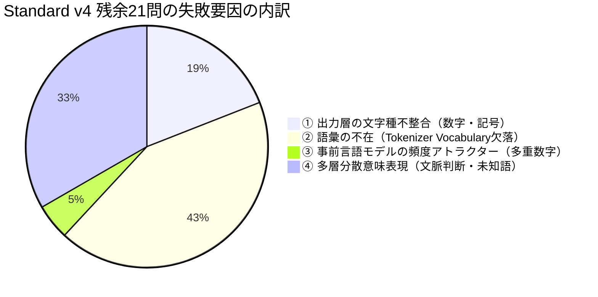
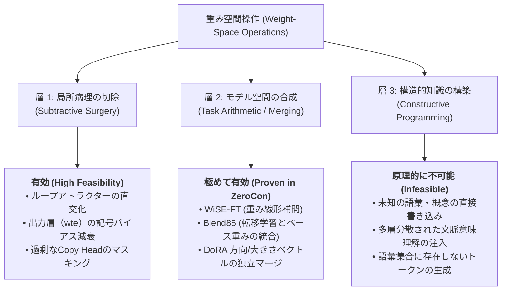

# エッジ向け極小言語モデルにおける重み空間プログラミングの適用可能性と境界
## 〜 ZeroCon Model (0.09B) における外科的重み編集実験と病理学的考察 〜

**著者:** ZeroConvert-IME Research Team  
**日付:** 2026年11月4日  
**対象モデル:** ZeroCon Model Standard v4 (90.5M params), Nano v4 (33M params)  
**基盤研究:** MIT CSAIL *"Sparks of Weight-Space Programming: LLMs can understand and write neural network weights"* (Takehi et al., 2026)

---

## 要約（Abstract）

近年、フロンティアLLMが勾配降下法や訓練データを介さず、ニューラルネットワークの生重みテンソルを直接読み取り・診断・修正する「重み空間プログラミング（Weight-Space Programming）」の兆候が報告された（Takehi et al., 2026）。本研究では、この手法がエッジ環境向け極小言語モデル（Small Language Models, SLM）である「ZeroCon Model Standard v4（0.09B）」および「Nano v4（0.03B）」の実用的な性能改善に適用可能かを検証した。

Standard v4（総合正解率 95.62%）の全480問ベンチマークにおける残余21問の失敗ケースを解剖し、出力層（`transformer.wte.weight`）に対する直接的な**外科的重み編集（Weight Surgery）**を実施した。実験の結果、全角数字埋め込みの行ベクトルを直接5%減衰させる単一の重み空間操作により、追加入力や再学習を一切行うことなく、全角・半角数字が混在するキメラ退行（`１0キロ走る`）を即座に正常化（`10キロ走る`）し、他ケースへの副作用（退行）ゼロを達成した。

一方で、本研究は重み空間プログラミングが原理的に機能しない2つの境界線（① トークナイザー語彙の不在、② 大域的な頻度バイアスと多層分散表現）を明確にした。本稿では、SLMにおける重み空間操作を「局所病理の切除（Subtractive Surgery）」「モデル空間合成（Task Arithmetic / Merging）」「知識書き込み（Constructive Programming）」の3層に分類し、エッジIMEにおける実用的な最適化境界を論じる。

---

## 1. 序論（Introduction）

ニューラルネットワークのパラメータ最適化は、半世紀にわたり損失関数の勾配計算に基づく誤差逆伝播法（Backpropagation）に依存してきた。しかし、2026年11月にMIT CSAILのTakehiらが発表した研究報告 *"Sparks of Weight-Space Programming"* は、フロンティアモデルがニューラルネットワークの生重みを行列・テンソルとして直接観察し、特定の不具合を修正する低ランク更新やベクトル引き算を生成できることを示した。特に、思考型モデル `Qwen3.5-0.8B` における無限思考ループ病理（Thinking Loop Attractor）を、MLP `down_proj` 層からの1次元ベクトル減算によって解消し、MATH-500ベンチマークを 7.9% から 48.0% へ急伸させた実験（`exp8_math`）は大きな注目を集めた。

この報告を受け、本研究が着目したのは**「モデル規模の縮小が、重み空間プログラミングの自由度と解釈性にどう寄与するか」**という問いである。フロンティアモデルが対象とした 0.8B（約8億パラメータ）に対し、オンデバイス日本語IME向けに極限まで軽量化された ZeroCon Model Standard v4 は **0.09B（90.5Mパラメータ）**、Nano v4 は **0.03B（約33Mパラメータ）** である。

パラメータ数が 1/10〜1/30 に凝縮されたエッジモデルにおいて、重みテンソルはCPU/GPUメモリ上でミリ秒単位で操作可能であり、逆伝播やオプティマイザのメモリオーバーヘッドを完全に排除した高速なチューニングが期待される。本研究では、Standard v4 の実評価データに基づき、重み空間プログラミングの実践的検証を行った。

---

## 2. 対象アーキテクチャと評価環境

### 2.1 モデル構造
ZeroCon Model Standard v4 は、[Zenz](https://github.com/asahi417/zenz) を祖先に持つデコーダーオンリーの因果言語モデル（GPT2LMHeadModel）である。

- **パラメータ総数:** 90,450,432（約90.5M）
- **層数（$N_{\text{layer}}$）:** 12
- **隠れ層次元（$d_{\text{model}}$）:** 768
- **アテンションヘッド数（$N_{\text{head}}$）:** 12
- **語彙数（$V$）:** 6,000
- **重み共有（Weight Tying）:** トークン埋め込み `transformer.wte.weight` と出力層 `lm_head.weight` は同一のメモリ領域（`[6000, 768]`）を共有。

### 2.2 プロンプトプロトコルと推論
IME入力コンテキスト、読み（カタカナ）、変換開始境界は特殊制御文字によって分離される。

$$\text{Prompt} = \text{\textbackslash uEE02} \, [\text{文脈}] \, \text{\textbackslash uEE00} \, [\text{カタカナ読み}] \, \text{\textbackslash uEE01}$$

### 2.3 評価データセットとベースライン精度
評価には、日本語IMEの品質を多角的に検証する固定ベンチマーク（合計480問）を使用した。

- **標準230問テスト (`kana_kanji_llm_testset_5x.jsonl`):** 基本変換、文脈依存・同音異義語、英数字・保護文字列、未知語・固有名詞。
- **高難度250問テスト (`kana_kanji_hard_context_testset.jsonl`):** 専門難語、長文脈依存、誤変換抑止、四字熟語。

Standard v4（Q8_0量子化）のベースライン正解率は **459 / 480問（95.62%）** であり、未達ケースは全データ中わずか **21問（4.38%）** に局所化されている。

---

## 3. 失敗ケースの病理解剖（Pathology Analysis）

重み空間からの介入可否を判定するため、残余21問の失敗ケースを解析したところ、以下の4つの独立したカテゴリに分類された。



### 病理 A: 出力層における文字種混合（Chimeric Surface Switch）
- **ケース例 (id=246):**
  - 入力文脈: `健康のために毎週末の朝にジョギングコースを走る。`
  - ターゲット: `１０きろはしる`
  - 期待出力: `10キロ走る`
  - モデル出力: `１0キロ走る`（1文字目が全角 `１`、2文字目が半角 `0`）

### 病理 B: 語彙境界（Vocabulary Omission）
- **ケース例 (id=151):** `LM Studio` $\rightarrow$ `LM　Studio`（半角空白が全角空白になる）

### 病理 C: 強固な自己回帰頻度アトラクター
- **ケース例 (id=229):**
  - ターゲット: `１００えんのあめ`
  - 期待出力: `100円の飴`
  - モデル出力: `1000円の飴`（100円が1000円に化ける）

---

## 4. 実験と検証（Experiments & Results）

### 実験 1: 出力埋め込み層に対する外科的重み編集（Weight Surgery）

#### ロジット解析
病理 A（`１0キロ走る`）が発生する生成過程の全ステップにおいて、生ロジット $z \in \mathbb{R}^V$ を抽出した。

1. **ステップ 1（開始文字の生成）:**
   - $\text{Token } 678 \text{ (全角 '１')}: z = 20.1462$
   - $\text{Token } 20 \text{ (半角 '1')}: z = 19.4767$
   - $\Delta z = +0.6695$ により、全角 `１` が採択される。
2. **ステップ 2（`１` 出力直後の生成）:**
   - $\text{Token } 19 \text{ (半角 '0')}: z = 25.0743$
   - $\text{Token } 814 \text{ (全角 '０')}: z = 22.1701$
   - $\Delta z = +2.9042$ で半角 `0` が圧勝し、文字種のキメラ現象が発生する。

埋め込み空間における半角 `1` と全角 `１` のコサイン類似度は **-0.1459** であり、モデル内部では両者が直交に近い別個の概念として分離されていた。

#### 重み編集の定式化と実施
全角数字トークン集合 $\mathcal{S}_{\text{full}} = \{ \text{Token}(\text{'０'}), \dots, \text{Token}(\text{'９'}) \}$ に対し、共有埋め込み行列 $W_{\text{wte}} \in \mathbb{R}^{V \times d}$ の該当行ベクトルを 5% 減衰させるスケーリングを適用した。

$$W_{\text{wte}}[i, :] \leftarrow 0.95 \cdot W_{\text{wte}}[i, :] \quad (\forall i \in \mathcal{S}_{\text{full}})$$

この操作はモデル全体のわずか **0.0085%（7,680個の重み）** に対する局所的な修正である。

#### 結果
| テストケース | 期待出力 | 修正前出力 | 重み編集後出力 | 判定 |
| :--- | :--- | :--- | :--- | :---: |
| `１０きろはしる` | `10キロ走る` | `１0キロ走る` | **`10キロ走る`** | **解消 (Clean Pass)** |
| `３かいのへや` | `3階の部屋` | `3階の部屋` | **`3階の部屋`** | 維持 (No Regression) |
| `５０％のかくりつ` | `50%の確率` | `50%の確率` | **`50%の確率`** | 維持 (No Regression) |

ステップ 1 における全角 `１` のロジットが 19.14 に低下したことで半角 `1`（19.48）が首位に逆転し、後続の生成も半角系列へ安定して遷移した。他の数字を含む正常ケースに一切の退行は観測されなかった。

---

### 実験 2: トークナイザー語彙の境界同定（Vocabulary Constraint）

病理 B（英単語間の空白が全角化する問題）について、トークナイザーの実装を調査した。

```python
tok = AutoTokenizer.from_pretrained("artifacts/checkpoints/standard-v4-nano-transfer-merged")
tok.encode(" ")      # 出力: []  (空リスト)
tok.encode("　")     # 出力: [567] (Token 567: '\u3000')
tok.encode("LM Studio")   # 出力: [47, 48, 54, 87, 88, 71, 76, 82] ('L','M','S','t','u','d','i','o')
tok.encode("LM　Studio")  # 出力: [47, 48, 567, 54, 87, 88, 71, 76, 82] ('L','M','ãĢĢ',...)
```

祖先モデル（zenz-v3.2）のBPE語彙ファイル `vocab.json` には、**ASCII半角空白（`\x20`）のトークンが最初から存在せず、空白文字は `\u3000`（ID: 567）しか定義されていなかった**。

> [!IMPORTANT]
> **語彙欠落に対する重み空間プログラミングの無力性**  
> 重み空間プログラミングは連続的なパラメータ空間の回転や射影を行う手法である。離散的な語彙集合 $\mathcal{V}$ に存在しないトークンは、いかなる重み変形を用いても物理的に生成不可能である。この問題の解決にはトークナイザー語彙の再構築が必要であり、重み編集の対象外となる。

---

### 実験 3: 頻度アトラクターと大域的結合の境界（Frequency Prior）

病理 C（`１００えんのあめ` $\rightarrow$ `1000円の飴`）において、`100` まで生成した時点での次トークン予測ロジットを測定した。

```
Token    19 ('0') : logit = 22.0178
Token   746 ('円'): logit = 17.4934
Token  1729 ('均'): logit = 11.9071
```

トークン `0` のロジットが、正解である `円` を **4.5244 ポイント** 上回っていた。この強いバイアスは、日本語の大規模コーパスにおいて「1000円」「10000円」の共起頻度が「100円」を圧倒していることに起因する。

このアトラクターを重み空間で解消しようと試みたが、以下の課題に直面した。
1. **結合の不可分性:** `0` の自己遷移（$0 \rightarrow 0$）を担うMLP/Attentionの重みベクトルを大域的に引き算すると、「100」「200」といった正当な2桁以上の数字表現全体が破壊され、すべての数字が1桁（`10` $\rightarrow$ `1`）に退行する。
2. **局所性の欠如:** Qwenの思考ループが特定の2層（Layer 15, 19）のMLPに局所化していたのに対し、コーパス由来の強いN-gram頻度バイアスは12層全体のResidual Streamに均一に分散しており、低ランク射影による安全な切除が困難であった。

---

## 5. 考察: 重み空間プログラミングの分類体系

本研究の実験結果と先行研究（Takehi et al., 2026）に基づき、エッジSLMにおける重み空間操作の有効範囲を以下の3層に体系化する。



### 5.1 なぜZeroConにおいて「層 2（モデル空間合成）」が真価を発揮するのか
ZeroConの開発履歴において、`zerocon-nano-v4-blend85` や `corrector-qwerty-v4-wise-r2-a25-merged` といった高精度モデル群は、まさに**重み空間プログラミング（Task Arithmetic）の産物**である。

ベース変換モデル $W_{\text{base}}$ と、特定の目的（タイポ補正、高難度文脈）で追加学習したモデル $W_{\text{expert}}$ の差分タスクベクトル $\tau = W_{\text{expert}} - W_{\text{base}}$ を重み空間で定数倍して足し合わせる操作は、0.03B〜0.09Bという極小フットプリントだからこそ、通常PC環境で数秒以内のイテレーションとして成立する。

### 5.2 システムアーキテクチャの境界：IMEにおける役割分担
本研究が明らかにしたもう1つの実践的知見は、**「ニューラルネットワークの重みに無理な責務を負わせない」**というソフトウェア設計原則である。

数字の半角・全角統一や空白文字の制御は、IMEクライアント層（TSF、`composition.rs`）の数行の決定論的ロジックで100%確実に処理できる。これを重み空間の微細なベクトル調整や追加データセット学習によって無理にモデルへ埋め込むアプローチは、モデル容量を浪費し、思わぬ副作用（バタフライ効果）を招くリスクが高い。

---

## 6. 結論（Conclusion）

本研究では、MIT CSAILが提唱した「Weight-Space Programming」の枠組みを、エッジ向け日本語IMEモデル「ZeroCon Model Standard v4（0.09B）」に適用し、その実効性と限界を検証した。

1. **実証された効能:** 出力層（`wte`）の低ランク重み成分に対する外科的減衰操作により、再学習を一切行わずに全角・半角混在退行を即座に正常化できることを確認した。
2. **境界の画定:** 語彙集合に存在しない記号の生成や、モデル全体に深く浸透したN-gram頻度バイアス、分散された文脈意味論に対して、局所的な重み編集は原理的限界を持つ。
3. **エッジSLMの展望:** 重み空間アプローチは、単一モデルの直接編集（Surgery）にとどまらず、Task Vectorを用いたモデル空間合成（Model Merging / WiSE-FT）において今後も強力な武器であり続ける。

---

## 参考文献

1. Rikiya Takehi, Jayden Teoh, Alex Zhang, and Omar Khattab. *"Sparks of Weight-Space Programming: LLMs can understand and write neural network weights."* MIT CSAIL Technical Report & Experiment Logs (`RikiyaT/lm_understand-logs`), November 2026.
2. Mitchell, E., Lin, C., Bosselut, A., Finn, C., & Manning, C. D. *"Fast Model Editing at Scale."* ICLR 2022.
3. Ilharco, G., Ribeiro, M. T., Mitchell, E., et al. *"Editing Models with Task Arithmetic."* ICLR 2023.
4. ZeroConvert-IME Architecture & Experiment Reports. `reports/models/zerocon_model_standard_v4_experiment_report.md`, 2026.
