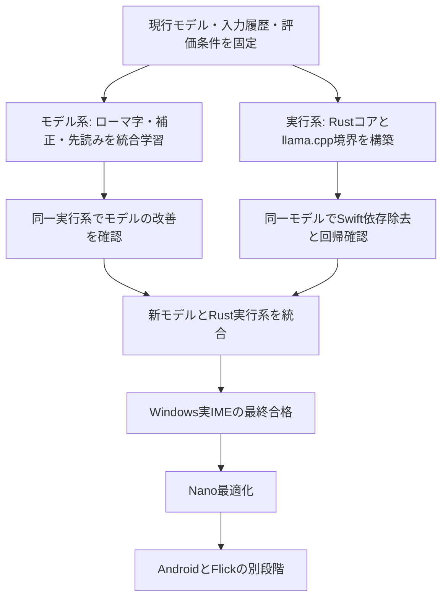
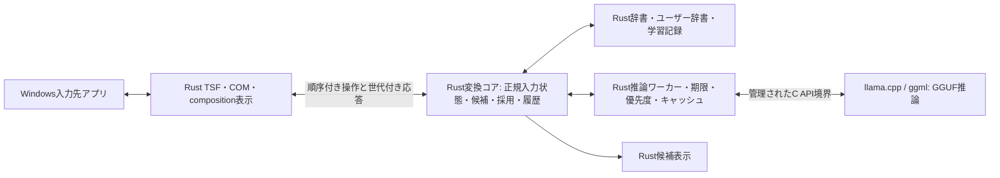

# ZeroCon-Origin オリジナルIMEモデル構築計画

2026-10-29 作成。指定された `zerocon_origin_project_charter.md`、現行リポジトリ、公式モデルカード・ライセンスを確認して改訂した実行計画。

**状態：設計・調査完了。学習・実装・モデル取得・実IMEへの適用は未実施。数値目標は提案であり、達成実績ではない。**

## 1. 目的と採用する方針

**目的は、モデルの性能向上とIME実行系の簡素化。ライセンス回避は目的にしない。** 2026-10-29のユーザー指定を反映し、初版の「外部教師不使用を本線にする」方針を改訂した。

> かな漢字変換・タイポ補正・先読みを、ローマ字の元打鍵列と入力途中の状態まで扱えるIME専用モデルとして学習する。同時に、IMEの変換実行系をRust＋llama.cppへ集約し、Swiftへの依存、複数の補正系、重複した状態管理を整理する。利用条件を守った既存コード・モデル・辞書・教師出力は活用し、実際の入力品質・応答速度・保守性で現行を上回る。

| 開発軸 | 達成したいこと | 成功判定 |
|---|---|---|
| モデル | 正しいかなだけでなく、ローマ字の誤打・未確定子音・文中編集に対応する。変換・補正・先読みを共通の重みで学習 | 未見入力の変換精度、誤補正率、先読み妥当性、打鍵削減、遅延 |
| IMEコード | 入力状態・候補生成/採点・採用・履歴をRustで管理し、推論をllama.cppへ統一 | Swiftなしで必要なIME機能が動作、重複状態と専用ワーカー減少、回帰・遅延の基準に合格 |
| 利用条件 | Apache-2.0/MIT等を含め、採用物の条件と来歴を記録・履行 | 必要なLICENSE/NOTICE、データ・教師・重みの由来を説明できる |

本計画の推奨は次のとおり。

| 判断対象 | 推奨 |
|---|---|
| オリジナルモデルの主案 | IME向け語彙・構造・taskを設計してランダム初期化から学習。スクラッチ自体を成功条件にせず、現行派生モデルと比較する |
| 語彙 | 自前語彙を第一候補にし、既存語彙も性能・互換性の比較対象にできる。採用物の来歴は明記 |
| 第1世代の構造 | RoPE・Pre-RMSNorm・SwiGLU・GQA・入出力埋め込み共有の小型Dense Decoder |
| 教師 | 利用条件を確認した現行zenz/ZeroCon、Qwen/Gemma等の系列蒸留・読み付与・選別を性能比較に採用可能。教師なし条件も対照実験として残す |
| 配布ライセンス | 自作コード・自前重みはApache-2.0を第一候補とする。第三者部分の条件は保持 |
| 実行系 | Rustの変換コア＋llama.cppのC API。Windows TSFの入力・採用経路はRustを継続 |
| 移行方法 | モデル改善とRust移行を独立に評価し、合格した組合せを統合。既存動作は比較・復旧用に保持 |

Llama 3 / Qwen 2.5より新しい候補は3章を参照。Apache素材を使うこと、外部教師から学ぶこと、自前のstudent重みを学習することは分けて記録する。「100%自作」「ライセンスフリー」を売り文句にせず、IMEの改善量と設計・学習内容を説明する。

### 1.1 Rust＋llama.cppに絞る範囲

本計画の対象は製品のIME実行時コア。Windows API/TSF/COM、辞書データ、GPU driver等は必要であり、依存ライブラリ総数を文字どおり2個にする意味ではない。学習・評価のPython、設定画面の現行Tauri/TypeScript、配布ツールは別範囲とし、コア移行と同時に全面刷新しない。候補表示は既存Rust UIを活用する。

llama.cppは推論を担当する。入力編集、辞書、ユーザー辞書、候補順位、再変換、個人学習、確定/取消はRustが責任を持つ。これらをモデルへ委ねれば自動的に消せるとは考えない。

## 2. 現状と構想書の修正点

### 2.1 比較する現行モデル

[2026-10-29 CPU比較](nano-standard-v4-cpu-comparison.md)に記録された値を出発点とする。この計画作成時に推論を再実行した値ではない。

条件はIntel Core i5-14500HX、CPU、4 threads、GPU offload 0、context 2048、temperature 0、キャッシュ無効。時間はHTTP要求から**全文出力完了まで**でありTTFTではない。各条件1回の測定で、反復評価が必要。

| 現行モデル | サイズ MiB | 480問正解 | 正解率 | 平均 | p95 |
|---|---:|---:|---:|---:|---:|
| Nano v4 IQ4_emb8・配布既定 | 18.69 | 445 | 92.71% | 38.71 ms | 55.75 ms |
| Nano v4 Q6 | 23.33 | 452 | 94.17% | 42.39 ms | 63.79 ms |
| Nano v4 Q8 | 27.69 | 454 | 94.58% | 40.32 ms | 59.86 ms |
| Standard v4 IQ4_emb8・研究モデル | 58.55 | 451 | 93.96% | 109.01 ms | 161.18 ms |
| Standard v4 Q8・研究モデル | 99.05 | 459 | 95.62% | 122.92 ms | 184.62 ms |

Standard v4は現行カタログの配布既定ではないが、精度の比較対象に含める。配布カタログは `windows/deployment/model-catalog.json`。Nanoの2種類に加え、補正用CorrectorとKeyboard Priorがあり、製品全体の総メモリ・総容量は通常変換モデル1本のサイズでは表せない。

構想書の453/480は過去の特定条件の結果であり、現在の最高成績の代用にしない。Standard v4 Q8の459/480を下回る新モデルを「現行を全面的に超えた」と判定しない。CPUとVulkanでは正解数も異なるため、同じ実行器で比較する。

### 2.2 構想書から引き継ぐもの・変更するもの

| 構想書の記載 | 本計画での扱い |
|---|---|
| 変換・補正・先読みの3機能 | 継続。ただし入出力契約と自動採用の基準を分ける |
| GPT-2から新しい構造へ | 継続。新しい構造だけで精度・速度の改善を保証しない |
| 25M / 70Mと層数・幅の指定 | FFN幅・KV heads・語彙・共有重みまで含めて再計算する |
| Llama 3 / Qwen 2.5準拠 | 最新モデルの比較資料へ更新。配布本体は小型Denseを基準にする |
| DoRAをスクラッチ学習の中核にする | 事前学習は全パラメータ更新。DoRAは完成後の追加適応の比較候補 |
| 既存損失・γ値を最初から全面採用 | CE基準から1要素ずつ検証。正常なひらがな保持・正しい継続を罰しない |
| 上流モデルや現行Nanoとの相互蒸留 | 条件を確認して採用可能。現行教師・新しい教師・教師なしを比較し、誤答を無条件に継承しない |
| 青空文庫・政府文書・Wikipediaは100%クリーン | 資料単位で利用条件を分類。Wikipedia等も条件を整理して採否を判断する |
| 2B〜3B tokensを最初から確保 | 承認・重複除去後の実量を測る。元文と合成による反復を区別 |
| 4090/4080で約20時間 | 手元の4070 12GBを基準に小規模計測から積算。固定時間を約束しない |
| 読みコピー・打切り0を損失で保証 | 学習だけでは保証しない。出力検査・上限・無提案・回帰評価も用いる |
| 817行で能力を確立 | 小規模の追加学習事例。ゼロから日本語能力を得るデータ量には不足 |
| 固定480問と隔離検査でリーク完全排除 | 開発回帰用。隔離検査の範囲を明記し、新規封印評価を別に用意 |
| Flickの「かえろ→帰ろう」 | 意図的な「帰ろ」と区別困難。文脈依存・補完・補正を分け、無条件に変更しない |
| バッテリー負荷ゼロ・専門用語完全対応 | 未検証の断定を削除。消費電力・語彙範囲を測定して報告 |

現行損失は[Standard v4報告](zerocon_model_standard_v4_experiment_report.md)でも各要素の寄与が分離されていない。新モデルでは構造・語彙も変わるため、既存γやBlend85/h0-guardをそのまま移植する根拠はない。

## 3. Llama 3 / Qwen 2.5より新しい候補

以下は2026-10-29に公式ページで確認した候補。世の中のすべての最新モデルを網羅した一覧ではない。モデルカードの総合ベンチマークは、日本語IMEの正確さや自動補正適性の証明にはならない。

| 候補 | 確認できた重みライセンス | 用途と判断 |
|---|---|---|
| **Qwen3.8-27B** | Apache-2.0 | 大きな環境での教師・比較候補。手元12GB GPUへ全面常駐する前提にしない。[モデル](https://huggingface.co/Qwen/Qwen3.8-27B)・[LICENSE本文](https://huggingface.co/Qwen/Qwen3.8-27B/blob/main/LICENSE) |
| Qwen3.6-27B | Apache-2.0 | 3.8との比較・再現用。新規教師の第一候補は3.8と実測比較して決める。[公式カード](https://huggingface.co/Qwen/Qwen3.6-27B) |
| **Qwen3.5-0.8B / 4B** | 各公式カードはApache-2.0 | ローカル実験候補。0.8Bでも800M規模で、本計画の28〜88Mより大きい。3.5のハイブリッド構造をそのまま小型化する案は後段実験。[0.8B](https://huggingface.co/Qwen/Qwen3.5-0.8B)・[4B](https://huggingface.co/Qwen/Qwen3.5-4B) |
| Qwen3-0.6B | Apache-2.0 | Dense系の比較基準。3.5以降と構造上の条件を分けて比較できる。[公式カード](https://huggingface.co/Qwen/Qwen3-0.6B) |
| **Gemma 4** | Apache-2.0。旧世代Gemmaと混同しない | Qwenと異なる教師候補。E2B/E4B、12B Unified、26B A4B、31Bが公式資料にある。E/Activeの数字を総重み容量と取り違えない。[公式モデルカード](https://ai.google.dev/gemma/docs/core/model_card_4)・[公式ライセンス](https://ai.google.dev/gemma/apache_2)・[12Bカード](https://huggingface.co/google/gemma-4-12B-it) |
| SmolLM3-3B | Apache-2.0 | 小型モデルの学習レシピ、GQA/NoPEの研究参考。日本語IMEへの適性は未検証。[公式カード](https://huggingface.co/HuggingFaceTB/SmolLM3-3B) |
| Olmo 3 / 3.1 | Apache-2.0のモデル群 | 学習コード・データ来歴・中間checkpointの公開方法を参考にする。公開データの各原著作物まで一律に権利処理済みとは扱わない。[Ai2モデル一覧](https://docs.allenai.org/quick_start/model_selection)・[3.1追記のある公式発表](https://allenai.org/blog/olmo3) |
| Llama 4 Scout / Maverick | Llama 4 Community License | 新しい世代は存在するが、独自条件と大きなモデル規模がある。最初の候補は小型・条件の単純なモデルを優先する。必要なら条件と費用を確認して比較する。[Meta公式](https://ai.meta.com/resources/models-and-libraries/llama-downloads/) |
| Qwen3.8-Flash-Next | Qwen Community License 1.0 | Apacheではない。商用サービス区分等の追加条件があるため初期採用から外す。[mainのLICENSE](https://huggingface.co/Qwen/Qwen3.8-Flash-Next/blob/main/LICENSE) |
| Qwen3.8-2.4T-A95B / Max級 | qwen3.8-maxという独自ライセンス表示 | 「Qwen3.8は全モデルApache」と判断しない。本計画の教師候補から外す。[公式カード](https://huggingface.co/Qwen/Qwen3.8-2.4T-A95B) |

**推奨判断：最新教師を採用するならQwen3.8-27BとGemma 4を比較する。オリジナルの配布本体を作るなら、それらの重みを縮小・切り出すのではなく、IME向けの小型モデルを別に学習する。**

### 3.1 新しい構造をそのまま採用しない理由

Qwen3.5-0.8BはGated DeltaNetとGated Attentionを組み合わせる。Qwen3.8-27Bの公開configにもlinear/full attentionの交互配置がある。これは構想書の「Llama風Dense Transformerを小型化」とは異なる設計。[0.8Bの仕様](https://huggingface.co/Qwen/Qwen3.5-0.8B)、[3.8のconfig](https://huggingface.co/Qwen/Qwen3.8-27B/raw/main/config.json)

IMEでは短い入力に対する応答、語中編集、Backspace、カーソル移動、候補の再採点が多い。長文生成の高速化が、そのままIMEのp95を改善するとは限らない。再帰状態を持つ方式では途中編集後の復元・再計算も設計対象になる。

第1世代は既存ランタイムで検証しやすいDense GQAを基準とし、次を実験枠に置く。

| 実験要素 | 導入条件 |
|---|---|
| QK-Norm | 学習安定性または精度の改善と、正しいGGUF実装を確認できること |
| NoPE混在 | 長めの文脈で改善し、短入力・候補採点を悪化させないこと |
| Gated DeltaNet系ハイブリッド | 同じデータ・規模でCPU p95と編集後再計算が改善すること |
| MTP・投機的生成 | 短い出力でも追加head/検証の費用を回収できること |
| MoE | 28〜88M級で容量・実装・ルーティング費用を含めた利点が実測できること |

新しい研究例として[Gated DeltaNet-2](https://arxiv.org/abs/2605.22791)もあるが、論文の1.3B規模の結果を数十M規模へ外挿しない。第1世代で複数の新規カーネルを同時に開発する工程にはしない。

## 4. ライセンスと来歴の設計

### 4.1 利用条件を五つの層で管理する

| 層 | 実施すること | 避ける判断 |
|---|---|---|
| 構造・方式 | 公開研究の考え方を参照し、採用コードの利用条件を記録 | Llama互換構造という名前だけでMetaの重み条件まで同一視 |
| 実装コード | 自作部分と第三者コードを識別し、commit・LICENSE・NOTICEを記録 | 数式を参考にしたこととコードを複製したことを混同 |
| 初期重み・語彙 | ランダム初期化/既存重み/既存語彙のどれかを記録 | 来歴を記録せず自作と表示 |
| 学習データ | 元文・辞書・疑似ラベル・教師出力まで追跡 | データセット表紙のライセンスだけで全収録物を承認 |
| 配布物全体 | 重み、辞書、ランタイム、UI資産等の表示義務を別に履行 | モデルが自作になったのでIME全体の第三者表示を削除 |

Apache-2.0も無条件・無保証の権利証明ではない。ライセンス同梱、変更表示、該当するNOTICE等の条件を確認する。[Apache公式本文](https://www.apache.org/licenses/LICENSE-2.0)

### 4.2 データの採否

**品質・多様性・利用条件を満たすデータを選び、データ純粋性のために学習の選択肢を狭めない。** 自作・許諾済み・PD・CC BY等は採用候補。SA素材や独自条件は、取得・学習・加工データ再配布・重み配布の扱いを整理して判断する。条件未確認の素材を黙って混ぜない。

| データ | 方針 | 必須確認 |
|---|---|---|
| 自作の現代文・会話・業務文・IME例 | 最優先 | 作成者・権利帰属、他資料からの転載がないこと、公開範囲 |
| 委託・寄稿の文章 | 優先して増やす | 学習、加工、再配布、商用モデル配布、国外提供の扱いを契約で明確化 |
| 青空文庫 | 著作権消滅作品だけを個別承認 | 著者・訳者・作品区分。図書カードや注記の条件も別に保存 |
| 法令・告示・裁判所判断等 | 対象本文を分類して採用 | 著作権法13条に該当する範囲。民間の解説・編集・転載部分を混ぜない |
| 政府・自治体の白書・案内 | 適用規約を確認して採用 | PDL/Government Standard Terms/CC BY等の適用、第三者引用・図表・別条件 |
| CC0 / CC BY素材 | 資料単位の審査後に採用可能 | 権利者、ライセンス版、表示、取得方法、プライバシー |
| Wikipedia本文・CC BY-SA | 条件整理後に採用を判断 | 加工データ・出力・重みの扱いを区別し、必要な表示・条件を管理 |
| UniDic等の解析辞書 | 採用版の許諾を確認 | エンジンと辞書は別。BSD選択可能な版ならその条件を記録 |
| 既存817行・既存蒸留JSONL | 来歴・利用条件・品質・分割を確認して再利用 | 元データmanifestがあれば単位ごとに検査し、不明な行を隔離 |
| 自前ノイズ付与データ | 承認元文から作成 | ノイズを足しても元文の利用条件は消えない |
| 外部LLM生成文 | 利用条件確認後は本線でも採用可能 | 重み条件、API規約、出力利用・再学習条件、元のプロンプトの権利、類似出力 |
| 個人のIME入力履歴 | 初期本線では不使用 | 将来使う場合も明示的参加、機密除外、同意・撤回手続と非公開原文保管 |

青空文庫には著作権存続作品も含まれ、翻訳者にも独立した権利がある。[青空文庫の取り扱い規準](https://www.aozora.gr.jp/guide/kijyunn.html)

著作権法13条は法令・一定の告示等・裁判所の判決等を対象としており、政府文書全部を一括して除外する規定ではない。白書等は適用された利用規約を調べる。公的な規約でも第三者権利部分の確認が必要。[法務省提供の条文英訳PDF](https://www.japaneselawtranslation.go.jp/ja/laws/download/4207/09/s45Aa000480504en14.0_r3A52.pdf)、[公共データ利用規約1.0](https://www.digital.go.jp/resources/open_data/public_data_license_v1.0)

Wikipediaの本文はCC BY-SA等の条件がある。データや出力・重みへの条件の及び方を一律断定せず、採用前に適用条件を整理する。Creative Commons自身もAI学習への適用と保守的な順守方法を区別している。[Wikimedia利用規約](https://foundation.wikimedia.org/wiki/Policy:Terms_of_Use)、[CCによるAI学習の説明](https://creativecommons.org/using-cc-licensed-works-for-ai-training-2/)

UniDicには複数のライセンス区分があるため「UniDicを使った」だけでは確認が足りない。採用する配布ファイルのバージョン・LICENSEを固定する。[国語研FAQ](https://clrd.ninjal.ac.jp/unidic/faq.html)

### 4.3 教師と初期重みを実験条件として区別する

| 系統 | 学習内容 | 位置付け |
|---|---|---|
| Origin-A | 自前studentをランダム初期化、教師なし | データ・構造単独の効果を確認する対照条件 |
| **Origin-B** | 自前studentをランダム初期化し、利用条件を確認した現行/外部/自前教師を活用 | 性能を優先する本線候補。教師を使ったことを明記 |
| 現行モデル追加学習 | zenz/ZeroConの既存重みから開始 | 精度・速度・費用の比較対象。新設計モデルと由来を区別 |

外部教師による読み付与、品質採点、候補選別、擬似正解の作成も採用可能とする。現行教師だけの条件、新しい教師の条件、教師なし条件を分けて改善寄与を測る。教師なしを製品として優先する条件にはしない。

A/Bの保存先は再現・分析のために分ける。来歴を記録した上で複数教師のデータを混合できるが、評価問題・正解・封印データから生成したものは学習へ入れない。教師の出力を人が修正した場合も元の生成IDを保持する。

### 4.4 データ台帳と証跡

元文ごとに少なくとも以下を保存する。

```json
{
  "source_id": "stable-source-id",
  "document_id": "stable-document-id",
  "source_url": "original-location",
  "retrieved_at": "ISO-8601",
  "raw_sha256": "sha256",
  "rights_basis": "permission-or-public-domain-basis",
  "license_id": "SPDX-or-LicenseRef",
  "license_url": "terms-at-acquisition",
  "license_snapshot_sha256": "sha256",
  "attribution": "required-credit",
  "third_party_exclusions": [],
  "training_allowed": true,
  "raw_redistribution_allowed": false,
  "model_distribution_review": "approved-or-pending",
  "teacher_model": null,
  "review_status": "approved",
  "reviewed_by": "reviewer-id",
  "reviewed_at": "ISO-8601"
}
```

加工行には親document/source ID、加工コードcommit、設定・seed、入力イベントID、split IDを継承する。許諾・規約の原本、メールや契約等の非公開証跡はアクセス制限された別保管とし、公開リポジトリには必要な台帳・ハッシュ・公開可能な根拠だけを置く。

学習前に、未確認の利用条件0件、取得本文と台帳のhash整合、除外元の子孫0件、runごとの教師/元重み/語彙の宣言との整合を検査する。問題の元データが判明した場合は、影響するデータ・checkpoint・量子化・配布版を追跡して、該当系統を再学習できる状態にする。

## 5. 製品とモデル構成

### 5.1 開発順序

モデル開発（M）と実行系移行（R）を分ける。Mは現行IMEへの研究用adapterまたは単体評価で改善量を測り、Rは凍結した現行モデル・入力履歴を使って動作互換を測る。



最初から3本を別々に事前学習しない。共通の言語・変換能力を学習し、QWERTY/Flickで条件付けまたは追加適応する。デバイス別モデルを分けるのは、同条件の比較で干渉が測定され、専用化の利益が確認できた場合とする。モデルと移行の片方が未達でも、もう片方の改善を測定できる状態を保つ。

### 5.2 構造の候補とパラメータ計算

共通仕様：biasなしのQ/K/V/O、GQA、RoPE、Pre-RMSNorm、SwiGLU、tied embeddings、head_dim=64、各層RMSNorm 2個＋最終Norm。まず標準のDenseを実装し、QK-Norm等は後段で比較する。

| 候補 | Layers | d | Q / KV heads | FFN幅 | 語彙 | 重みパラメータ数 | 用途 |
|---|---:|---:|---:|---:|---:|---:|---|
| N28 | 8 | 512 | 8 / 2 | 1,536 | 8,192 | 28,320,256 | 最小容量の比較候補 |
| **N33** | 8 | 512 | 8 / 2 | 1,536 | 16,384 | 32,514,560 | Nanoの第一候補 |
| **S68** | 10 | 768 | 12 / 2 | 1,792 | 16,384 | 67,649,280 | Windows Standardの第一候補 |
| S88 | 12 | 768 | 12 / 4 | 2,048 | 16,384 | 88,099,584 | S68の容量不足を調べる精度候補 |

計算式は、語彙V、幅d、層L、FFN幅f、KV幅k=KV_heads×head_dimとして次のとおり。

```text
P = V*d + L*(2*d*d + 2*d*k + 3*d*f + 2*d) + d
```

Q6_K等のK量子化はtensorの行幅にブロック境界の制約がある。今回の候補はdとFFN幅を256の倍数にそろえる。たとえばd=640やFFN=1,408では一部tensorがQ8_0等へフォールバックし、期待した容量にならない可能性がある。採用revisionでも全tensorの形状・量子化種別を検査する。[llama.cppの型選択実装](https://raw.githubusercontent.com/ggml-org/llama.cpp/master/src/llama-quant.cpp)

この値は上記の仕様に対する計算値。学習時に実装の `numel`、tied weightの共有、保存テンソルの数を照合する。QK-Norm・補助head・untied出力を加えたら再計算する。

概算のQ6_K＋埋め込み保護でN28は24〜27 MB、N33は28〜31 MB、S68は59〜66 MB、S88は75〜83 MBを見込む。これは**推定範囲**で、GGUFのメタデータ、量子化ブロック、共有テンソルの保存方法で変わる。実サイズが決まるまでファイル名に容量を約束しない。MBとMiBを区別する。

GQAのFP16 KVだけなら、1系列・1024 tokensでN28/N33は4 MiB、S68は5 MiB、S88は12 MiB。ワーク領域、重み、候補再採点用の系列、プロセスの費用は別。製品で常駐する全モデルを含めてRSS・private bytes・最大メモリを測る。

### 5.3 文脈と実行方式

- 事前学習は256→512を基本とし、Standardだけ1024へ延長する。2048は精度・負荷の比較候補。
- 文脈は主に確定済み左文脈とし、未確定表記・元打鍵列・読み・保護領域を別フィールドで保持する。
- 変換は候補採点と直接生成を両方検証する。辞書候補を生成して再採点する経路を最初の統合先とする。
- 補正と先読みは背景処理とし、古い世代・カーソル位置の結果は破棄する。
- 先読みが補正を上書きしたり、補正で通常候補が消えたりしない。Tab対象の安定性を保持する。
- 1本の重みで複数タスクを処理しても、プロセス間で重み・KVが自動共有されるとは仮定しない。常駐方式も計測する。

## 6. 語彙・正規化・データ形式

### 6.1 IME向けtokenizer

SentencePiece BPEを初期基準とし、8,192と16,384を比較する。必要なら24,576を追加するが、最初から全規模を総当たりしない。SentencePiece実装自体の利用条件も記録する。[公式LICENSE](https://github.com/google/sentencepiece/blob/master/LICENSE)

条件：学習partitionの承認済み文章だけを用い、validation・開発回帰・封印テスト・利用者入力は語彙学習へ入れない。新語彙条件では既存モデルのvocab/merges/special token IDを流用しない。既存語彙を比較する条件は別runとし、速度・表記保持・移行費用を含めて評価する。

日本語の漢字・かな、ASCII・ローマ字、全半角数字、記号、結合文字・異体字・絵文字を検証する。byte fallbackを候補にし、unknownによる文字欠落を防ぐ。tokenizerの正規化は入力保持を優先し、NFKCによる全角数字・記号・空白の破壊を既定にしない。重複検出用の正規化と、モデルに渡す原文を区別する。

`add_dummy_prefix`、連続空白、行頭空白、改行、先頭/途中のASCII、分割encodeと連結encodeの差をHFとllama.cppで検証する。新語彙で改善するかを確認せず「デュアルスペース方式が必須」と固定しない。

語彙採用はtoken/文字の圧縮率だけで決めず、かな変換精度、出力token数、prefill/decode時間、embedding容量、保護文字列の往復一致で決める。かなとローマ字を落として語彙効率だけを良くしない。

### 6.2 タスク契約

特殊タグは予約トークンにする。下記は可読表示であり、実際のIDは自前tokenizerのmanifestへ保存する。ユーザーがタグと同じ文字列を入力したときはデータとして符号化し、制御タグへ昇格させない。

| タスク | 入力 | 出力 | 制約 |
|---|---|---|---|
| convert | 左文脈・正しい読み・保護領域 | 入力範囲の表記 | 読みの勝手な増減、後続の補完をしない |
| repair-qwerty | 元ローマ字・確定かな・未確定ローマ字・カーソル等 | 修復候補の読み、またはkeep/abstain | 未確定子音をタイポと断定しない |
| repair-flick | 確定かな＋取得可能な実イベント情報 | 修復候補の読み、またはkeep/abstain | 方向・隣接・濁点小文字を分ける |
| predict | 左文脈・現在の可視表記・部分入力 | 追加するsuffix、またはabstain | 可視の接頭部を変更しない。短く完結させる |
| rank（後段実験） | 同一入力と候補集合 | 候補順位/校正可能な点数 | 正解候補を評価時だけ追加しない |

例：

```text
<bos><task_convert><ctx>会議室の<reading>よやく<out>予約<eot>
<bos><task_repair_qwerty><ctx>感謝を伝える。<raw>argiatou<pending><out>ありがとう<eot>
<bos><task_repair_qwerty><ctx><raw>arigatou<pending><out><keep><eot>
<bos><task_predict><ctx>本日の議事録を<surface>共有<out>します。<eot>
```

初期の補正は「読みを修復→通常変換」の検査可能な経路にする。直接表記を生成する方式も別実験で比較する。二段階方式は読みの検査がしやすい一方で、呼出し遅延が増えるため両段を合算して採否を決める。

補正候補の文字列と採用に使う信頼度を区別する。LMの文字列中の自己申告confidenceを確率として使わない。keep候補との尤度差・候補順位・編集距離等から、validationで信頼度を校正する。

## 7. コーパス構築と学習例の品質

### 7.1 規模は実在量から決める

まず承認・重複除去後に30M〜100M tokens相当を集めて試作する。成立したらuniqueな元文を増やし、100M→300M→必要に応じ1B以上へ広げる。これは収集予算の段階目標であり、すでに用意できている量ではない。

2B〜5Bの**処理token数**は、異なるタスク表現・ノイズ・prefix展開による反復を含む学習予算の候補。元文の実量、元文のunique token数、合成後の全token数、損失を計算するtarget token数、反復回数を別に記録する。古典作品と行政文だけを何周しても、現代の会話・技術語の不足が解消するとは考えない。

初期の元文配合の目安は、自作・許諾済み現代文/会話/業務文40%、承認公的資料25%、承認PD文学10%、承認された技術文章10%、表記保護・辞書に基づく自作例15%。**入手済み量ではなく、偏りを監視する目安**。不足分は既知の資料を大量反復して埋めず、配合変更と品質の限界を明記する。

現代文が不足する場合の優先投資は、許諾済み文例の収集・執筆・読み校正。特定の出版社・ニュース・SNSを量だけのために一括取得しない。第三者へ執筆や許諾依頼を送る作業は別途実施する。

### 7.2 読み付与

形態素解析の発音をそのままIME入力の正解読みにしない。助詞「は/へ/を」、長音、数字、助数詞、人名地名、英語の読み、活用、小書き文字、Unicode幅を扱う。

1. 解析用辞書の版と条件を固定し、元文から書字形に対応する読みを抽出する。
2. 文字オフセットと読みの対応を保持し、文節・文末境界を記録する。
3. 数値・単位・略語・URL・コードは保護領域として処理する。
4. 読み付与器の不一致、固有名詞、多義語、数値混在を検査キューへ出す。
5. カテゴリごとの標本を人が校正し、誤り率と採用率を記録する。
6. 特に表記保持と一般的な読みで誤り率が高い元データは学習から隔離する。

1文から文脈付き変換、文脈なし変換、短いprefix、読み修復、先読みを生成する。同一文の派生行は同じpartitionに置く。

### 7.3 ノイズと正常例

QWERTYでは実際のローマ字表と入力状態を基準に、隣接置換、脱落、挿入、転置、連打、母音抜け、促音・撥音、`si/shi`等の許容表記を扱う。一般的な同義ローマ字をエラーに分類しない。

Flickでは実装済みキー配列・方向を確認してから、方向違い、隣接キー、濁点/半濁点、小文字、長押し、取り消しを扱う。取得していないタッチ位置や方向を推測して学習入力へ足さない。

- 補正タスクの初期配合は正常/keep 60〜80%、誤り20〜40%を比較する。実運用での誤り頻度とは別に、評価時は実際の頻度も使う。
- 1誤りを先に学習し、複数誤り、文中・語境界、未確定末尾へ広げる。
- 正しい別語になる誤り、意図的な省略、口語、方言、固有名詞は「補正しない/提案だけ」の難しい負例にする。
- テスト専用のノイズ規則・利用者・元文を残し、同じ生成器に対する正答だけを測らない。
- 学習器へ常に完成文を渡さず、実際の途中入力・削除後・再入力後の状態を作る。

先読みは現在の可視表記に接続する短いsuffixを正解とし、長い定型文の自動補完を既定にしない。情報が不足した場面、文末、数値・予定・人物の創作が必要な場面には無提案例を用意する。

## 8. 学習計画

### 8.1 実行前提

初回の計画作成時の `nvidia-smi` は **NVIDIA GeForce RTX 4070 / 12,282 MiB**。4070の12GB環境を最初の実測対象とする。学習環境は既存venvを壊さず専用環境を作り、OS、GPU driver、CUDA/PyTorch、tokenizer、変換器、ランタイムの版を固定する。

PyTorch＋Transformersの既存実装を利用することは、自前重みのランダム初期化と両立する。`from_pretrained`で外部重みをロードする経路をAの学習から排除し、configから作成する。使う実装のLICENSEを保持する。[Transformers公式LICENSE](https://github.com/huggingface/transformers/blob/main/LICENSE)

### 8.2 学習ステージ

| Stage | 内容 | 初期予算候補 | 次へ進む条件 |
|---|---|---:|---|
| T0 | 小さな構造と少量データで過学習、GGUF往復 | 1〜5M処理tokens | loss低下、EOS、文字保持、HF/CPUの符号化・出力整合 |
| T1 | N33/S68を同一データで短期学習 | 各50M処理tokens | 学習安定性、validation、CPU遅延・容量を比較できる |
| T2 | 文体・表記・かな変換の基礎学習 | 採用候補に300M、その後1Bまで段階追加 | カテゴリ別改善が継続し、反復過学習が支配しない |
| T3 | 入力prefix・変換・keep・補正・先読みの同時学習 | 100M〜500M、その後必要分 | 変換退行と誤補正を監視して3タスク成立 |
| T4 | 実IMEで見つかる失敗種別の追加学習・候補採点調整 | 元文追加量と検証改善から決定 | 封印テスト以外で合格候補を選べる |
| T5 | 量子化と信頼度校正 | train由来校正データ | 校正後も同じ品質・速度条件に合格 |
| T6 | 自前StandardからNano、必要ならFlickへ適応 | 個別に見積もり | 専用化が共同モデルより良いと説明できる |

T2では自然文LMと条件付き変換を並行して使う案を初期基準とする。自然文だけを長時間学習してからIMEに切り替える案も小さく比較する。T3の初期task比率はconvert 45%、repair 30%、predict 20%、自然文保持5%を出発点とし、validationで変更する。taskごとの損失をtarget長で正規化し、長文先読みが損失を独占しないようにする。

### 8.3 初期ハイパーパラメータ

以下は探索開始値であり、最終設定ではない。

- AdamW、BF16対応確認、gradient clip=1.0、warmup 1〜3%、cosine decay。
- 事前学習LRは3e-4を基準に1e-4/6e-4を短期比較。weight decay=0.1、β=(0.9, 0.95)を開始値とする。
- タスク追加学習は事前学習より小さいLRから比較する。norm・bias等の減衰除外を明記する。
- 実効batchは32k tokens前後から開始。12GBでのmicrobatch・系列長・gradient accumulationはT0で決める。
- 損失対象のないprompt・paddingをmaskする。packed sequence間の文脈混入を防ぐattention maskとEOSを検証する。
- 進捗はepochより処理/target tokensで記録。tokenizerが違う比較では元文量と計算量も併記する。
- 初期化前seed、データ順、乱数状態、optimizer/scheduler、tokenizer hashを保存し、途中再開を検証する。
- 中間checkpointは段階ごとに別名保存し、既存成果物を上書きしない。再現性の範囲と非決定的演算を記録する。

### 8.4 損失・蒸留・量子化の比較順序

| 順序 | 条件 | 検証すること |
|---|---|---|
| A0 | CEのみ、通常のEOS学習 | 新構造とデータだけの基準値 |
| A1 | keep/abstain、正常例と保護文字列の追加 | 誤補正を下げても提示率・救済率を保てるか |
| A2 | 入力状態・prefix・ノイズcurriculum | 未確定子音や語中編集で頑健になるか |
| A3 | 条件付きのコピー/EOS対照損失 | 不要コピー・過生成を減らし、正しいかな表記・先読みを損なわないか |
| A4 | 辞書の候補集合を使う順位学習 | 候補の同音異義語選択が改善するか |
| A5 | 学習済みStandard教師→Nano | 小型化の利益。教師の誤りを無条件に固定しない |
| B0 | 条件確認済み現行/外部教師→Origin-B（推奨本線候補） | 教師なし・現行教師・新しい教師の改善量、退行、費用を比較 |
| Q0 | F16/Q8を基準にQ6/Q4・必要ならQAT | 正常表記、数字、EOS、全タスクの劣化量 |

コピー抑制は「入力に含まれる全トークンへの罰則」にしない。ひらがな、カタカナ、数字、コード、既存表記の保持は正解になり得る。EOS強化も補正と先読みでは適切な長さが違う。既存γ=3/6を固定せず、追加項なしを含めて比較する。

語彙の異なる外部教師とはtoken IDごとのKLをそのまま計算できない。初期の外部教師蒸留は生成系列を使う方式を先に試す。KLを採る場合は語彙整合方法を別途設計し、logit位置・温度・ラベル補正の検証を行う。自前Standard/Nanoで語彙を共有すればこの問題を減らせるが、N28の8kと16kを直接同一IDと扱わない。

### 8.5 計算時間と予算

学習FLOPsの粗い規模感はDenseの `6 × P × 処理tokens` を用いる。attention、語彙softmax、padding、評価、I/O等の費用を含む正確な時間予測ではない。実測tokens/sを優先する。[計算量の参照元となるGPT-3論文](https://arxiv.org/pdf/2005.14165)

2B tokensならN33で約3.90e17、S68で約8.12e17、S88で約1.06e18 FLOPs相当の粗い見積もり。

| 実測がこの速度だった場合 | 2B tokensの純学習時間 | 5B tokensの純学習時間 |
|---|---:|---:|
| 5,000 tokens/s | 約111時間 | 約278時間 |
| 15,000 tokens/s | 約37時間 | 約93時間 |
| 30,000 tokens/s | 約18.5時間 | 約46時間 |

**この速度表は計算例であり、4070の実測性能ではない。** T0で10〜30分程度の連続実行からデータ供給を含む速度・VRAM・温度を記録し、checkpoint保存・validation等の実測時間を加算する。小規模比較・再試行を含め、採用モデル1本の完走時間だけで全体予算を見積もらない。

クラウド費用は、必要GPU時間×利用時点で確認した単価＋保存・転送費で積算する。本計画ではGPUを契約せず、価格も未取得。先に手元環境でT0/T1を終え、S68の学習時間や27B教師が必要な場合にだけ見積もる。

Chinchilla等の一般的な規模則は予算の参考にはなるが、日本語IME・短いtarget・反復ノイズ学習に最適なtokens/P比を保証しない。[原論文](https://arxiv.org/abs/2203.15556)

## 9. 「現行を完全に上回る」の合格条件

**有限のテストで、あらゆる入力に対する完全優越を証明することはできない。** 目標を弱めるのではなく、変換・誤補正・先読み・速度・容量・実IME操作のどの軸で上回ったかを隠せない合格表にする。

### 9.1 評価セット

| セット | 規模の提案 | 目的 |
|---|---:|---|
| 既存230＋250 | 480 | 既存資産の回帰。改善判断の唯一の基準にしない |
| 開発用の新規変換 | 2,000以上 | 表記保護・未知語・同音異義語・長文等の診断 |
| 封印する新規変換 | 5,000以上 | 現行と新モデルを同じ条件で最終比較 |
| QWERTY誤入力 | 3,000以上 | 正解の読み復元と最終表記を別採点 |
| Flick誤入力 | 3,000以上 | Android段階で、別枠の実イベント/実入力評価 |
| 正常・保護入力 | 10,000以上 | 誤提案・誤自動適用。URL・人名・数字・コード等を含む |
| 先読み | 2,000以上 | 複数許容解・無提案・可視prefix保持・打鍵削減 |
| 順序付き編集シナリオ | 200以上 | 打鍵、削除、移動、採用、確定/取消、フォーカス遷移 |

件数は計画値。テスト作成・校正の工数も必要であり、同じ元文のノイズだけを大量に生成して独立件数を水増ししない。利用者別・元文別に集計する。

### 9.2 データ隔離

現在の `data/dataset_isolation.py` は、5評価ファイルの予約キーと読み/表記等の連結成分を利用する。文書説明の「4本」より現在のコードを優先する。ただし意味の近さ、出典共有、過去の開発判断まで完全には検出しない。

Originでは元文・出典・派生関係による分割を先に行い、tokenizer、事前学習、追加学習、蒸留、量子化校正の全段階へ引き継ぐ。短い一般語が共通するだけで大規模コーパス全体を巨大な連結成分にしないよう、文単位の近重複と語彙重複を区別する。既存小規模用のキー連結を無変更で数B tokensへ拡大しない。

完全一致hash、文字n-gram近重複、同一作品・同一文の派生、ノイズ元文、テンプレート、教師生成IDを検査する。封印テストはアクセスを分け、設定・checkpoint・しきい値・量子化の選択終了後にだけ開ける。中身を見て調整した場合は開発用へ格下げし、新しい封印評価を用意する。

### 9.3 数値目標と出荷判定

以下の絶対値は初期目標。未測定の現行指標はPhase 0で測り、**新モデルを評価する前に**最終基準を固定する。モデルの成績を見て有利にしきい値を動かさない。

| 軸 | Standardの目標 | Nanoの目標・採否 |
|---|---|---|
| 既存480問 | **468/480以上（97.5%）** | **466/480以上（97.08%）**。少なくともStandard v4の459を超える |
| 新規封印変換 | 最良現行比+2ptを目標、paired差の95% CI下限>0 | 同じ評価で現行Nanoを明確に上回る。Standard現行とも比較 |
| 通常の入力保持 | 主要カテゴリで事前定義した非劣性範囲内。数字・URL等の重大な破壊は新規0件 | 同左。総合点で保護文字の退行を相殺しない |
| 補正候補 | 未知実入力の読み復元90%以上を目標。最終表記は別に比較 | QWERTY/Flick各90%を目標。合成と実入力を分ける |
| 自動補正 | precision 99.5%以上を初期目標、正常誤変更率の片側95%上限0.1%未満 | recall・適用率を同時に報告。無提案だけで合格しない |
| 先読み | 同一提示率で妥当性改善、同一妥当性で打鍵削減20%以上改善を目標 | suffix保持・無提案も含め現行と比較 |
| CPU p95 | まずStandard v4 Q8比25%以上短縮を目標。**全面優越の最終目標はNano Q8以下** | Nano Q8以下、できれば配布IQ4以下 |
| 容量・常駐メモリ | 最良精度現行Standardより削減。全面優越を言う場合は比較対象全体の上限を満たす | 同程度容量のNanoと比較し、製品の全モデル常駐も削減 |
| 実行系の簡素化 | R0〜R5完了、Swiftへのリンク/起動依存なし、正規入力状態の所有箇所を集約 | モデル追加で専用プロセス・重複状態を増やさない |
| 打切り・重複・暴走 | 封印セットで0件。件数と観測範囲を明記 | 同左 |
| 実IME | 順序付き回帰・入力アプリの確認に合格 | Windows、続いてAndroidを別々に合格させる |

Standardが精度で勝ち、Nanoより遅ければ「高精度化」、同じ資源枠で全項目に勝てばその枠で「総合的に上回った」と表記する。**全モデル・全資源軸の全面優越を達成したとは扱わない。** そこを狙うため、S68に加えてN33を育て、同じ高品質データと自前蒸留で速度と精度の両立を追う。

正常入力10,000件で誤り0なら、独立な二項事象を仮定した片側95%上限はおよそ0.03%。ただし同一元文・同一利用者の相関があるため、これだけで実利用全体の誤り率は保証しない。precisionの評価には実際に採用判定した件数も必要。

### 9.4 採点と統計

- 正解率だけでなく、正常入力の破壊、誤補正、数字/ASCII/空白保持、未知語、かな保持をカテゴリ別に出す。
- 変換の旧スコア互換採点と、幅・空白等を厳密に扱う新採点を併記する。従来の空白無視で表記破壊を隠さない。
- 現行と新モデルは同じケースでpaired比較し、改善/退行件数、元文単位bootstrapの95% CI、必要ならMcNemar検定を出す。
- 先読みは単一の期待文のprefix一致だけで採点しない。人によるblind比較、文脈妥当性、余計な情報の創作、提示率、採用操作込みの打鍵削減を測る。
- 打鍵削減率は `(基準操作数 − 提案利用時操作数) / 基準操作数`。提案の採用、取消、誤補正の修復操作も数える。
- スコアの僅差・単回遅延・480問の数問差だけで一般的な優越を断定しない。
- 学習の候補選択はvalidationで行い、最終候補では最低3 seedを比較する。資源不足で単一seedなら制約を明記する。

## 10. GGUF・Windows統合・量子化

### 10.0 Rust＋llama.cppへの実行系移行

**最終目標は、Swift変換エンジンに依存せず、Rustの単一コアで入力・変換・補正・先読みを制御すること。** Swiftとの新モデル互換は、現行で改善量を測るために必要な範囲の移行用adapterとする。最終構成としてSwift経路を増強し続ける計画にはしない。



推論ワーカーはTSF DLLの入力スレッドから隔離する。最初は現行の別プロセス境界を再利用し、その内部でRustからllama.cppを呼ぶ構成を第一案にする。IPCを全部消すことは目標にせず、重い推論と障害を入力先アプリへ持ち込まない。開発評価のHTTP serverは使えるが、最終IMEでは複数のHTTP常駐モデルを必須にしない。[llama.cpp公式のC API案内](https://github.com/ggml-org/llama.cpp)

| 責務 | 最終的な担当 | 残す理由・制約 |
|---|---|---|
| キー列、読み、未確定ローマ字、カーソル、文節、変換範囲 | Rustコアが正規状態を所有 | TSF側の表示・一時状態と区別し、更新順序を一本化 |
| かな漢字変換・補正・先読みの意味的判断 | 統合モデル＋必要な辞書採点 | 3タスクを共通の重みで処理することを目標。KV/contextはtaskごとに分離可能 |
| 基本のローマ字入力規則 | Rust | `si/shi`、促音、撥音等の正常入力を決定的に処理。モデルには元打鍵も渡せる |
| 辞書・ユーザー辞書・候補生成 | Rust | 固有名詞、未学習語、保護文字列、明示指定を扱う |
| 候補ID、操作世代、Tab対象、確定/取消 | Rust | モデルの文字列生成と分け、古い応答を採用しない |
| 数字/URL/コードの保護、出力長、タイムアウト | Rust | モデルの誤生成をそのまま本文に適用しない |
| 常駐重み、KV、キャンセル、スケジューリング | Rustからllama.cppを制御 | 単一の要求管理で補正・先読みの競合と重複ロードを抑える |
| 個人学習・設定・診断・復旧 | Rust | 個人履歴は重みの再学習と分け、移行時に保持 |

既存の `engine/rust` はWindowsアシスト実装等の共有であり、Swiftの通常変換を置き換える完全なRustエンジンにはなっていない。ここを完成済みとして再利用計画を組まない。実装先は共有コアとして育てるかWindows内のcrateに置くかをR0で決め、同じ状態機械を二重実装しない。

#### 移行工程R0〜R5

| 工程 | 実施内容 | 検証・完了条件 |
|---|---|---|
| R0 境界の棚卸し | Swift FFI、辞書、文節操作、再変換、履歴、設定、個数/文字単位を列挙。入出力traceを作る | 呼出しと責務・データ形式・失敗時動作を説明できる |
| R1 Rustコアの状態 | append/delete/move/範囲変更/commit/cancelを正規操作列で処理 | 同一入力履歴に対し読み・末尾ローマ字・カーソル・確定範囲が一致 |
| R2 辞書と候補 | 辞書読取、ユーザー辞書、文節、候補順位、再変換、学習履歴をRustで実装 | 許容差を明示して現行回帰を通す。辞書全廃は別実験 |
| R3 推論境界 | Rustから固定llama.cpp C APIを呼び、model/task/context寿命を管理 | tokenizer/logits/EOS、競合、キャンセル、再起動、メモリ解放を検証 |
| R4 補正経路の集約 | 同じタスクAPIへモデル変換・補正・先読みを接続。固定表/探索/専用ワーカーを1つずつ比較して整理 | 削除した分岐の救済例・正常例で退行せず、全常駐モデル数と遅延が改善 |
| R5 Swift依存の除去 | Windowsのリンク・配布・ビルドをRust＋llama.cppコアに切替 | 新構成のビルド/起動/実IMEがSwiftライブラリ・実行時に依存しない |

履歴移行では旧ファイルをバックアップし、変換/読取互換を検証する。新エンジンを試すためにユーザー辞書・補正履歴を消さない。旧バイナリは比較・復旧用に保管し、新配布物からの除去とローカル保全を区別する。

辞書＋統合モデルを第一案とし、直接生成中心の案を同じ評価で比較できるようにする。複雑さの削減は、言語数だけでなく、正規状態の所有箇所、補正分岐、専用プロセス、モデル常駐数、FFI境界、ビルド工程、総メモリ、追加機能の変更箇所数で測る。単純化を理由にIMEの編集機能や復旧性を失わない。

#### モデル改善と移行を分離する比較

可能な組合せで、現行モデル×現行エンジン、現行モデル×Rust新エンジン、新モデル×現行adapter、新モデル×Rust新エンジンを比較する。現行adapterで再現不能な新taskは単体評価と共通入力traceで補い、比較できない範囲を明記する。

モデルの改善量、Rust移行による差、統合時の相互作用を別々に出す。新モデルが良くなったためにRust移行の退行が隠れたり、実行系の高速化だけをモデルの高速化として報告したりしない。

### 10.1 学習前に互換性を実証する

現行コードの確認では、Swift依存の `ZenzPromptBuilder` はEE00/EE01/EE02等、`ZenzContext` は512 context、既存Python評価器はzenz形式のpromptとstop文字列を使う。候補評価はモデルのlogitsを利用する。**新タグ・語彙のGGUFを既存名へコピーするだけでは対応にならない。**

依存checkoutは調査対象として読んだだけで、編集先にしない。現行エンジンとの比較用に必要な変更は、管理されるadapter等で最小限に行う。最終移行先は10.0のRustコアとする。

T0で次を確認する。

1. 自前tokenizer＋ランダム重みの小モデルを作り、F16 GGUFへ変換する。
2. 採用するllama.cpp revisionでCPUロード・encode/decode・logits・EOSを確認する。
3. HFとGGUFで全半角、空白、英数、かな、特殊タグのtoken ID列と復号を照合する。
4. 固定prefixのlogitsを比較し、数値誤差基準とgreedy出力差を記録する。
5. 入力を連結したencodeと部分encodeの差、BOS追加、特殊タグ認識を確認する。
6. 通常変換の候補採点を最小adapterで通し、候補境界・出力境界・EOS位置を照合する。
7. 量子化・imatrixが実行できるか確認し、Windows側のABIとDLLも固定する。

変換器やランタイムはモデル構造・tokenizer対応が必要。新しい版で対応していることは、このPCのb4846系ABI/既存forkで動く証明にはならない。[llama.cppモデル追加手順](https://github.com/ggml-org/llama.cpp/blob/master/docs/development/HOWTO-add-model.md)、[公式変換検証](https://github.com/ggml-org/llama.cpp/blob/master/examples/model-conversion/README.md)

### 10.2 統合契約と編集範囲の候補

| 層 | 将来の主な対象 | 追加・変更する契約 |
|---|---|---|
| 共通設定/RPC | `windows/crates/shared/` | モデルID、format version、機能、入力状態、世代番号 |
| 通常変換 | 新Rustコア。現行Swiftは比較・移行用adapter | 入力編集、辞書候補、Origin prompt、tokenizer/EOS、候補採点、文脈長 |
| 補正/先読み | `windows/crates/server/src/ai_assist/` から共通task APIへ段階移行 | 読み修復/直接表記・keep・suffix、保護、校正値、deadline |
| 表示/採用 | `windows/crates/client/src/engine/composition.rs` と `composition/typo.rs` | 世代・カーソル照合、Tab対象安定、取消、元入力保持 |
| モデル起動 | launcher、runtime_assets | architecture/tokenizer/manifestの対応検査、メモリ・起動 |
| 設定画面/配布設定 | frontend、shared、deployment | 定義・既定値・Rustコア受渡し・カタログ整合。Swift項目を最終的に整理 |
| 配布 | `windows/deployment/model-catalog.json` 等 | 新ID・hash・サイズ・役割・NOTICE、旧モデルの保持 |
| Android | `android/AGENTS.md` と開発手順を読んだ後に限定調査 | tokenizer、JNI/runtime、Flick入力契約、端末更新 |

学習時と推論時の違いを防ぐため、model manifestにarchitecture、語彙hash、prompt_schema_version、BOS/EOS/タグID、normalization、max_context、対応task、quantization、校正値、必要runtime revisionを入れる。新モデルが読めなければ明示的に失敗し、旧zenzをOriginとして暗黙ロードしない。

入力・TSF経路へ同期モデルロードや同期I/Oを追加しない。推論は背景で行い、並行数・候補数・出力長・deadlineを制限する。timeoutは失敗として記録し、通常候補を維持する。数字・URL等の保護は読み取り違いと区別する。

### 10.3 量子化と応答時間

- 基準はF16/BF16とQ8。Q6_K、Q4系を同一checkpointで比較する。
- imatrixはtrain由来の独立校正partitionを使い、封印テストを校正に使わない。
- 入出力埋め込みのQ8/F16保護は比較条件とし、共有重みの扱い・容量増加を記録する。
- 量子化で数字・ASCII・EOS・正常保持が壊れる場合、QATまたは高精度tensor指定を試す。Blend85を既定の修理法にしない。
- 直接生成・候補採点・補正の二段処理・先読みを別々に測り、統合時の競合も測る。
- 時間は起動、prefill、TTFT、全文完了、キー→表示を別の値として保存する。
- CPUを必須、Vulkanを追加とし、CUDAは別枠。スレッド2/4/8、cold/warm、キャッシュ有無、短/中/長文、連続入力、編集後を測る。
- 条件順を入れ替えて最低3反復。温度・電源設定・負荷を記録し、p50/p95/p99とtimeout率を出す。
- モデル・実行器・データ・設定hash、ポート、所有プロセスを固定する。稼働IMEの推論プロセスを評価用に流用しない。

### 10.4 Windows実IMEでの完了条件

モデル単体→Rust候補生成/統合task→RPC→TSF/実アプリの順に進める。現行Swift経路を同じ入力traceの比較対象にし、移行時の機能欠落も採点する。少なくともNotepad等の通常編集、ブラウザの入力欄、実際に利用するエディタで確認し、特殊な入力欄も段階的に加える。

打鍵→補正/先読み到着→追加入力→Backspace→左右移動→候補/Tab採用→確定/取消→フォーカス切替の履歴を保存する。未確定子音、数字・URL、選択置換、Undo、長文・高速入力、推論timeout/再起動を含める。評価入力による個人学習の混入も管理する。

適用はリポジトリの手順に従い、通常の増分は `Build-Trial.bat` がビルド・自動適用まで行う。続けて引数なしApplyを実行しない。TSF DLL更新後は入力アプリを開き直す。配布確認は完全Package→そのPackage適用→実操作→同じPackageからInstallerとする。[開発・反映手順](../../docs/development-workflow.md)

AndroidはWindows合格後の別段階。APK作成・端末更新・Flick実操作・最終署名済みAPKの配布を分け、端末なしの評価を完了扱いにしない。

## 11. 実装の配置案と成果物

以下は**これから作るファイルの設計案**。現時点では本計画書だけを追加している。Pythonはすべてルートから `python scripts/run.py <対象.py>` で実行する想定。

```text
data/origin/
  source_registry.py          # 利用根拠・台帳・親子関係
  collect_approved.py         # 承認元だけを取得する入口
  normalize.py               # 原文保持と解析用表現を分離
  annotate_reading.py         # 読み・境界・保護領域
  split_sources.py           # 元文・近重複・派生による分割
  noise_qwerty.py
  noise_flick.py
  build_tasks.py
  audit_manifest.py
training/origin/
  configs/                   # N28/N33/S68/S88、学習設定
  train_tokenizer.py
  train_base.py              # 新設計studentのランダム初期化学習
  train_tasks.py
  distill.py                  # 現行/外部/自前教師をmanifestで区別
  export_gguf.py
  quantize.py
  tests/                     # loss mask、境界、再開、来歴等
benchmarks/origin/
  evaluate_model.py           # model形式別prompt adapter
  evaluate_conversion.py
  evaluate_repair.py
  evaluate_prediction.py
  evaluate_latency.py
  compare_paired.py
  replay_windows.py
engine/rust/ または新しい共有Rust crate/
  state/                     # 正規入力・編集・世代・文節
  dictionary/                # 辞書・ユーザー辞書・履歴
  inference/                 # llama.cpp C API・KV・task・期限
  conversion/                # 候補生成/採点・補正・先読みの統合
  tests/                     # 現行trace比較・状態遷移・FFI寿命
artifacts/datasets/origin-a/<dataset-id>/
artifacts/datasets/origin-b/<dataset-id>/
artifacts/checkpoints/origin-a/<run-id>/
artifacts/checkpoints/origin-b/<run-id>/
artifacts/models/origin/<release-id>/
artifacts/results/origin/<run-id>/
artifacts/logs/origin/<run-id>/
```

封印テストの正解原本・許諾証跡は公開Gitとは別の制限された保存先を使い、manifestでID・hashだけを照合する。既存データ・モデル・実行環境を移動・削除しない。

配布候補には次をそろえる。

| 成果物 | 必須内容 |
|---|---|
| HF重み・GGUF | config、tokenizer、hash、quantization、対応runtime |
| Rustコア・llama.cpp境界 | Swiftなしのビルド/起動、状態所有、辞書/履歴移行、操作trace回帰 |
| 構成比較報告 | 言語・FFI・常駐プロセス・補正分岐・メモリ・ビルド工程のbefore/after |
| MODEL_CARD | 学習内容、できること、不得意、元文/teacher、評価条件・制約 |
| DATA_CARD | source数、unique量、配合、除外・分割、来歴・利用条件 |
| LICENSE / NOTICE | 自作部分と第三者部分、表示文、規約の参照 |
| run-manifest | code commit、dirty差分hash、seed、環境、入力/出力hash、親checkpoint |
| 評価報告 | 現行とのpaired比較、退行、精度/遅延/容量、実IME確認範囲 |
| 再現手順 | データ再構築、学習再開、export、量子化、評価、端末別適用 |
| 配布カタログ | 役割・ID・SHA-256・正確なbytes、互換性条件 |

自作重みにApache-2.0を付けることを目標とするが、他者データそのものを自分のApacheライセンスで再配布できるとは扱わない。文章・辞書・重み・コードの配布可否を別に記載する。公開元・配布先の国や用途に依存する未確定事項は公開前の確認対象として残す。

## 12. フェーズ・所要期間・判断ゲート

期間は1名主体での概算作業幅。データ品質、利用条件確認、元文執筆、校正者、機材、学習速度で変わる。モデル系とRust移行系を別工程として積算し、1名で同時に進む前提にはしない。

| Phase | 目安 | 作業と成果物 | 次へ進む条件 |
|---|---|---|---|
| P0 現行固定 | 2〜4日 | 現行hash・設定、3タスクの基準測定、評価契約、GPU計測 | 比較対象と「合格」の定義が固定 |
| P1 利用根拠とデータ試作 | 1〜3週以上 | 台帳、承認元、現代文計画、読み品質、初期30M〜100M相当の実量 | 未承認混入0、採用量と不足分が説明できる |
| P2 語彙と互換試作 | 3〜6日 | 8k/16k語彙、T0、HF/GGUF/Rust最小往復。必要な現行adapter | 文字・タグ・EOS・候補採点の互換成立 |
| P3 規模選定 | 3〜7日＋計算 | N33/S68の50M比較、必要ならS88 | 精度・容量・遅延の観点で本学習候補を選べる |
| P4 Standard本学習 | 1〜2週以上＋計算 | データ段階拡大、T2〜T4、validationで比較 | 封印以外の条件で現行を上回る候補 |
| P5 量子化・Windows | 1〜2週＋移行工程 | 全タスク評価、CPU/Vulkan、Rustコア統合、実IME回帰 | 封印評価・製品基準・Swift依存除去の条件に合格 |
| P6 Nano | 1〜2週以上 | 自前蒸留・専用適応、資源枠別比較 | 小容量・低遅延で現行精度超え |
| P7 Android/Flick | 2〜4週以上 | Android限定調査、実イベント、端末評価 | 端末別の品質・遅延・発熱・消費電力に合格 |

**モデル系の最初のStandard合格候補まで概ね6〜10週を計画枠とする。これはRust全面移行の工数を含まない。** Rust移行はR0で責務量を測り、暫定4〜8週以上を別枠に置く。1名で順次実施なら合算し、統合検証とデータ・校正の待ち時間を追加する。R0でこの概算自体を更新する。全3モデルと新IMEを20時間の学習で完成させる計画にはしない。

### 12.1 最初の2週間に着手する順序

1. 現行モデルと実行器のhash・結果を凍結し、旧評価のTTFT表記や採点の混同を整理する。
2. Rust移行のR0を行い、Swiftが担う責務・辞書・履歴・操作traceを列挙する。
3. データ/教師の来歴台帳を作り、現行教師と新しい教師の小規模な比較用データを用意する。
4. 未使用評価の元文を先に取り分け、語彙学習へ入れない。
5. 8k/16k語彙の文字保持を確認し、ランダム小モデルをGGUFにする。
6. Rustからllama.cppを呼ぶ最小接続と現行モデルの符号化・logitsを検証する。
7. 4070で10〜30分の学習計測を行い、T1と本学習の計算予算を見直す。
8. N33/S68を同じ元文で短期学習し、データ拡張と規模選択の報告を作る。

データ準備中はRust入力状態・辞書・推論境界の調査と実装を進められる。利用条件確認と品質管理は維持し、純粋性だけのために既存教師・既存データを除外しない。

## 13. 未達時の判断

| 症状 | 調べる順序 | 次の手 |
|---|---|---|
| 変換精度が現行未満 | 読みラベル、語彙分割、現代文/専門語不足、候補採点、学習量 | 元文・読みの品質改善→学習量→S88比較 |
| 同音異義語だけ弱い | 左文脈の渡し方、対照例、候補集合 | 文脈対照データ、候補順位学習 |
| 正常入力を壊す | keep比率、保護、曖昧入力、採用しきい値 | 正常例追加、校正、低確信時は提案のみ |
| 合成タイポだけ強い | ノイズ分布、元打鍵・入力途中の欠落 | 同意済み実打鍵、未見ルール、状態付き学習 |
| 先読みが冗長・捏造 | suffix契約、長さ分布、abstain、採点 | 短い正解、無提案、blind妥当性評価 |
| CPUが遅い | 出力token数、再prefill、語彙head、並行競合、2段補正 | 語彙/キャッシュ/候補数調整、N33へ自前蒸留 |
| 量子化で数字/EOSが壊れる | HF/F16比較、tensor種類、校正分布 | Q8保持、Q6、必要ならQAT |
| 学習データ・教師の効果が不足 | 現代文量、ラベル品質、教師の誤答、取得費用 | 利用条件を満たすデータ追加と教師変更を比較。純粋性を理由に必要な手法を排除しない |
| Androidで発熱・遅延 | 実機のCPU、常駐数、頻度、候補到着 | 呼出し頻度・長さ・Nano規模を再設計 |

合格しないモデルで現行配布を置き換えない。研究版として保持し、原因と次の実験を記録する。旧モデルを削除して見かけ上の完全移行を作らない。

## 14. この計画作成で確認した範囲

2026-10-29改訂：ユーザー指定により、性能向上とRust＋llama.cppへの簡素化を主目的にした。ライセンス回避・外部教師不使用を目的から外し、現行/外部教師の活用、Rust移行R0〜R5、比較と完了条件、所要期間を更新した。実装開始の依頼としては扱わず、今回も計画書のみを編集した。

- 指定された構想書を読んだ。
- root/Windowsのガイド、開発手順、モデル配置・カタログ、既存学習・評価コードと報告を確認した。
- 現行CPU比較とStandard v4の最新報告を読み、過去の94.4%と区別した。
- Swift依存checkoutのprompt・context・候補採点を読み、移行に必要な境界を確認した。依存を編集していない。
- 公式モデルカードとライセンス本文を確認し、Qwen3.8内の条件差、Gemma 4のApache-2.0を反映した。
- 4070のGPU名・VRAMを読み取った。学習速度は未計測。
- パラメータ・KVメモリ・時間例を式で計算した。実モデルのサイズ・速度・精度の実測ではない。

今回の変更は本計画書のみ。元の構想書・既存ソース・モデル・個人設定を変更していない。学習、ベンチマーク再実行、ビルド、実IMEへの適用、入力アプリでの確認、インストーラー作成、commit/pushは未実施。
