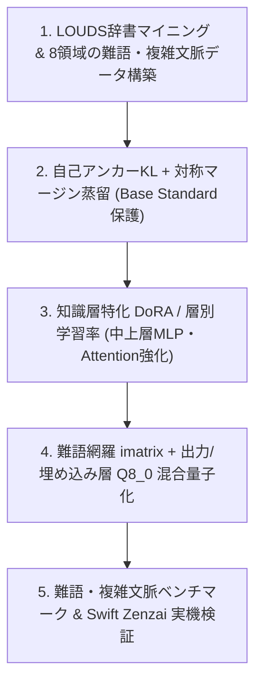

# ZeroCon Model Standard v3 精度・知識量強化計画書
**対象モデル**: `ZeroCon Model Standard`（ベース: `zenz-v3.2-small` / Apache-2.0）  
**策定日**: 2026-10-28  
**目的**: `Nano v3` で確立した「退行ゼロの対称蒸留・アンカー正則化・`imatrix` 量子化」の知見を土台に、`Standard`（90.5Mパラメータ）の持つ表現容量を最大限に引き出し、複雑な文脈における難語・専門語・多岐同音異義語・四字熟語の変換精度を引き上げる。

---

## 1. 現状分析と課題の構造

### 1.1 現行 `Standard` と `Nano v3` の比較
かな漢字変換ベンチマーク（`data/kana_kanji_llm_testset_5x.jsonl`、全230問）における現在地は以下の通りである。

| モデル | パラメータ規模 | 量子化・サイズ | 総合正解率 | 同音異義 (100) | 基本 (50) | 英数 (30) | 誤補正抑止 (25) | 未知語 (25) | 平均遅延 |
| --- | --- | --- | --- | --- | --- | --- | --- | --- | --- |
| 現行 Standard (`zenz-v3.2-small`) | 12層 / `d=768` (90.5M) | 通常 `Q4_K_M` (61.30 MB) | 189 / 230 (82.2%) | 90 | 45 | 22 | 17 | 15 | 28.47 ms |
| 配布原本 `zenz-v3.2-small-q5km` | 12層 / `d=768` (90.5M) | 通常 `Q5_K_M` (70.45 MB) | 189 / 230 (82.2%) | 90 | 45 | 22 | 17 | 15 | 28.47 ms |
| Nano v3 (`zerocon-nano-v3-q4km`) | 6層 / `d=512` (24.9M) | `imatrix Q4_K_M` (17.60 MB) | 189 / 230 (82.2%) | 88 | 45 | 22 | 20 | 14 | 22.17 ms |
| Nano v3 (`zerocon-nano-v3-q6k`) | 6層 / `d=512` (24.9M) | `imatrix Q6_K` (21.92 MB) | 192 / 230 (83.5%) | 91 | 45 | 22 | 20 | 14 | 25.74 ms |
| Nano v3 (`zerocon-nano-v3-sym2-f16`) | 6層 / `d=512` (24.9M) | `F16` (50.06 MB) | 194 / 230 (84.3%) | 93 | 45 | 22 | 20 | 14 | 26.38 ms |

`Standard` は `Nano` の約3.6倍のパラメータ数（12層・隠れ層次元768・FFN中間次元3072）を持ちながら、現時点では `Nano v3`（17.60 MB）に並ばれ、`Nano v3 Q6_K` / `F16` に逆転されている。これは `Standard` のモデル容量が不足しているのではなく、**知識の偏り（頻度バイアス）と文脈ルーティングの未学習**によって潜在能力が眠っている状態を示す。

### 1.2 難しい単語・複雑な文脈で誤変換が起きる4つの原因

1. **コーパス頻度バイアスによる難語・低頻度語の押し潰し**
   一般WebコーパスやWikipediaの事前学習では、`構成`・`効果`・`記者`・`医師`・`干渉`・`解答` といった高頻度語が、同じ読みの難語や専門語（`校正/鋼製`、`考課/硬貨/高架`、`帰社/貴社/喜捨`、`意志/遺志`、`鑑賞/感傷/緩衝`、`回帰/開基/会期`、`瑕疵/下賜`）の数十倍〜数百倍の頻度で出現する。結果として、左文脈に強い手がかりがあってもユニグラム事前確率の差を覆せず、頻出語へ吸い寄せられる。
2. **Swift Zenzai の候補評価機構（Top-1 Argmax 制約）との相互作用**
   実IMEの変換エンジン（`ZenzCandidateEvaluator.swift` および `zenzai.swift`）は、LOUDSシステム辞書（約81.5万語）が生成した候補に対し、トークン単位でモデルの最大確率トークン（`maxItem.token == tokenID`）と一致するかを検査する。辞書側に難しい単語（例：`瑕疵`、`考課`、`喧々諤々`）が存在していても、モデル側の第1位トークンが頻出語（`菓子`、`効果`）になった瞬間に `.fixRequired` が発火し、辞書ラティスを頻出語側へ強制的に書き換えてしまう。
3. **間接的・複合的な文脈手がかりの減衰**
   実際の入力文脈では、直前に直接的なキーワードがあるとは限らない。たとえば「赤ペンを片手にゲラ刷りの文字づかいを点検する」という状況描写から `こうせい` → `校正` を導くような、複数語にまたがるドメイン・場面理解（多段階の連想）が求められる。また現行の `ZenzPromptBuilder.swift` は左文脈を既定で末尾40文字（`maxLength ?? 40`）に切り詰めるため、長めの文脈手がかりが落ちやすい。
4. **上位の同族教師モデル（`zenz-v3.2-medium/large`）の不在と量子化劣化**
   `Nano v3` では上位の `zenz-v3.2-small` を教師にできたが、`Standard` には同じトークナイザを持つ上位の `zenz-v3.2` モデルが存在しない。また現行の `zerocon-model-standard.gguf` は難語キャリブレーションなしの通常 `Q4_K_M` であり、語彙分布のロングテールにある低頻度漢字トークンほど4bit量子化誤差の影響を強く受けている。

---

## 2. `Nano v3` から引き継ぐ設計原則（退行ゼロの鉄則）

`Nano v3` で実証した以下の3原則を `Standard v3` の学習パイプラインにもそのまま適用する。

1. **学習データの純度保証（スライス断片・読み不一致の完全排除）**
   形態素の途中で切った不完全な文節や、出力表記の読みが入力カタカナと1文字でも食い違うデータ（`separated-v1/distilled` で発覚した動詞ひらがな化ノイズや `\uEE08` 混入）は一切入れない。すべての学習データは LOUDS 辞書および読み検証器で読み一致（100%）を機械検証する。
2. **GPT-2 Dropout の完全無効化（`attn_pdrop = embd_pdrop = resid_pdrop = 0.0`）**
   ベースモデルとの分布アンカー `KL(P_base || P_student)` を計算する際、Student側のDropoutを `0.0` に固定し、Step 0 におけるノイズ勾配を厳密にゼロにする。これにより左文脈を参照する Attention ヘッドの破壊を防ぐ。
3. **同音異義語クラスターの対称バランス学習**
   難しい単語（例：`校正`、`考課`、`瑕疵`）だけを単独で追加学習すると、バイアスが逆転して通常の文脈でも難語ばかり出すシーソー退行が起きる。必ず同じ読みを持つ兄弟語（`校正 / 構成 / 鋼製 / 後世`）をそれぞれの自然な文脈とセットで同一データセット・同一エポック内にバランス配置する。

---

## 3. `Standard v3` 強化の5大施策

### 施策1：LOUDSシステム辞書マイニングによる「難語・多岐同音異義語・四字熟語」知識コーパス構築
「知識量を増やし、複雑な文脈の難しい単語に対応する」ため、外部の曖昧な雑多テキストではなく、**ZeroConvert-IME が同梱している LOUDS システム辞書（81.5万語）を知識の母集団として逆引きマイニング**する。

- **ステップ1-A：辞書からのターゲット語彙クラスター抽出**
  システム辞書（`windows/server-swift/azooKey_dictionary_storage/Dictionary` および逆引き辞書 `reverse-v2.bin`）から、以下の条件に該当する語彙クラスター（目標：1,500〜2,500クラスター、計8,000〜15,000文）を抽出する。
  - **多岐同音異義語クラスター（3〜8語競合）**  
    例：`こうか`（効果・硬貨・高価・降下・高架・校歌・考課・硬化）、`かし`（菓子・歌詞・下肢・瑕疵・仮死・下賜）、`しんせい`（申請・神聖・新生・真性・新星・親政）、`こうせい`（構成・校正・公正・攻勢・更生・後世・恒星・抗生・鋼製）、`かいとう`（回答・解答・解凍・快刀・怪盗）
  - **8つの専門・高度文脈ドメイン語彙**
    1. **法務・契約・行政**：`瑕疵`、`善後策`、`係争`、`棄却/却下`、`施行/執行`、`批准`、`勾留/拘留`、`遡及`、`相殺`
    2. **医療・生命科学・心理**：`予後`、`寛解`、`所見`、`誤嚥`、`罹患`、`抗体/交代`、`診察/視察`、`腫瘍/主要`、`禁忌`
    3. **IT・工学・自然科学**：`冗長化`、`閾値`、`漸近`、`干渉/緩衝`、`絶縁`、`励起`、`触媒`、`輻輳`、`冪等`
    4. **金融・会計・ビジネス実務**：`考課`、`償却/焼却`、`決済/決裁`、`稟議`、`債権/債券`、`引当金`、`賦課`、`督促`
    5. **出版・学術・歴史・人文**：`校正/校閲`、`凡例`、`編纂`、`遺構`、`史料/資料`、`考察`、`摂政`、`奉行`、`勅撰`
    6. **文芸・四字熟語・故事成語・慣用句**：`懐柔`、`趨勢`、`杞憂`、`忖度`、`矜持`、`忸怩`、`嚆矢`、`白眉`、`喧々諤々`、`侃々諤々`、`旧態依然`、`朝令暮改`、`溜飲を下げる`、`人口に膾炙する`
    7. **ビジネス敬語・書簡・複合動詞**：`貴社/御社/帰社`、`拝受`、`ご自愛`、`ご笑納`、`差し支え`、`お目にかかる`、`鑑みる`
    8. **誤補正抑止（方言・口語・英数・単位・カタカナ語）**：`知らん/あかん/せやな`、`1枚/3階/100円`、英略語・IT用語の無変換保護
- **ステップ1-B：「間接的・複合的な左文脈」の設計**
  単純な1語トリガー（「病院で」→「医師」）だけでなく、**場面・状況・前文の論理関係から意味が定まる40〜90文字の複雑な左文脈**を作成する。
  - 例（直接トリガーなし・状況文脈）：  
    `左文脈`: `"引き渡しから半年が経ち、基礎のコンクリートに設計図にはない深いひび割れが見つかった。売主に対して"`  
    `入力読み`: `"かしほしょうせきにんを追及する"` → `正解表記`: `"瑕疵担保責任を追及する"` / `"瑕疵保証責任を追及する"`
  - 例（1文内に複数の同音異義語が連続する複合文節）：  
    `左文脈`: `"監査法人から指摘を受けた箇所について、"`  
    `入力読み`: `"けっさいしょるいのこうせいとけっさいをおこなう"` → `正解表記`: `"決裁書類の校正と決済を行う"`
- **ステップ1-C：厳格な品質フィルタと評価データ分離**
  - カタカナ読みと正解表記の読み整合性を100%検証する。
  - `data/dataset_isolation.py` および `training/dataset_guard.py` により、既存の4ベンチマークおよび新設する難語ベンチマークとのキー重複・グループ重複・左文脈重複が **すべて0件** であることを強制検査する。

---

### 施策2：自己アンカーKL蒸留 + 難語トークン・マージン損失（教師不在問題の解決）
`Standard` には上位の `zenz` 教師が存在しないため、**凍結したベース `zenz-v3.2-small`（F16復元版）自身を「知識保全アンカー（Self-Anchor）」**とし、難語データセットの正解ラベルを「新規知識ティーチャー」として組み合わせるハイブリッド損失関数を採用する。

$$\mathcal{L}(\theta) = \frac{1}{|M|} \sum_{i \in M} \left[ \alpha_{\text{CE}} \mathcal{L}_{\text{CE}}(z_i, y_i) + \alpha_{\text{anchor}}(i) T^2 \mathrm{KL}\!\left(P_{\text{base}}^{(T)}(i) \parallel P_{\theta}^{(T)}(i)\right) + \alpha_{\text{margin}}(i) \mathcal{L}_{\text{margin}}(z_i, y_i, \hat{y}_{\text{base}, i}) \right]$$

- **トークン別の動的ゲーティング**：
  1. **Base Standard がすでに正解しているトークン（$\hat{y}_{\text{base}, i} = y_i$）**  
     - 助詞・活用語尾・既知の漢字トークン。
     - $\alpha_{\text{CE}} = 0.35, \alpha_{\text{anchor}} = 0.65, \alpha_{\text{margin}} = 0.0$。
     - Base Standard のロジット分布（温度 $T = 2.0$）を強く保持する。Swift の `ZenzCandidateEvaluator` は第1位トークンだけでなく第2〜第3位トークンの確率比（`probabilityRatioToMaxProb > 0.25`）を使って代替候補（`alternativeConstraints`）を生成するため、Base のソフトロジット分布を守ることが候補一覧の品質維持に直結する。
  2. **Base Standard が誤答している難語トークン（$\hat{y}_{\text{base}, i} \neq y_i$）**  
     - Base Standard が高頻度語 $\hat{y}_{\text{base}, i}$（例：`構成` の `構`）を第1位に予測し、正解の難語トークン $y_i$（例：`校正` の `校`）が第2位以下に沈んでいる位置。
     - $\alpha_{\text{CE}} = 0.60, \alpha_{\text{anchor}} = 0.10, \alpha_{\text{margin}} = 0.30$。
     - **コントラスティブ・マージン項** $\mathcal{L}_{\text{margin}} = \max(0, \gamma - (z_{i, y_i} - z_{i, \hat{y}_{\text{base}, i}}))$（例：$\gamma = 1.5$）により、誤った高頻度語トークン $\hat{y}_{\text{base}, i}$ のロジットを正解難語トークン $y_i$ より確実に下回らせ、`ZenzCandidateEvaluator` の Top-1 判定（`maxItem.token == tokenID`）をピンポイントで反転させる。

---

### 施策3：12層GPT-2の役割分担に合わせた知識層特化 DoRA / 層別学習率
`zenz-v3.2-small`（12層、`d_model = 768`、`d_ff = 3072`）では層ごとに役割が分かれている。

| 層の範囲 | 主な役割 | 学習方針 |
| --- | --- | --- |
| 下位層（Layer 0〜3） | `\uEE00` 入力カタカナ読みと出力文字位置のアライメント、英数字・記号の素通し | 学習率を低く抑える（`0.25x`）。文字アライメントや英数保護を壊さない |
| 中位層（Layer 4〜7） | `\uEE02` 左文脈のドメイン・状況手がかりを変換対象位置へルーティングする Attention | 中〜高学習率（`0.75x〜1.0x`）。複雑な文脈・長距離の手がかり抽出を強化 |
| 上位層（Layer 8〜11） | FFN（`c_fc`, `c_proj`, 次元3072）による語彙・同音異義語・四字熟語の知識メモリと出力選択 | 最大の学習率（`1.0x`）とランクを割り当て、新しい難語・専門語の知識を格納 |

- **手法**：PEFT の **DoRA（Weight-Decomposed Low-Rank Adaptation）** または高ランク LoRA（`r = 32, lora_alpha = 64`、`target_modules = ["c_attn", "c_proj", "c_fc"]`）を採用し、重みの「方向（文脈判断）」と「大きさ（出力確信度）」を分離して更新する。
- **埋め込み層（`wte` / `lm_head`）の凍結保護**：語彙サイズ6,000のトークン埋め込み自体は凍結（Freeze）し、未学習の希少漢字トークンの埋め込みベクトルがドリフトするのを防ぐ。

---

### 施策4：左文脈長の拡張と難語網羅 `imatrix` + 混合精度量子化

1. **左文脈の有効活用（40文字 → 80〜120文字への対応）**
   - 学習時に40〜120文字の複合文脈（前文＋直前文節）を含めて学習し、文脈の少し前に出た専門領域のキーワード（例：1文前の「特許明細書の請求項では…」）を落とさず拾えるようにする。
   - 必要に応じて `ZenzPromptBuilder.swift` へ渡す `maxLeftSideContextLength` の設定値も検証する（KVキャッシュ再利用が効くためレイテンシへの影響は極小）。
2. **6,000語彙カバー `imatrix` と混合精度 GGUF の生成**
   - `Q5_K_M` 配布重みから `Q6_K` の `output.weight` を用いて高精度F16ベースモデルを復元済み（`artifacts/models/hf/zenz-v3.2-small`）。
   - 8領域の専門語・難語・四字熟語を網羅した約1,000〜1,500文の独立キャリブレーションコーパス（評価データと完全分離）を作成し、`llama-imatrix` で全6,000トークンの活性重要度を計測する。
   - 以下の量子化バリエーションを作成し、精度とサイズ・速度のトレードオフを計測する：
     - **`zerocon-standard-v3-q4km.gguf`（`imatrix Q4_K_M`、約61.3 MB）**：現行と完全同一サイズでの置き換え候補。
     - **`zerocon-standard-v3-iq4nl-emb8.gguf`（`imatrix IQ4_NL` + `--token-embedding-type q8_0 --output-tensor-type q8_0`、約60.5 MB）**：ブロック本体に非線形 `IQ4_NL` を使って現行 `Q4_K_M` より容量を抑えつつ、難語選択の要となる `token_embd.weight` / `output.weight` を8bit精度で保持する高知識密度構成。
     - **`zerocon-standard-v3-q5km.gguf`（`imatrix Q5_K_M`、約70.4 MB）**：デスクトップ（Windows）向けの最高精度構成。

---

### 施策5：難語・複雑文脈ベンチマークの新設と2段階評価

現行の230問テストセット（`kana_kanji_llm_testset_5x.jsonl`）での退行ゼロ確認に加え、真に「複雑な文脈の難しい単語」の能力を測るための専用評価セットを新設する。

1. **新設ベンチマーク `data/kana_kanji_hard_context_testset.jsonl`（250問・完全隔離）**
   ※学習データ作成前に作成し、`data/dataset_isolation.py` の `DEFAULT_EVAL_FILES` に登録してリークを機械的に遮断する。
   - **カテゴリ1：多岐同音異義語・間接文脈（80問）**（直接的なヒント語を含まない状況描写からの3〜6択同音異義語選択）
   - **カテゴリ2：専門領域・難語（60問）**（法務・医療・IT・金融・学術・歴史の難語）
   - **カテゴリ3：四字熟語・慣用句・文芸表現（40問）**（`喧々諤々`、`杞憂`、`矜持`、`嚆矢`、`溜飲を下げる` 等）
   - **カテゴリ4：1文内の複合文節・複数同音異義語（40問）**（1回の変換入力に2〜3個の同音異義語が含まれる長文変換）
   - **カテゴリ5：誤変換・過剰変換抑止（30問）**（方言・口語・数値単位・英略語・固有名詞が難語へ化けないことの検証）
2. **2段階の検証プロトコル**
   - **Stage A（モデル単体評価）**：`benchmarks/research/benchmark_kana_kanji_models.py` により、既存230問＋新規難語250問の計480問で正解率・カテゴリ別内訳・レイテンシを比較。
   - **Stage B（Swift Zenzai + LOUDS 辞書統合評価）**：実際のIME変換経路（`azookey-server` の Zenzai v3 モード、LOUDS辞書ラティス＋`ZenzCandidateEvaluator`）を通した状態での第1候補一致率と推論ステップ数（`inferenceLimit` 消費数）を検証。

---

## 4. 実行ロードマップ（全5フェーズ）

| フェーズ | 作業内容 | 成果物・検証指標 |
| --- | --- | --- |
| **Phase 1: 難語評価ベンチマークの先行構築と隔離登録** | 1. 難語・複雑文脈ベンチマーク（250問）の作成 2. `data/dataset_isolation.py` への登録と単体テスト実行 3. 現行 `Standard` / `Nano v3` のベースラインスコア計測 | `data/kana_kanji_hard_context_testset.jsonl` `artifacts/results/standard_hard_baseline.json` |
| **Phase 2: LOUDS辞書マイニング & 対称知識データセット構築** | 1. LOUDS辞書・逆引き辞書からの多岐同音異義語・難語・四字熟語抽出 2. 8領域の間接文脈ペア＋兄弟語バランスデータの生成（まずは高純度1,500〜3,000文から開始し段階拡大） 3. 読み100%一致検証・全ベンチマークとの重複0件検査 | `data/build_standard_v3_dataset.py` `artifacts/datasets/standard-v3-knowledge/` |
| **Phase 3: 自己アンカーKL + マージン損失 + DoRA 学習** | 1. Zero-Dropout + 自己アンカーKL + 難語マージン損失トレーナー実装 2. 層別学習率・DoRA/LoRAによるファインチューニング 3. F16 GGUF変換と480問（既存230＋難語250）での退行ゼロ確認 | `training/train_standard_v3.py` `artifacts/models/zerocon-standard-v3-f16.gguf` |
| **Phase 4: 難語網羅 `imatrix` 生成と混合精度量子化** | 1. 6,000語彙カバー用の独立キャリブレーション文生成と `imatrix` 計算 2. `Q4_K_M`、`IQ4_NL + Q8_0 emb/head`、`Q5_K_M` の量子化と比較評価 | `artifacts/models/zerocon-standard-v3-q4km.gguf` `artifacts/models/zerocon-standard-v3-iq4nl-emb8.gguf` |
| **Phase 5: 実IME適用とWindows / Android 統合検証** | 1. 採用量子化モデルの `zerocon-model-standard.gguf` 配置 2. Windows試験IME・Androidへの反映と実入力確認 | `windows/deployment/model-catalog.json` `reports/zerocon_model_standard_v3_experiment_report.md` |
